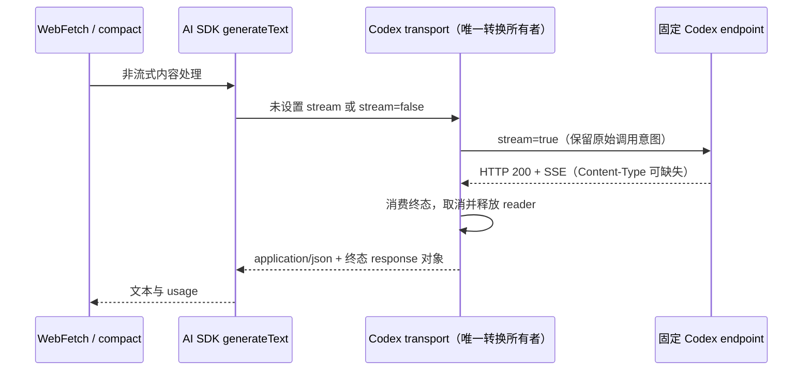

# ChatGPT / Codex account execution

产品与所有者合同见 [订阅 spec](../../../../../../docs/codex-subscription/spec.md)。

`codex-account` access 仅携带 accountId。绑定模型在每个 attempt 前通过既有 runtime-headers port 请求 Host 鉴权；没有端口时明确报缺少账号鉴权。协议新增可选 codexAccountId，不能与智谱 accountAccess 同时传递。普通 API-key 请求保持静态鉴权。

Codex 使用原生 Responses streaming，复用 AI SDK 的文本、reasoning、tool call 与取消处理。transport 固定 backend endpoint；强制 store=false、stream=true、instructions 存在，删除 backend 不支持的输出 token 上限、temperature、top_p 等字段。无论 Provider 配置或 endpoint routing 如何变化，都不能将订阅令牌发往其他地址。禁止跟随 redirect。历史 reasoning 需要 encrypted_content，工具结果仍用 Responses input 项。

回归覆盖：请求变换、固定地址、redirect、工具 SSE、取消、原有 API-key Responses 不变。只在没有产生内容的既有 retry 边界重试，不为额度错误新增切换/重放机制。

## 非流式调用的 SSE 归一化（2026-11-08）

`WebFetch` 内容提取、compact 等调用 `generateText`；Codex transport 保存调用方原始
`stream` 意图后，向固定 backend 发送 `stream=true`。成功的非流式调用必须消费 SSE
终态并返回 `response.completed` / `response.incomplete` 中的 Responses 对象，不能以
`Content-Type` 是否存在、大小写或值作为转换开关。此规则仅属于固定端点的订阅 transport，
不扩展到普通 API-key provider，也不在 WebFetch handler 增加另一套转换。

根因证据：当日 Astra 子代理 WebFetch 的模型处理返回 HTTP 200、正文以
`event: response.created` 开头，SDK 报 `Invalid JSON response`；同一子代理已记录的
流式响应缺少 `Content-Type`。已安装 Personal.4 含转换代码，但旧 Content-Type 条件
会在缺头时跳过转换。失败调用自身未保留响应头，因此用相同缺头 SSE 的合成响应在真实
AI SDK `generateText` 调用链复现，测试不包含用户正文或账号信息。

HTTP 非成功响应原样交给既有错误处理；原始流式调用直接返回响应体，不预读或等待终态。
没有终态、流错误与取消必须失败，不能返回部分成功或自行重发请求。一次调用只消费自己的
reader，无共享状态；桌面 continuous 与手机 replayable 继续使用既有 CLI 结果/错误事件，
不改变 owner/lease、序号或恢复链路。

验收：真实 AI SDK 路径覆盖缺头、错误 MIME、大小写及标准 SSE 头；覆盖碎片化终态、
incomplete 终态、缺失终态、取消、HTTP 错误和原始流式调用透传。

验证结果：修改前新增回归 6 项失败，其中真实 SDK 的缺头、错误 MIME、大小写三种场景
均报同类 `Invalid JSON response`；修复后 `codex-subscription`、
`openai-responses-json-compat`、`model-execution` 共 49 项与 core `webfetch-tool`
38 项通过。根目录 typecheck、lint、架构门禁通过；CLI typecheck（临时使用根锁文件的
Turbo 2.9.14，34 项任务成功）及 lint 通过，Lint 保留已有警告。未进行真实账号联网重试
或安装包升级，本证据仅代表源码与合成 transport 的回归。
