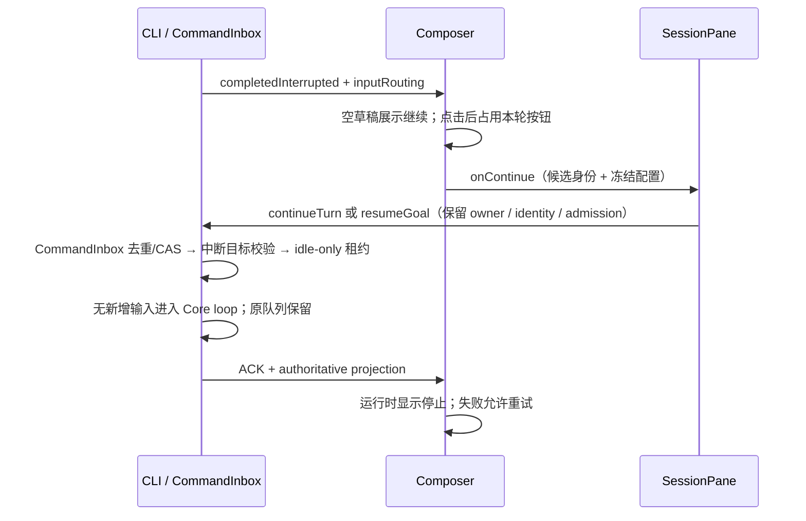

# 中断后从输入区直接继续

## 行为

会话权威状态为 `completedInterrupted`、停止已完成且当前没有待提交正文、附件或引用时，输入区右下角显示“继续”按钮。点击后沿用当前会话和点击时的模型/模式，通过 `continueTurn` 控制命令从已有上下文启动下一轮执行。不得创建预制用户消息、空用户消息或隐藏的继续提示，不写输入历史，不重发最初任务，也不清理输入草稿。正常完成、错误、草稿、运行中和拒绝输入状态不显示此入口。已有草稿时优先正常发送，Enter 的空输入行为保持不变。

有暂停 Goal 且现有 `resumeGoal` 可用时，同一个按钮直接提交已有 `resumeGoal` 控制命令，不经过 slash 文本或输入历史。权限、连接、运行时初始化和提交配置的门禁仍生效。按钮有中英文提示、键盘焦点与提交等待反馈。

暂停队列存在时，继续使用现有 `keepQueueAndSend` 校验和点击时的队列 ID 集合，不清空、提升或自动恢复任何待发送项。并发变化导致拒绝时不自动重试。快速连点只提交一次；提交成功到运行态投影到达之间，同一中断轮不能再次点击继续。明确拒绝或失败恢复可点击状态；传输结果未知时保留命令账本并查询结果，不生成新命令自动重发。新草稿不被迟到回包清除。

`continueTurn` 携带 `expectedTurnId`、`expectedLogEpoch`、`expectedHeldQueueItemIds` 和冻结的模型/模式；使用既有 `baseRevision` CAS 与 `commandId` 去重。CLI 以权威投影核对中断轮、停止状态和输入路由，再取得 Core `idle-only` 前台租约；模型准备后再次核对目标，拒绝已改变的轮次。Core 仍是执行与队列的唯一所有者。控制命令的成功事实沿用持久化 command fact，重连只对账。

停止已经取消的 HTTP 请求和工具进程不会原地复活。点击继续明确结束本次暂停：模型上下文移除最近一次停止标记，并把该轮已取消工具的“STOP 等待用户”文本还原为取消事实（保留 error、toolCallId 和可能存在部分副作用的说明）；原始持久化记录、UI 工具状态和已完成结果不改写。下一轮使用已保留的回复与工具结果重新进入模型循环，由模型决定剩余步骤；不注入继续提示，不重放已经完成的工具，不承诺进程级断点恢复。冷恢复遇到控制边界执行相同转换。

## 状态与命令边界

`conversation-continuation` 只根据快照派生继续候选与稳定轮标识。Composer 只记录点击状态；SessionPane 使用既有 command dispatch、pending registry 与连接路由。Desktop continuous 通过原实时事件流投影；Web replayable 从同一 owner 的 snapshot/delta 恢复。两者均不合成用户气泡，不新建会话、Host 或恢复链路。

Core 在事件发布前持久化无正文的 assistant 控制记录（`timeline_event`，provider/UI/transcript 均隐藏），以 `anchor.controlTurn=continue` 标记续跑边界。它不是用户输入或模型提示；后续回复以它为 parent，冷恢复据此重建相同的 model-only 轮和 commandId，稳定 fork 也以此划分消息范围。不得仅在内存产生轮 ID，否则冷恢复会把续跑并入已中断的上一轮。

## 验收

- 运行中点击停止，停止完成后可不输入文字直接继续，沿用同一 session 和此前上下文。
- 快速连点、已接受但未投影、失败重试、新一轮再次中断均符合上述规则。
- 有草稿/附件时正常发送；已完成、新建任务、待确认或不可用连接不误显示可执行的继续入口。
- 暂停队列保留原 ID 与顺序；暂停 Goal 复用现有 resumeGoal。
- 续跑前后 UI userInput 行、持久化用户消息与输入历史数量不增加；provider 请求不含中英文预制继续文本，保留原任务与前轮输出。
- 中英文、Zai 深浅主题；真实停止/继续 E2E；CLI 命令、模型输入与 continuous/replayable 投影回归；根类型、Lint、架构检查。

## 当前验证（2026-11-04）

- Core/Bootstrap 定向回归 283 项通过：无新用户输入、热/冷上下文、稳定轮边界、旧目标/忙碌/队列变化拒绝、命令去重、continuous/replayable 投影。
- Fedora Electron E2E 2/2 通过，运行 `desktop-e2e-20261104035951315-p61075-d1fe5d12dec95479`：真实停止/继续、两次续跑、键盘/双击、暂停队列和用户气泡数量；模型使用受控回放，检查请求不含预制继续文本、停止标记或队列正文。
- 根 typecheck、根/CLI lint、受影响 CLI 包类型检查、架构与 fixture 检查通过。CLI 聚合 typecheck 缺少 `turbo`，未将其记为通过。详细范围与未覆盖项见[覆盖矩阵](../testing/conversation-session-e2e-coverage-matrix.md#中断后无消息续跑cic2026-11-04)。

## 历史验证（预制消息实现，不作为新控制命令的验收证据）

- 定向单测 87 项通过，覆盖中断候选、重复点击、失败重试、Web 门禁、暂停 Goal 与迟到回包的草稿保护。
- Fedora 真实 Electron E2E `conversation-session-continue-interrupted.test.ts` 通过（`desktop-e2e-20261029-085618-762`）：无队列继续、再次停止、有队列继续、同一 session 与原上下文、连点防重、完成后退出继续状态。
- 共享按钮在 390×844 触摸浏览器中完成中英文、Zai 深浅主题、触摸/键盘激活与禁用验证；此项是共享组件检查，不等同于完整手机远控链路验收。
- 根类型检查、Lint（96 项既有警告、0 错误）和架构检查通过。
