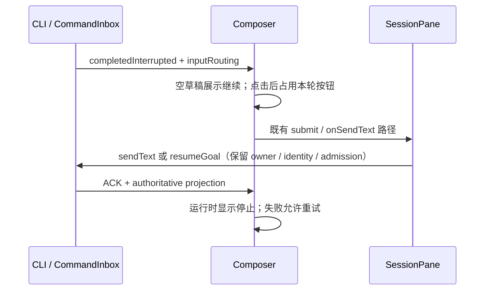

# 中断后从输入区直接继续

## 行为

会话权威状态为 `completedInterrupted`、停止已完成且当前没有待提交正文、附件或引用时，输入区右下角显示“继续”按钮。点击后沿用当前会话和已选模型/模式，提交本地化的“继续”指令，保留此前工作和历史；不重新发送最初的任务。正常完成、错误、草稿、运行中和拒绝输入状态不显示此入口。已有草稿时优先正常发送，Enter 的空输入行为保持不变。

有暂停 Goal 且现有 `resumeGoal` 可用时，同一个按钮提交已有 `/goal resume` 控制入口。权限、连接、运行时初始化和提交配置的门禁仍生效。按钮有中英文提示、键盘焦点与提交等待反馈。

暂停队列存在时，继续明确使用现有 `keepQueueAndSend` 语义和点击时的队列 ID 集合，不清空任何待发送项。并发变化导致拒绝时不自动重试，保留继续入口供用户重新操作。快速连点只提交一次；提交成功到运行态投影到达之间，同一中断轮不能再次点击继续。失败恢复可点击状态，新草稿不被迟到回包清除。

## 状态与命令边界

`conversation-continuation` 只根据快照派生继续候选与稳定轮标识。Composer 只记录本次点击状态，复用原有发送、草稿保护和 telemetry；CLI 继续拥有执行事实和队列。Desktop continuous 与 Web replayable 共用同一个展示及提交入口，不新增协议、计时器或恢复链路。

## 验收

- 运行中点击停止，停止完成后可不输入文字直接继续，沿用同一 session 和此前上下文。
- 快速连点、已接受但未投影、失败重试、新一轮再次中断均符合上述规则。
- 有草稿/附件时正常发送；已完成、新建任务、待确认或不可用连接不误显示可执行的继续入口。
- 暂停队列保留原 ID 与顺序；暂停 Goal 复用现有 resumeGoal。
- 中英文、Zai 深浅主题与触摸宽度检查；定向单测和真实停止/继续 E2E；根类型、Lint、架构与推送检查。

## 本次验证

- 定向单测 87 项通过，覆盖中断候选、重复点击、失败重试、Web 门禁、暂停 Goal 与迟到回包的草稿保护。
- Fedora 真实 Electron E2E `conversation-session-continue-interrupted.test.ts` 通过（`desktop-e2e-20261029-085618-762`）：无队列继续、再次停止、有队列继续、同一 session 与原上下文、连点防重、完成后退出继续状态。
- 共享按钮在 390×844 触摸浏览器中完成中英文、Zai 深浅主题、触摸/键盘激活与禁用验证；此项是共享组件检查，不等同于完整手机远控链路验收。
- 根类型检查、Lint（96 项既有警告、0 错误）和架构检查通过。
