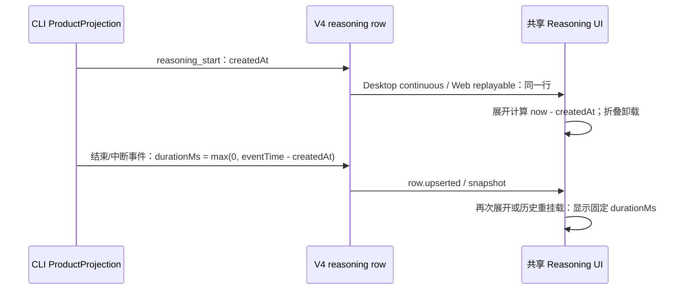

# Reasoning Inline Streaming Summary

## 背景

Assistant thought / reasoning 块本身已经表达“模型正在思考”。流式阶段默认保持收起，触发器在 `Thinking ·` 后直接展示原始流式内容；摘要紧跟标签、宽度随内容增长，最大使用当前行剩余空间。用户仍可主动展开查看完整内容。

## 规则

- thought 块 `isStreaming=true` 时默认保持收起，触发器的 `Thinking` 文案继续使用 `animated-gradient-text`，保持轻量文字渐变，不新增颜色 token。
- 收起态格式为 `Thinking · <流式内容>`。中文运行态标签使用“正在思考”，完成态标签使用“思考”；英文保持 `Thinking` / `Thought`。
- 流式内容按换行边界派生摘要快照，但不把换行转换为 ` `：同一行内的新 token 原位更新；出现下一条非空行时，旧行向上退出、新行从下方进入。纵向切换复用工具摘要的队列与节奏（300ms 动画、500ms 停留、最多当前项加两条待播项），主线程卡顿或 reduced motion 时直接收敛到最新行。
- 当前行摘要视口紧跟分隔点，不使用 `ml-auto` 或 `text-right`。内容未撑满时从左向右自然增长；视口达到标签与箭头之外的剩余宽度后保持单行，并在当前行每次流式更新后滚到末尾，让旧内容向左移、最新 token 始终可见。
- 摘要发生横向溢出时，视口左右两侧同时使用 16px mask 淡出；未溢出时不挂 mask，避免短内容边缘变淡。容器或内容宽度变化时必须重新测量溢出状态。
- 流式摘要文字使用次要文字色 `text-foreground-subtle`；图标、分隔点与箭头继续使用更弱的 `text-foreground-subtlest`。
- 运行中展开 thought 后，头部切换为 `icon + **Thought** + · + duration`，隐藏单行流式摘要及其横向 mask；duration 从思考开始计时并每秒更新，完整 thought 在下方继续流式追加。
- 完成态显示为 `icon + **Thought** + · + duration`；三个文本节点使用 `gap-2`，中文为加粗的“思考”、普通字重的分隔点和普通字重的“持续了 N 秒”。
- 英文 duration 直接显示为 `N seconds`，不添加 `for` 或 `took`；例如 `Thought · 2 seconds`。
- 同一行 token 到达时直接更新当前文本节点；只有非空换行边界使用与 Explore 相同的纵向翻滚和摘要队列。reasoning 完成时立即切换为现有 `Thought · duration` 完成摘要并清空待播内容。
- 用户展开后，完整 thought 继续流式追加并沿用现有换行、折行和吸底规则；收起态的 `whitespace-nowrap` 不得影响展开内容。
- 用户仍可手动展开已完成 thought 查看内容。
- 展开的 thought 内容只有在实际产生纵向滚动时才显示边缘 mask；位于顶部时只显示底部渐隐，位于中间时显示上下渐隐，位于底部时只显示顶部渐隐。
- 展开的 thought 内容默认跟随底部；用户主动向上滚动离开底部后暂停吸底，用户回到底部后恢复吸底。
- `open` 受控时尊重外部传入状态，只负责同步耗时与内容延迟卸载。

## 兼容性

流式摘要和折叠由共享 UI 渲染，耗时由 CLI 的现有消息字段提供。不新增 ZCode Protocol 字段，
不改变 desktop continuous 或 mobile replayable 的交付语义。移动 Web 与桌面端消费同一 V4 行，
共用默认收起和单行原位流式摘要规则。

## 折叠后的耗时恢复（EA-TIMING-01，2026-11-02）

思考耗时属于消息事实，不属于折叠组件的挂载状态。原实现把开始时间存在组件 ref，
外层执行过程或历史收起卸载后会重新计时；CLI 收口 reasoning 时又遗漏现有 `durationMs`，
因此完成态重新展开也不能恢复原来的秒数。

- CLI `ProductProjection` 继续是唯一事实所有者。运行态以行的 `createdAt` 为起点；正常结束、
  取消、错误、失败流丢弃、模型降级或下一思考段收口时，用该事件的时间减去 `createdAt`，
  将非负结果写入已有 `durationMs`。不读取重放时的系统时钟，不重复修改已经收口的行。
- UI 将行的起点传入 `Reasoning.startedAt`（毫秒）；运行中仅在展开时刷新显示，重新挂载仍
  从同一起点计算，收起期间的时间计入。完成态优先显示 CLI 的 `durationMs`，不继续增长。
- 外层执行过程、历史和 CUA 分组仍可卸载子项；不常驻隐藏内容、不建立全局耗时缓存或第二份消息状态。
- 不同消息独立计时。旧快照若确实缺少完成耗时，继续显示“几秒”，不凭重新展开时间伪造时长。
  `Reasoning` 未传起点的既有调用保留本地计时兼容行为。

验收：首次延迟展开、内外层反复收起、隐藏期间完成/中断、完成后历史重挂载均保留耗时；
新行独立开始。CLI 事件重放及两种 delivery profile 必须得到相同的终态耗时。
浏览器复用 `execution-history.test.mjs` 验证真实组件、桌面/手机、中英文及深浅主题；
CLI 回归复用 `product-projection.test.ts`，不恢复 App 业务单测。

验证（2026-11-02）：修复前浏览器延迟展开场景无法显示累计 5 秒，新增 CLI 8 项均因缺失
`durationMs` 失败；修复后完整投影文件 248/248、浏览器 26/26（新增计时 14 项、原历史 12 项）
通过。浏览器覆盖普通/后台/timelineOnly、桌面中文/手机英文、Zai 深浅主题、终态/中断和
挂载中结束；中断仍按既有规则外显。完成态截图等待真实动画结束后核对。
产物：`packages/desktop/.e2e-artifacts/reasoning-timing-20261102/`。

根 `pnpm typecheck`、bootstrap 包类型、桌面 E2E 类型及架构检查通过；根 Lint 83 warnings /
0 errors，CLI Lint 72 warnings / 0 errors（另 7 项原样上游行数诊断）。CLI 全仓类型命令因
`turbo: command not found` 未完成，受影响 bootstrap 包类型已通过。浏览器候选保持 pending，
未运行打包桌面或实体手机远控 E2E，未发布或安装新版。
