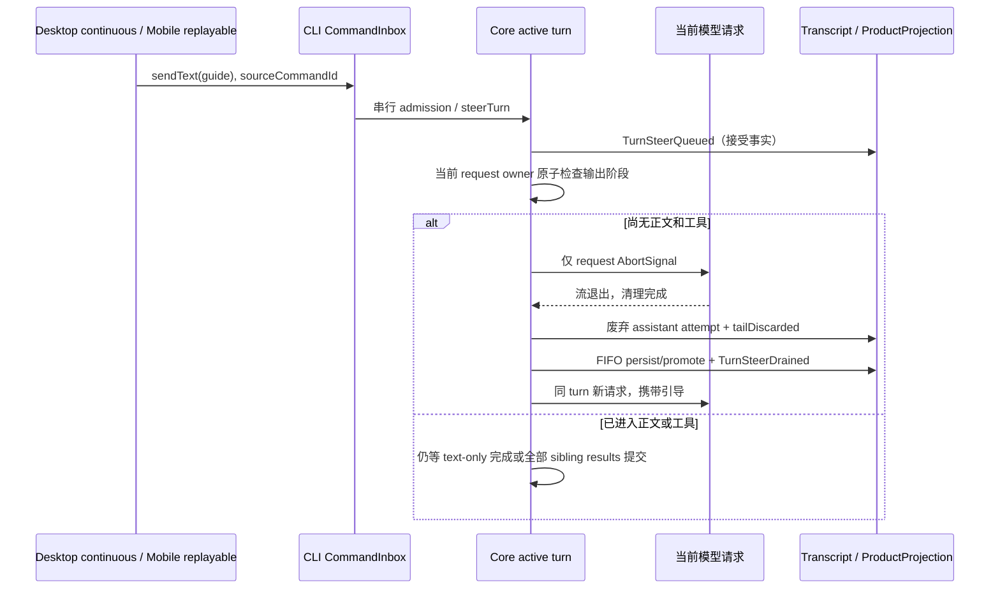

# 思考阶段提前接收引导

## 产品规则与范围

运行中的普通对话收到 `guide` 时，若当前流式模型请求尚未开始正文、工具参数或工具调用，
CLI 可取消这个请求，等待请求退出后按原 admission FIFO 消费引导，再在同一 product turn
发起包含新输入的请求。等待首个内容和只产生 reasoning 的请求均属于候选状态。
这是用户引导，不是 Stop、网络错误或自动重试：不暂停 goal，不改变 autoDrain，不触发
TurnError/TurnCompleted(cancelled)，不消耗网络恢复次数。普通 `queue` 保持等待语义。

任意正文开始、工具参数/调用/结果或终态事件一旦进入 Runtime，本次请求永久关闭提前中断资格；
之后重新出现 reasoning 也不能重新开放。工具执行、权限/问答、compact、verifier 和非流式
请求沿用现有边界。已有完整历史和工具结果保留；未完成 reasoning 不进入后续 provider history，
避免重放缺少签名或尚未闭合的推理块。已显示的 reasoning 以 interrupted 收口。

原始请求已经花费的计算不可恢复；优化的是新指令生效时间，不保证总耗时或 token 用量下降。
不使用定时器判断安全、不并行重发、不按 provider 名称设白名单。

## 所有者、接口与事件顺序

唯一 owner 是 Core 的当前 model request scope，短生命周期回调挂在既有 activeTurn 上；
不新增 accepted queue。流事件在任何 await/投影/工具调度之前关闭抢占资格，已取消请求的
迟到事件在同一入口被拒绝。释放 scope 只清除自身回调，不影响后续请求。新请求必须等旧请求
finally 完成；连续输入在这个交接期间合并到同一次 FIFO drain，不产生并发请求。

普通 stop 仍通过 turn AbortSignal 优先收口；抢占与撤回/send-now 使用现有 pending input
reservation 互斥。输入被撤回时不凭旧快照恢复；已启动消费的输入按现有逐条提交规则收口。
sourceCommandId、queueItemId、clientId 和 admissionSeq 不变。guide 提交失败仍显式失败并保留
未提交输入，不能为了更快展示而提前伪造 UserInputRow。

废弃 attempt 复用现有 `STREAM_RECOVERY_DISCARDED_*` transcript 排除标记以及
`StreamRecoveryTailDiscarded` 的行收口语义，原因明确记录为 guide；不发布 recovery-start/retry，
不把主动引导伪装成网络失败。新请求沿用现有 guide Selection/权限/Plan 应用路径。
本轮性能摘要只统计成功完成的请求，抢占 attempt 不生成 requestPerformance。

两种交付共用相同事件：desktop-continuous 直接收 delta，web-remote-replayable 用 snapshot/gap
恢复。Main/relay 不持有抢占状态；Host owner/lease、workspaceIdentity 与 remoteSessionId 不变。

## 影响简报

| 项目           | 结论                                                                                                                                                                                      |
| -------------- | ----------------------------------------------------------------------------------------------------------------------------------------------------------------------------------------- |
| 模式与层级     | implementation-handoff；validation、commit-effect、recovery                                                                                                                               |
| 用户授权       | 2026-11-12：完成优化，包含已有未提交改动，发布新 release                                                                                                                                  |
| UI 入口        | 桌面/Web/手机共用 SessionPane composer → sendText；草稿仍在 UI，App followup 设置同步到 session，单条 requestedDelivery 优先                                                              |
| 权威提交       | V4 CommandInbox → prompt admission → activeTurn.pendingInputs；持久事实沿 session-input ledger、transcript 与 projection                                                                  |
| 共享与差异     | 共用资格/消费；continuous 与 replayable 只在交付恢复不同，非流式请求维持原边界                                                                                                            |
| must-inspect   | steering、model event ingress、turn-model-step、guide drain、tailDiscarded 投影及 hydration                                                                                               |
| should-inspect | 旧请求 usage、本轮性能摘要、guide 撤回/立即发送、goal/Stop 优先级                                                                                                                         |
| conditional    | provider 原生工具、流式工具执行、手机重连                                                                                                                                                 |
| invariant-only | workspace 隔离、Host owner/lease、普通 queue、已完成工具副作用                                                                                                                            |
| evidence-only  | CLI 可控流回归、Desktop pending E2E、两种 delivery 投影回归                                                                                                                               |
| 代码图证据     | 本环境无 codegraph 工具/CLI；从图谱 seeds 手动追踪 2 层：sendText → startPromptTurn → prompt admission；steerTurn → model request scope；turn-model-step → drainInlineGuideForNextRequest |
| graph drift    | 旧 interaction-behavior/protocol 的 text-only fallback 描述落后于 turn-stop 与 M06b；同步为当前同 turn continuation                                                                       |
| graph delta    | conversation-runtime 增加安全请求抢占不变量及 turn-guide-drain/model 入口                                                                                                                 |
| 未决产品问题   | 无；本版保守排除正文、工具、非流式及特殊执行，后续扩展另立语义                                                                                                                            |

## 用例与剪枝

| ID   | 设置与动作                                                                 | 断言                                                                                        | 证据                        |
| ---- | -------------------------------------------------------------------------- | ------------------------------------------------------------------------------------------- | --------------------------- |
| GI01 | 流停在 reasoning；接受一条 guide                                           | 旧 signal 取消；新请求含 guide；原 turn/goal/autoDrain 保持；无 TurnError 或 cancelled 终态 | CLI + Desktop pending       |
| GI02 | 未收到首个内容；guide 到达                                                 | 取消当前请求后新请求含输入；未完成 attempt 不进入性能统计                                   | CLI                         |
| GI03 | 已有正文、工具参数、完整工具调用或服务端工具事件后再 reasoning；发送 guide | 不抢占；工具结果完整提交后才消费；无重复副作用                                              | CLI + 既有工具边界回归      |
| GI04 | queue 模式、非流式、compact/verifier 或审批等待                            | 不启用新抢占路径                                                                            | CLI 与既有 eligibility 回归 |
| GI05 | 取消期间连续 guide、迟到 text/tool/finish、Stop、撤回或 reservation 竞争   | 单请求退出后才重发；FIFO 每条仅一次；晚事件不执行工具；Stop 优先、预留输入不被偷消费        | CLI                         |
| GI06 | live 后 snapshot/replay/cold history                                       | pending guide 变同 ID 正式行；未完成 reasoning 不进入模型历史；无网络错误横幅；两种交付一致 | CLI projection/hydration    |

正文自动截断、取消正在执行的只读/写入工具、抢占审批和特殊轮次均 pruned：它们已有输出、
配对义务或独立 owner，不能凭“没有文字变化”判断安全。跨 provider 名称组合由统一事件合同
折叠；保留 reasoning/no-token/text/tool 的关键状态与 late-event/Stop/withdraw 竞争。
E2E 保持 manual-review/pending，不自动晋升正式用例。

## 验证记录（2026-11-12）

- Core 新增可控流回归 11/11 通过；连同 runtime-tool-loop 的最终复跑共 190 项通过。
  首次实现验证发现非流式请求的 AbortSignal 身份改变，已保持其原 turn signal 并通过回归。
- Bootstrap performance / product-projection / transcript-hydration 共 348 项通过，
  command-inbox 定向回归通过。覆盖相同 ID 的 guide 消费、continuous/replayable 快照、
  interrupted reasoning 收口及性能统计排除。
- 根 typecheck、Core/Bootstrap 类型检查、E2E 类型检查、fixture 检查和架构检查通过；
  根 Lint 为 0 错误、545 条既有警告。性能摘要的桌面/手机深浅色浏览器验收 4/4 通过，
  已核对桌面与手机详情截图，未新增 React effect 或统计状态所有者。
- Desktop pending 用例经真实 Composer、Host 和 stdio CLI 提前取消 60 秒思考夹具，
  15 秒内发出含 guide 的下一次请求并完成，用户行仅一次、原 session 保持、旧 reasoning
  不进入请求且无旧回复。仍不把合成模型回放等同真实账号或实体手机网络恢复验证。
- Desktop 的 6 个不同用例通过：思考抢占、双能力 P06 工具/文本边界及冷恢复、同批两条
  guide、active goal 与 verifier 隔离。证据为
  `desktop-e2e-20261112124124307-p3833678-5cc6553ee6fed4c2` 的 3 个通过用例及
  `desktop-e2e-20261112124452753-p3838201-0bc5728dfb71573e` 的 3 个通过用例。
  后一运行的普通 running-guide 用例停在气泡对齐断言：实际偏差 8px，要求不超过 1px。
  该项未通过，不计为覆盖；未改动待引导气泡布局，也未确认偏差的引入版本。
- 测试准备先遇到本机 ChromeDriver 路径缺失，改用同主版本缓存驱动；后台窗口动画通过
  现有窗口录制模式保持采集。旧模型/思考菜单 helper 错等被 modal overlay 遮挡的 trigger，
  已按菜单展开状态操作实际菜单项。工具边界夹具首包发出完整 tool_call，延后模型流终态，
  以可见工具行确定输入窗口，避免只等待工具行时 guide 实际在整批结束后才发送。
