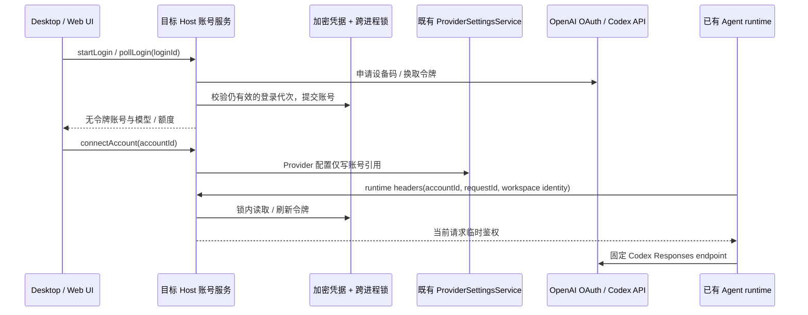

# Codex 订阅接入

基线：3.17.1-personal.1。用户确认手动切换账号；完成验证后发布 personal 版本。

## 产品规则

设置 → 模型供应商提供 ChatGPT / Codex 账号面板。使用官方设备授权页面登录，支持取消、过期重试、重新登录、移除本地账号。每个账号绑定一个独立 Provider；通过现有模型选择器手动切换账号与模型。额度不足时保留该账号并报告错误，不自动切换。退出移除 ZCode 本地凭据和绑定该账号的自定义供应商，不撤销其他客户端的登录；旧会话引用不自动切换到其他账号。先删除凭据，再清理供应商；清理失败可重试，不能恢复已退出的凭据。

按账号发现可用模型，显示订阅类型、各额度窗口剩余百分比与重置时间，以及服务器提供的额外 credits。未知额度显示未知；查询失败保留上次成功值并标记过期。401 / 无效 refresh token 显示需要重新登录；网络错误不删除账号。不把百分比换算成虚构的请求次数或金额。

本功能直接接入 ZCode 的 Responses 模型执行器；不是通过用户另行部署 CC Switch。外部 Claude Code 的配置改写与通用本地代理不属于本次账号接入。不得读取或覆盖其他应用的 auth.json。

## 所有者与接口

- Host 的 Codex subscription service 唯一管理授权过程、账号、刷新和额度；凭据复用加密 CredentialService。
- 同一数据目录的 Host 通过独立文件锁串行化账号存储事务与 refresh-token 轮换；每次事务重读，不以窗口内缓存覆盖其他窗口的更新。
- Renderer / 手机 Web 只获取无令牌 DTO 和设备授权码，通过 hooks 发出命令；不持久化账号真相。
- Provider 配置只存 `access: { type: codex-account, accountId }`。令牌经现有请求级 runtime-headers RPC 注入 CLI。固定 `https://chatgpt.com/backend-api/codex`，禁止 endpoint routing 将订阅凭据重定向至自定义源。
- 每个物理模型请求前检查有效期，提前 60 秒刷新；刷新失败保留错误并允许重新登录。不重放已经产生输出的请求。
- 重新登录绑定账号身份（用户 + ChatGPT workspace）；错账号不能覆盖目标。取消、移除与过期后，迟到授权结果不能复活账号。登录过程使用随机 ID，poll 单飞并遵守服务端 interval。

Desktop continuous 与手机 replayable 共用目标 Host；本功能不新增消息流或修改会话 owner/lease。断线后重新读取账号快照；授权过程只在原 Host 存活期间有效。远程账号不回传至本地凭据库。

## 影响范围

Provider access schema / Registry → 请求级鉴权协议 → Host 服务与加密存储 → CLI Responses transport；设置页 hook → 账号面板。API-key、智谱账号与原有配置迁移保持原语义。codegraph 当前不可用，使用源码引用检索定位。新增模块纳入 architecture-policy。

## 验收与证据计划

| 场景 | 预期 | 验证方式 |
| --- | --- | --- |
| 设备登录、等待、成功、过期、取消 | 单飞；无令牌 DTO；取消后迟到结果丢弃 | 隔离 Host 集成用例 + UI E2E |
| 重复登录、错账号重新登录 | 不重复创建；不覆盖其他账号 | 隔离 Host 集成用例 |
| 过期令牌与并发请求 | 一次轮换；持久化成功才返回 | 隔离 Host 集成用例 |
| 移除与迟到刷新 | 不复活账号；旧模型下次请求失败 | 隔离 Host 集成用例 |
| 模型发现与手动切换 | 每个账号独立 Provider，无自动切换 | CLI + UI E2E |
| 额度成功、未知、网络失败、401 | 正确剩余/重置，保留旧值且标记 stale，重新登录提示 | 隔离 Host 集成用例 |
| Responses 文本、工具调用、错误、取消 | 兼容 backend 字段与 SSE；不泄漏令牌至其他 URL | CLI adapter 回归 |
| 窄屏、深浅主题、中英文 | 操作可达，长文案换行 | UI E2E / 截图 |

剪枝：自动切换已由用户排除；不增加外部应用凭据同步。真实账号授权需用户在浏览器完成，mock 证据不得写成真实订阅联网通过。
