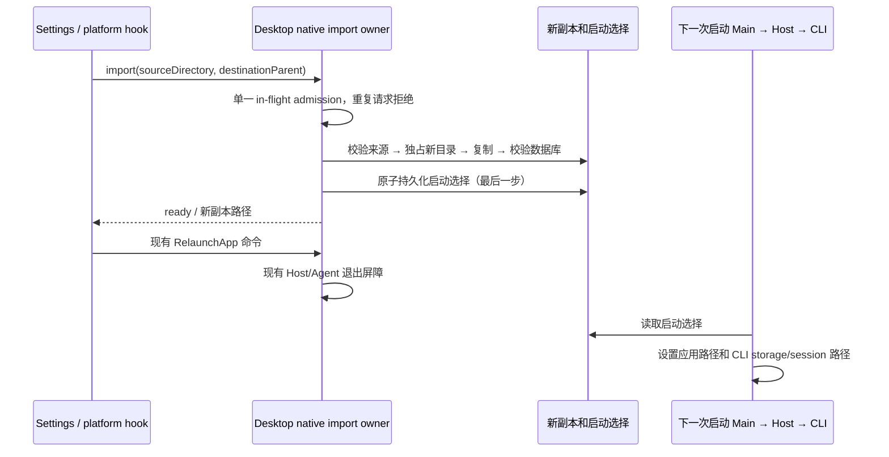

# 从 ZCode 目录导入并切换

## 产品规则

设置 → 通用 → 从 ZCode 目录导入。选择含 `v2` 的 `.zcode` 数据目录，或包含它的上级目录；选择用于存放副本的目录。应用在目标中创建唯一的 `zcode-import-*` 子目录，不覆盖或合并现有文件。来源与当前数据均保留。

复制整个数据树，包括 `v2` 会话索引、`cli` 会话正文/配置/插件、技能、命令、默认 workspace 和附件，保留空目录和项目依赖锁文件。应用 JSON 配置的运行锁、socket 和 SQLite 共享内存不迁移；SQLite WAL 必须连同数据库复制并在副本中检查、checkpoint。有本地历史索引却缺少 CLI 正文数据库的来源拒绝导入。来源必须停止写入；复制前后逐文件校验，不允许把变化中的文件当作成功快照。软链接和外部存储重定向不能静默跳过，遇到时报告不支持，用户整理成独立目录后重试。跨机器的项目路径、系统钥匙串和外部程序不属于目录副本；界面提示凭据可能需要重新登录。

导入操作只生成新副本和一个启动选择文件，不修改当前设置。复制、校验或持久化失败时移除本次未完成副本，保留旧启动选择。完整副本准备好后才原子更新默认 desktop home 下 `.zcode/import-profile.json`。进程内路径不变；正常退出屏障完成后冷重启，早期 bootstrap 读启动选择，Main/Host/CLI 一起切换到副本。原 `setting.json` 不覆盖；副本中的 `dataBaseDir` 和内部默认 workspace 路径改指副本。外部项目路径保留。

导入保留自动任务定义，但副本中的自动任务和 bot 自动启动暂停，避免复制后重放外部副作用。再次启用由用户在对应设置中完成。导入后的数据路径移动暂不可用，避免旧的仅迁移 v2 流程拆散完整副本；仍可再次导入。删除启动选择文件并重启可恢复初始数据，之前的副本均保留。

会话中指向来源目录内部的附件路径、`file:` URL 和助手工作目录元数据同步改指副本；用户文本、工具输入输出、附件预览和外部文件引用保持原值。不能对历史 JSON 做无差别字符串替换。

## 所有者与顺序

Main 只协调文件和进程生命周期，不加载会话业务状态。services/data-import 是目录快照与 profile 路径适配器，settings 服务继续是设置唯一写入者。UI 只保留选择草稿和结果；导入 API 仅 Desktop 注入，Web/手机不提供本机导入。IPC 验证绝对路径，结果使用结构化错误，不把凭据写入日志。

## 验收

- 标准 `.zcode` 与上级目录均识别；空目录、外部重定向、软链接、嵌套目标、来源变更、损坏 SQLite 拒绝，失败后启动选择不变。
- WAL 中尚未 checkpoint 的会话在副本可读；会话索引和 CLI 正文、附件、workspace、设置存在，来源文件内容不变。
- 重启前继续使用旧 profile；重启后设置、App 索引和 CLI 数据库使用副本，默认 workspace 路径同步，项目路径不改变。
- UI 支持选择、取消、错误后重试、完成提示和重启，深浅主题与窄屏可用；Web 不展示操作。
- 并发请求被拒绝，重复导入产生独立副本；原数据和之前副本不删除。

## 首版验证（2026-10-29）

- 导入、启动 profile、设置控件和 Desktop bootstrap 定向测试：5 个文件、26 项通过；已有数据路径相关服务测试：8 个文件、199 项通过。
- 根与 CLI 类型检查通过；根 Lint 为 0 错误、96 项存量告警，CLI Lint 为 0 错误、69 项存量告警；架构检查无新增违规。
- Fedora 上运行真实 Electron E2E `conversation-session-import-zcode-directory.test.ts`，运行编号 `desktop-e2e-20261029-071308-336`。覆盖原生目录选择接口、完整导入、冷重启、历史恢复和继续会话；原索引不变，副本索引更新。1200/390 像素窗口、简体中文/英文和深浅主题截图已检查。
- CLI 全量运行存在一个批量时序失败：`NodeExecutionAdapter / keeps Bash descendant enumeration out of generic argv cancellation` 超过默认 5 秒。适配器包其余 2267 项通过、4 项跳过；其他 CLI 包 41 个构建/测试任务通过。该用例在原基线和当前源码单独运行均通过（约 2.9 秒），未放宽测试时限或改动执行器。不能将本次 CLI 全量结果表述为无失败。
- Windows/macOS 路径使用 Node 标准 API，尚未做这两个系统的原生运行验收。
