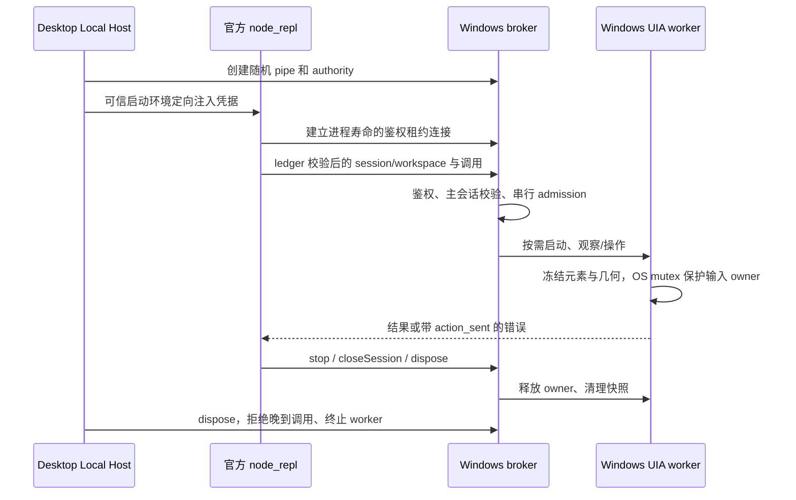

# 开源 Windows 电脑控制

基线：`release/3.17.2-personal.1`（`e9648942`）。开源包只有不可用占位；新增公开源码后端，不恢复私有 Helper、下载链或内部依赖。

交付版本：`3.17.2-personal.2`。推送 `release/3.17.2-personal.2` 触发现有五平台原生构建及草稿 Release；电脑控制仅在 Windows 可用。发布说明保留实际验证范围、签名状态与取消恢复限制，不把草稿构建等同于已公开发行。

## 产品规则

- 沿用 Computer Use 插件和 `agent.computerUse` SDK，默认关闭，用户启用后接入。仅桌面本地 Host 提供控制；远端 workspace、独立 server 和子智能体不获得本机输入能力。
- Windows 使用系统 PowerShell 5.1、.NET UI Automation 和 Win32，不要求 Python、额外 SDK、管理员权限或联网下载。macOS/Linux 明确报告不可用。
- 支持运行中应用/窗口发现、无障碍树、单窗口 PNG、元素点击/设值/文本选择/语义操作，以及绑定窗口的鼠标、拖动、滚动、Unicode 输入、快捷键。应用匹配必须唯一；不隐式启动任意程序，未运行时提示用户打开。
- UIA 优先；模拟输入必须验证目标前台窗口，不向其他应用发键。拒绝 UAC/安全桌面。不支持的能力明确返回错误。
- 截图为窗口原始像素；坐标仅相对于同会话该窗口最近截图。校验 frame、进程、句柄、位置、尺寸和前台，移动或换窗后拒绝旧坐标。不承诺后台截图、PiP、幽灵光标或应用启动等私有实现功能。

## 所有者与事件

broker 独占执行队列与会话授权，worker 独占原生元素和 Windows 会话级 mutex。
owner 包含 runtime 实例、sessionId、workspaceIdentity（本地 fallback workspacePath/workspaceKey）及 remoteSessionId。
竞争 owner 返回 CONTROLLER_BUSY；stop/Esc 使当前 owner 终态，后续操作拒绝。取消/超时不重放动作，失去收据按 possibly_sent 处理。子进程退出释放 mutex。
租约断开清理该 runtime 的所有 owner。Esc 在 worker 空闲时也由持锁线程释放 mutex，其他 Host 可接管；同一个已停止 owner 不可恢复。
截图携带原始 PNG 的 SHA-256、frame id 和尺寸；模型输出链验证相邻 image_ref，拒绝被替换、缩放或混入多帧的图片。兼容的旧元数据验证通过后保持结果原样，新后端引用自带摘要供最终输出校验。
桌面 continuous 与手机 replayable 复用同一 Host、ledger 和 owner，不重放电脑输入、不新增会话协议、不另起手机 Helper。

## 接口与验证

`@zcode/zcode-cua` 保留 runtime，`broker/server` 提供 Windows host。`zcodeCuaPlaceholder` 继续表示没有私有原生产物，新增开源 Windows 能力说明。
所有工具参数严格校验并限制大小；外部 IO 收口在 adapter。模型文字仅经 JSON stdin 传递，不拼入脚本。
worker 源码内联进入 bundle，按需写入自身临时目录并隐藏启动，dispose 只清理自身目录。安装包不依赖开发目录。
UIA 在不创建窗口的 MTA worker 线程执行，遵循 [Windows UI Automation 线程要求](https://learn.microsoft.com/en-us/windows/win32/winauto/uiauto-threading)。取消先经独立 stdin reader 设置终止标志，使持有的按键/鼠标通过 finally 释放；500ms 内仍未退出的阻塞 worker 才强制终止。此代 worker 不恢复、不重放。

CUA 定向回归覆盖鉴权、非法参数、子会话、workspace 隔离、竞争 owner、停止/取消、过期 frame、动作不重放及生命周期。
真实 Windows 验收使用专用 WinForms 窗口，通过 SDK 发现/读取/设值/点击/截图/键盘/停止并断言窗口结果，不操作用户文档。
另以临时目录中的正式 node_repl bundle 启动 MCP 和真实 Worker，穿过 ledger、SDK、broker 及模型图片投影，验证凭据捕获、原帧完整性和子会话隔离；原生适配层用确定性图片 fixture。
必跑根 typecheck、lint、架构检查和 CUA 测试；未运行的完整桌面/手机 E2E 与非 Windows 验证如实记录。

## 验收记录（2026-11-07）

- 根 `pnpm typecheck`、CLI `pnpm --dir apps/zcode-cli typecheck` 通过。
- 根 `pnpm lint`：0 errors / 84 warnings；CLI lint：0 errors / 72 warnings，另有 7 项已接纳的上游行数诊断。新增 Windows 模块单独 lint：0 errors / 0 warnings。
- `pnpm architecture:check --changed`：0 violations。
- `node --test packages/zcode-cua/windows/runtime.test.mjs packages/zcode-cua/windows/windows.e2e.mjs`：9 项通过。真实窗口覆盖中文设值、键盘输入、截图、陈旧坐标拒绝、竞争 owner、stop/Esc、跨 Host 接管，以及 Ctrl 按下后取消并确认松键。
- `node --test apps/zcode-cli/packages/node-repl-host/test/windows-bundle.test.mjs`：正式 bundle + MCP + Worker + SDK 链路通过；最终只保留最新原始帧，子会话不能进入后端。
- CLI plugin-host-entry：2 项通过；node-repl-host mcp-server：27 项通过；core 的 mcp-tool-bridge、frame-contract-artifact、image-normalization-forged-frame：39 项通过。
- node_repl host build 和 Desktop `tsup` 构建通过，Host bundle 包含原生 worker 源码。
- 未运行完整 Electron 界面至真实模型的 E2E、手机远控 E2E，未制作或安装发行安装包。macOS/Linux 不提供控制实现。
- 正常 stop/Esc 后可在新会话继续；执行中的取消/超时/崩溃会终止该 Host 的 worker，需重启 ZCode 恢复。
