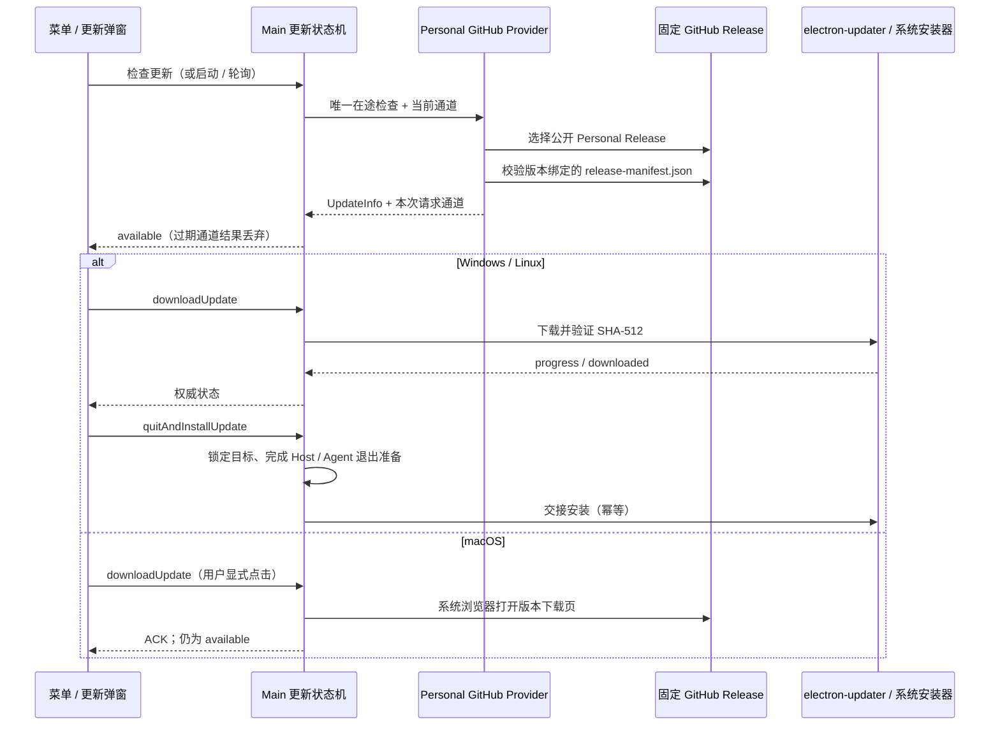

# Personal 桌面应用更新

## 产品规则

- Personal Release 构建开启 `ZCODE_AUTO_UPDATE=1`。既有已发布版本没有更新入口，需手动安装首个包含本功能的版本一次。
- Personal 只读取 `xiaobaoaaaaaa/ZCode` 的 GitHub Releases；官方 production 保留官方 manifest，Preview 身份仍禁用更新。启动参数、环境变量、后端地址不能改变 Personal 更新源。
- stable 使用 GitHub Latest（公开且非预发布）；接收 preview 时从最近 100 个公开 Release 中选择版本最高的 Personal 版本（含预发布）。草稿、官方版本、其他版本格式均排除；不降级。
- `3.17.1-personal.3 → 3.17.1-personal.4` 必须识别为升级；比较完整 SemVer，不丢弃 Personal 序号。GitHub 的 prerelease 标记决定发布通道，版本中的 `personal` 不代表测试版。
- Windows/Linux 复用检查、下载进度、取消、跳过、自动下载、退出准备和重启安装流程。Linux 严格保持已安装包格式；下载验证 SHA-512。
- Personal Windows 当前无 Authenticode 签名，只在固定 GitHub 源 + 清单 SHA-512 校验下接受自身安装包；官方 Windows 继续执行已有 Authenticode 校验（含缓存安装复查）。不改变系统安全设置。
- macOS 当前为 ad-hoc 签名，按用户确认范围只检查并打开对应版本的 Release 下载页。按钮文案为“打开下载页”，不展示自动下载复选框；自动下载偏好即使为 true 也不打开浏览器。设置中禁用不适用的自动安装选项。后续正式签名接入另行验收。
- 网络、限流、格式或校验失败通过现有错误状态反馈，不回退官方源。当前版本或更旧版本无需下载更新清单，兼容旧 Release 尚无 SHA-512 的元数据。

## 状态所有者与接口

`autoUpdater.ts` 仍是唯一更新状态与安装时序 owner。`PersonalGitHubUpdateProvider` 只将 GitHub Release 与 `release-manifest.json` 解析成 electron-updater 的 UpdateInfo，不保存第二份下载状态。复用 manifest provider 的平台与包格式解析。

`UpdateStatePayload` 的 available 变体增加可选 `manualDownload`，缺省 false；它只描述操作方式，不携带可由 renderer 修改的安装 URL。`downloadUpdate` IPC 在 macOS Personal 中打开由 Main 根据当前版本构造的固定 Release URL，成功 ACK 后 UI 解除按钮锁。其他平台保持原契约。

既有 `lib/desktopUpdateMenu.ts` 纳入 `desktop-update-menu` 受管模块，保留原入口，契约目录仅记录纯展示投影；不迁移 hook 或引入状态。

检查 generation、通道过期结果、下载 token、安装锁、跳过版本等均沿用既有 owner；Web / 手机远控不检查本机应用更新，不改变 desktop-continuous 或 web-remote-replayable 会话语义。

## 发布清单

发布脚本对原有 13 个安装包计算 SHA-256 与 SHA-512（base64），并将 SHA-512 纳入 stage 与 collect 的相等校验。`release-manifest.json` 仍由五平台聚合门唯一生成；不增加第二份独立更新清单。清单记录的版本、文件名前缀、平台、架构、格式、大小与 SHA-512 必须匹配；URL 由固定仓库和 `v<version>` 构造，不读取清单提供的任意地址。

## 验收场景

| 场景       | 验收                                                                                                                                               | 证据入口                                                                  |
| ---------- | -------------------------------------------------------------------------------------------------------------------------------------------------- | ------------------------------------------------------------------------- |
| 发布完整性 | 13 包 SHA-512 正确；篡改、缺包、来源不符拒绝                                                                                                       | `scripts/test/personal-release.test.mjs`                                  |
| 更新运行时 | 正式包忽略 argv/env/backend 更新源；Personal 序号递增；最新/旧版不更新；预发布和草稿筛选；版本绑定、错误文件名、格式缺失、下载校验失败；取消后重试 | `packages/desktop/scripts/personal-update-smoke.mjs`                      |
| 跨平台格式 | NSIS、AppImage、deb、rpm、pacman 只选择自身格式；macOS 仅打开固定版本页，自动偏好不触发                                                            | 同上，平台适配器模拟运行，不等价于真实 OS 安装                            |
| UI 交互    | macOS 文案及按钮 ACK 解锁；普通下载按钮保留；中英、深浅、宽窄布局                                                                                  | `packages/ui/test/browser/manual-review/pending/personal-update.test.mjs` |
| 官方回归   | 正式包源限制及 Windows 缓存签名校验保持                                                                                                            | `test:auto-update-source-security-smoke`                                  |

真实 Windows/Linux 覆盖安装、macOS 下载页以及升级后数据保留需在两个原生发行版本之间验收；本地模拟不得宣称覆盖这些系统操作。

## 本次验证记录

- 发布工具 7/7 通过，包括 SHA-512 与篡改拒绝。
- Electron 隔离运行时 17/17 通过：`packages/desktop/.e2e-artifacts/personal-update-HT85C9`，实际本地 HTTP 下载，覆盖五种安装适配器、两种架构的格式选择及 macOS 下载页；系统安装执行端被替换为顺序记录器。
- 浏览器 4/4 通过：`packages/desktop/.e2e-artifacts/personal-update-ui`，中文浅色宽屏、英文深色窄屏分别覆盖 native/manual 动作。
- 官方源安全回归 24/24 通过：`packages/desktop/.e2e-artifacts/update-source-security-wuP7bX`、`update-source-security-AApgLN`、`update-source-security-8hw71z`。
- Release CI 的 Linux x64 校验阶段持续执行 Personal 运行时场景。真实原生覆盖安装尚未执行，不作为本次通过项。
