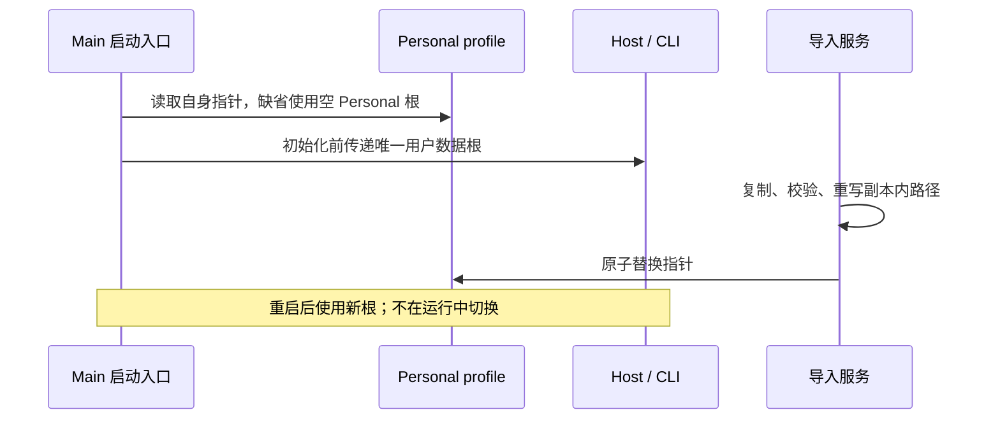

# ZCode Personal 独立发行身份

用户选择：应用名 ZCode Personal，默认数据目录 `~/.zcode-personal`；首次启动为空，旧数据只通过导入入口复制并切换。已发布的 personal.2 仍属于旧的共享身份版本。

## 身份与状态所有者

构建开关 `ZCODE_PERSONAL_IDENTITY=1` 选择 personal flavor，与后端 `ZCODE_ENV` 分离；个人版发布工作流必须开启。与 Preview 开关同时开启应报错。构建脚本拥有安装身份，共享 env 模块公开编译后的运行身份；不在用户设置中切换身份。

| 项目                         | Personal                       |
| ---------------------------- | ------------------------------ |
| 名称                         | ZCode Personal                 |
| app id / Windows AUMID       | dev.zcode.app.personal         |
| Linux 包及可执行文件         | zcode-personal                 |
| URL 协议                     | zcode-personal                 |
| 用户数据根                   | ~/.zcode-personal              |
| Electron userData / 单实例锁 | 平台 appData 下 ZCode Personal |

Main 启动入口在 settings、logger、Host 初始化前确定用户数据根及导入 profile。profile 指针仅从 Personal 根读取，不读取官方 `.zcode/import-profile.json`。导入服务仍为复制与切换的唯一写者；成功复制、校验数据库、重写副本路径后原子替换 Personal 指针，重启生效。失败不切换，来源和旧副本保留。

全局设置、任务索引、CLI 会话库、日志、凭据、技能、Provider、缓存与自带工具使用 Personal 根；通过既有 CLI 路径环境变量传递，不修改 HOME。项目内 `.zcode`、`.agents` 及用户主动选择的目录维持项目语义。显式开发/E2E home 覆盖继续隔离测试。普通 dataBaseDir 设置仍使用所选目录下的 Personal 子目录。

安装器、桌面快捷方式、协议注册、Windows 右键项及 macOS Finder 服务有独立身份，不覆盖官方入口。官方后端 OAuth 仍由既有 Host 轮询收口；Personal 回跳协议使用自身 scheme，不能注册抢占 `zcode://`。

## 验收

1. 安装产物、运行应用名、包标识及协议一致；常用五个平台启动验证。
2. 在隔离测试 home 预置官方配置及 profile，Personal 首次启动不读取或写入它们，实际数据只出现在 Personal 根。
3. 导入官方目录到独立副本后，重启读取完整副本；来源和导入前 Personal 数据保持。
4. CLI 子进程和 Main/Host 使用同一数据根，设置、会话、用户技能及内置缓存无官方路径回退。
5. UI 显示 Personal 身份，官方应用不被覆盖；Personal 更新使用本 fork GitHub Releases，Windows/Linux 应用内安装，macOS 打开下载页，见 [更新规格](personal-app-update.md)。
6. 项目外新建入口创建未归类草稿，项目内新建及 Composer 项目选择保留既有行为；桌面真实交互与桌面/手机入口单测回归。

2026-10-29 本地验证：根与 CLI 类型检查通过；根 lint 无错误（96 项既有警告），CLI lint 无错误（69 项警告）；完整 CLI 测试的 42 个 Turbo 任务通过（限制并发以避开本机负载导致的计时失败）。新建入口与中断继续的真实 Electron 场景 2/2 通过，运行编号 `desktop-e2e-20261029-130150-163`，覆盖中文浅色、英文深色。原生发行包的最终证据由 Release manifest 和 Actions validation artifacts 记录。
