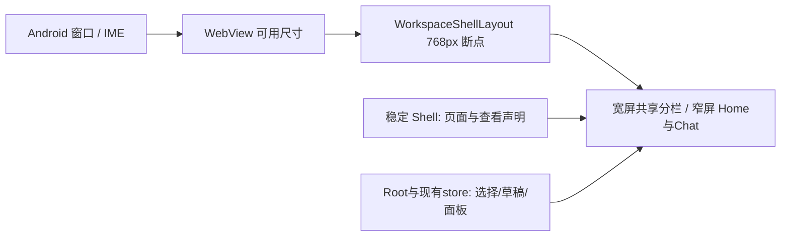
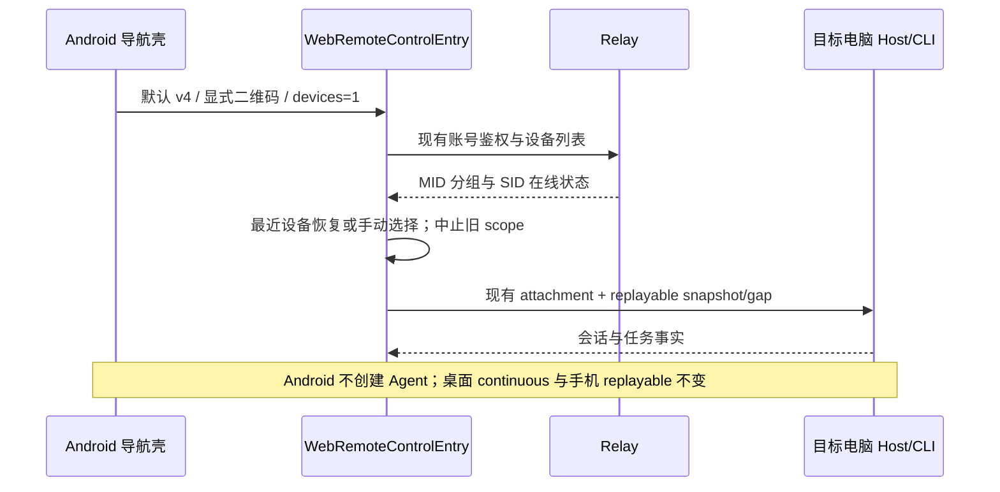

# Android 多电脑远控 App

## 产品合同

Android 复用 `packages/web` 的 `/remote/v4`、共享 UI 和现有 Host attachment。启动 App
直接进入远控入口，登录后恢复最近在线电脑；最近电脑离线或同 MID 有多个候选时展示电脑列表。
电脑列表、在线状态、账号切换、SID 失效按 MID 接续均归 `WebRemoteControlEntry`，Android 不保存
第二份设备事实。电脑需登录同一账号并开启远控；扫码/粘贴链接作为另一入口。

- 电脑切换：原生顶部“电脑”显式打开 `?devices=1`；Web 消费并清除此参数，展示列表且本次不自动连接。
- 每台电脑的草稿沿用 `mobile:${mid ?? sid}` namespace；附件沿用既有不持久化合同。
- 项目/会话位置由 Web 保存为 origin + provider/账号 ID + MID（缺失时 SID）下的本地导航偏好。
  冷启动只恢复 bootstrap 中仍存在且可连接的 workspace，缺失/离线目标退回现有初始选择器；
  taskId 经 bridge 的 Host task service 验证；明确不存在时清该任务偏好并回项目，RPC 异常不吞掉。
  不缓存旧 remoteSessionId、bridge 或任务快照。
- “在此手机隐藏”只保存当前 origin/账号的 MID 集合；列表提供恢复隐藏入口。隐藏不改变 relay 在线事实、
  不注销电脑、不调用注册删除 API；自动连接跳过隐藏电脑，显式扫码仍可连接。
- 关闭/切后台/切电脑不发送停止任务命令；任务事实与执行权留在对应电脑 CLI/Host。
- 同一时刻只有当前电脑完整实时连接；其他电脑状态由 relay 设备列表提供，不能把页面加载成功当作电脑在线。
- App 重启从无 SID 的 v4 入口恢复，不能落盘 OAuth code/state 或过期二维码 SID。Cookie 与 Web localStorage
  在 App 私有 WebView 中保留；原生不读取 JWT，不把链接/凭据显示在顶部或写日志。
- 显式入口（扫码、系统链接）优先于默认恢复。系统重建不强制拉回最初 URL；Web 自己的 history/登录跳转不触发重载。
- 网络/HTTP/渲染失败提供重试和回到电脑入口，失败不删除登录/草稿。

## 界面与原生能力

聊天、电脑列表、登录使用桌面共享 React UI 与 Zai Light/Dark 主题。原生仅保留紧凑顶部导航、扫码、
输入链接与错误反馈，颜色/字号/圆角对应 DESIGN.md；不得延续旧版居中大蓝按钮启动页。
中英文与系统深浅主题都支持。WebView 覆盖系统栏安全区域及输入法；附件通过系统文件选择器处理。
默认 v4 前端随 APK 打包；API、relay、OAuth 与附件继续走真实网络。打包脚本复用 Web Vite，生产构建
明确 `ZCODE_ENV=production`，不修改共享 Web 的桌面业务逻辑；本地资源只拦截生产入口和本包资源，不能覆盖 API 或 OAuth。
受信 OAuth 页面在同一 WebView 完成往返，普通外链交给系统浏览器；禁止任意 scheme/file 加载。
App 不宣称绕过供应商的嵌入式登录限制；真实账号流程需人工验收。

### 平板与可调整窗口

布局按 WebView 的可用 CSS 宽度切换，不按 Android 设备类型或方向锁定。宽度至少 768px 时
复用桌面工作区的左侧项目/任务列表、中间会话与右侧文件/预览面板；1280×800dp 横屏是主要验收尺寸，
800×1280dp 竖屏仍使用宽屏布局。小于 768px 的分屏窗口回到现有 Home/Chat 与侧面抽屉。
宽屏草稿页也提供共享 WorkspaceHeader 的侧面板入口；会话与面板保留可用最小宽度。
宽屏沿用桌面共享的主题、字体、图标、12px 面板圆角和弱边框，使用 4px 外沿留白，
不为平板另造一套组件。原生导航栏保持紧凑并避开系统栏、输入法。

`WorkspaceShellLayout` 是断点与面板布局的唯一所有者；稳定的 `WebRemoteControlMobileShell`
继续持有 Home/Chat 与 TaskViewReporter，Root/现有 store 持有任务选择与草稿。旋转、窗口缩放和键盘
只改变可用尺寸，不创建新的设备连接、不清空草稿、不重发用户输入、不修改远端任务事实。
宽屏也仍是 `web-remote-replayable`，不能因采用桌面样式而启用桌面专属能力或多会话分屏。



验收场景与模拟器证据记录在 [平板验收](testing/android-tablet-acceptance.md)。

## 所有者与事件顺序



每次原生显式导航有独立 generation；WebView 仅在 generation 变化时加载。页面内 URL 变化不反向覆盖
原生导航请求。账号变化/设备切换沿用 Web AbortController 和 stale-result guard。

## 验收（实现前维护）

| ID     | 可重复场景                                | 期望                                                 |
| ------ | ----------------------------------------- | ---------------------------------------------------- |
| AND-01 | 清数据启动 / 杀进程再启动                 | 无需浏览器标签，直接 v4；已有登录持久保留            |
| AND-02 | 两个电脑同账号，切换 A/B                  | 列表在线事实正确，命令发向当前目标，草稿隔离         |
| AND-03 | 最近电脑离线 / SID 换代 / 多候选          | 复用现有列表或 MID 接续，不选错电脑                  |
| AND-04 | 点击顶部电脑                              | 只展示列表，本次不自动回连                           |
| AND-05 | Web replaceState / OAuth 同域及受信跳转   | 不因 Compose 重组回滚 URL，登录 nonce 存储上下文一致 |
| AND-06 | 网络/HTTP失败、重试、后台恢复             | 保留登录/草稿，错误可退出；任务继续由电脑运行        |
| AND-07 | 扫码/粘贴/系统入口、恶意 host/path/scheme | 合法 v4 接受，非白名单拒绝；非法二维码可重扫         |
| AND-08 | 文件选择、取消、返回、旋转                | callback 恰好一次，页面导航与布局不损坏              |
| AND-09 | 中英文、亮/暗、窄屏及键盘                 | 共享 UI 与桌面风格一致，原生栏紧凑可达               |
| AND-11 | 冷启动 A/B，账号切换，workspace 失效      | 导航偏好隔离且受 bootstrap/Host 校验                 |
| AND-12 | 隐藏在线/离线电脑，刷新与恢复隐藏         | 不发删除 API，不影响在线事实，账号隔离               |
| AND-10 | 飞行模式启动                              | APK 内前端能打开；网络服务错误如实显示               |

Android instrumentation/E2E 覆盖壳与测试 HTTP 页面，Web 浏览器场景覆盖现有 entry 和双设备 mock。
mock 只证明路由、状态与 UI 合同，不代表真实公网配对；真实两台电脑、真实账号 OAuth 和相机扫码须单独记录。

### Web 本轮证据

`pnpm exec tsx packages/web/test/e2e/manual-review/pending/android-device-preferences.mjs`
（先运行 Web Vite 于 `127.0.0.1:5178`）通过 390px 中英文 × Zai Light/Dark 四组合：
显式电脑入口、隐藏/恢复及刷新持久化、账号/电脑导航隔离、失效 workspace 回退；另用真实
Web bootstrap/bridge/RPC 与受控 Host 验证已删除任务明确返回 null 时清任务偏好并回项目。
截图位于 `.tmp/android-device-preferences/`。这是受控浏览器证据，不代表真实多电脑配对或 OAuth 已验收。

## 构建与安装

环境版本取 `mise.toml`、Android version catalog 与 Gradle wrapper；需 JDK 21 和 Android SDK 36.1。
仓库根目录执行：

```sh
packages/android/gradlew -p packages/android :app:assembleDebug
adb -s emulator-5554 install -r packages/android/app/build/outputs/apk/debug/app-debug.apk
```

`bundleRemoteWeb` 自动以 production endpoint 打包共享 Web；原生修改不会触发无关 Web 重编译。
APK 版本名取根 `package.json`；页面版本调用与桌面相同的 `resolveWebRemoteControlPageVersion`（Personal 后缀按既有合同归一化）。Web 请求的 `app_version` 与 APK 的共享页面版本不一致时保留服务端版本路由，
不能用本地前端替换其他桌面版本。调试 APK 允许本机/私网远控测试链接；release 仅生产白名单。
正式发布提供独立应用 ID `io.github.xiaobaoaaaaaa.zcode` 的签名 release APK；debug 使用 `.debug` 后缀，二者可并存。签名与 CI 发行合同见 [发布说明](releases/personal-release.md)，本轮不包含应用商店发布。

### Android HTTP 错误回调顺序

API 36.1 模拟器的独立 HTTP 500 场景确认：`onReceivedHttpError(mainFrame=true)`
先于 `onPageStarted` 到达。因此页面开始通知只更新进度，不能清除错误；错误只由用户显式重试
或新的原生导航 generation 清除。AND-06 必须在服务器已成功写出 HTTP 500 后断言重试入口可见，
随后恢复 200、重试并确认同源 localStorage 仍保留。

### 平板输入法与面板保留（TAB-05）

800×1280 宽布局手动打开文件面板后，仅将可用高度减为 800（宽度仍为 800）的浏览器场景
复现了文件面板被自动收起。窗口自动收起策略只响应实际 CSS 宽度变化；输入法/系统栏引起的
高度变化不得关闭用户已打开的文件面板或侧栏。高度事件也不取消之前真实宽度变化等待中的检查，
保留原有宽度收缩阈值与 resize idle 语义；不新建布局状态所有者。

### 平板跨尺寸类别的窗口恢复（TAB-03 / TAB-06）

API 36.1 Pixel Tablet 从全屏 `sw800dp` 切到自由窗口 `sw600dp` 时，原 Manifest 只处理
`orientation|screenSize`，实测 Activity relaunch、WebView CDP target 更换且页面回到默认入口。
App 的尺寸配置处理必须同时覆盖 `orientation|screenSize|screenLayout|smallestScreenSize`，
与现有 `keyboardHidden|uiMode` 并存；Compose 和 WebView 响应新尺寸，保留同一页面、连接与草稿。
这不承诺操作系统杀进程后保留 WebView 实例，杀进程仍沿用已定义的安全入口/导航偏好恢复。
