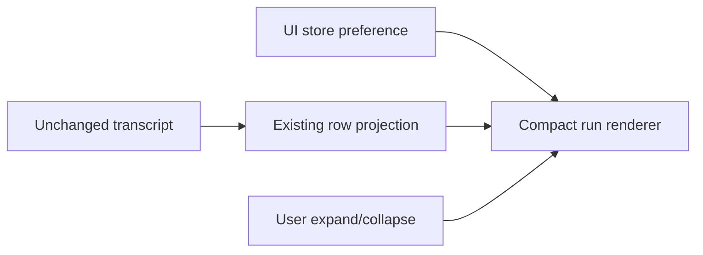

# Compact execution (personal fork)

Default-on renderer preference, independent of memory, stored by the existing UI Zustand store in this profile's local storage. Settings exposes a switch. No protocol, transcript, execution, or hidden-reasoning changes.

The renderer groups consecutive eligible rows: already-visible reasoning and known read/search or command tools. Only running/success tool states qualify; pending approval, error, cancelled, unknown tools, plugin cards, user inputs, assistant text, questions and result rows are boundaries and remain outside. Existing reasoning visibility policy remains authoritative.

Each run has a stable first-row key and its own collapsed state. Appending streamed rows or completing a turn does not reset a user's choice. Expanding uses existing original row renderers. Status and counts derive from current rows; elapsed time uses existing timestamps, frozen on completion. Switching off restores upstream presentation.

Validation: mixed reasoning/read/command aggregation; text/control/error boundaries; hidden reasoning excluded; append/completion preserve expansion; switch-off compatibility; narrow desktop/mobile and light/dark layout; keyboard toggle; original rows after expand. Desktop/Windows acceptance requires actual platform evidence and is not inferred from Linux tests.

## Validation evidence (2026-10-23, Linux / Node 24.14.0)

- `vitest run packages/ui/test/v4ConversationTurnGroup.test.ts packages/ui/test/interfaceMode.test.ts packages/ui/test/settingsPageIntegratedTerminalShell.test.ts`: 135 passed.
- `vitest run packages/ui/test/compactExecutionInteraction.test.ts`: 1 passed. React/Radix DOM interaction verifies expanding original records, streaming appends and completion without resetting the user's choice. The existing dependency graph prints a jsdom canvas-not-implemented warning.
- `pnpm lint`: exit 0, 96 warnings, 0 errors across the current worktree. Focused UI lint: 0 warnings/errors.
- `architecture:check --changed`: 0 violations.
- Root `pnpm typecheck` executed; blocked by the concurrent global-memory settings edit (`MemorySettingsSection.tsx:229`, unsupported `defaultMessage`). No compact-execution diagnostic was emitted; rerun after integration.
- Native desktop E2E, Windows build and visual checks at mobile/desktop widths in both themes remain unverified. DOM interaction tests are not a substitute for those platform checks.
