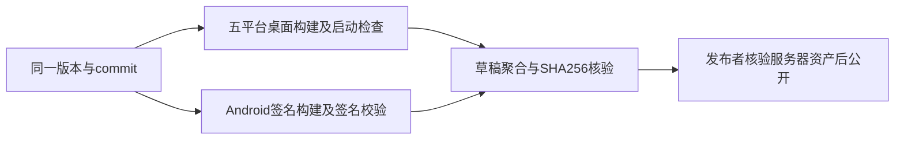

# 个人版桌面发布

个人版从上一已发布版本的 tag 创建 `release/<version>` 分支，版本格式为
`<上游版本>-personal.<序号>`。`main` 继续作为官方基线，不承载发布流程。

## 构建与发布所有者

GitHub Actions 的 `personal-release.yml` 负责原生构建、打包、启动验证与草稿资产上传。
发布者在核对五个平台的任务与草稿资产后公开 Release；构建流程不自行公开草稿。
草稿默认带预发布标记。正式版核验完成后显式取消预发布并设为 Latest：

```sh
gh release edit v<version> --draft=false --prerelease=false --latest
```

版本继续使用个人版序列；是否正式发布由 GitHub Release 标记决定，不能仅根据标签名推断。

| 目标        | Runner           | 资产                        |
| ----------- | ---------------- | --------------------------- |
| Windows x64 | windows-2022     | NSIS EXE                    |
| macOS x64   | macos-15-intel   | DMG、ZIP                    |
| macOS ARM64 | macos-15         | DMG、ZIP                    |
| Linux x64   | ubuntu-22.04     | AppImage、DEB、RPM、Arch 包 |
| Linux ARM64 | ubuntu-22.04-arm | AppImage、DEB、RPM、Arch 包 |

所有目标使用 Node 24.14.0、pnpm 10.33.2 和冻结锁文件，调用官方的运行资源准备、
bootstrap 构建和 bundle 入口。安装阶段使用 `--child-concurrency=1`，串行执行依赖构建、
补丁应用及 hoisted 副本写入；保留安装脚本和所有校验，避免 pnpm 10.33.2 的相对目标路径与
补丁 `chdir`、嵌套目标并发写入发生竞争。来源为发布日志中的 `_tmp_* → esbuild` 重命名失败、
当前 pnpm 实现与 [上游记录](https://github.com/pnpm/pnpm/issues/13627)；日志未能区分两类竞争。
Linux 使用原生 fpm，避免 ARM64 runner 执行 x64 工具。
依赖收集同时包含 glibc 与 musl 可选包，使 Linux 生成的第三方声明覆盖与 macOS/Windows
相同的已登记平台包；实际发行包仍由上游原生依赖裁剪规则选择对应目标。
macOS 使用 ad-hoc 签名，不代表 Developer ID 签名或公证；Windows 不使用 Authenticode。
发布说明必须说明这些实际状态，不声称经过证书认证。

## 资产合同

- `personal.3` 起固定开启 `ZCODE_PERSONAL_IDENTITY=1`，应用名 ZCode Personal，文件名前缀 `ZCode-Personal-`，协议 `zcode-personal`，默认根 `.zcode-personal`。
- 启动检查预置官方配置和 profile，必须验证 Personal 根实际写入，且官方文件内容与目录清单不变；聚合门校验这两项及运行应用名。
- 版本、平台与架构必须匹配当前源码与 runner；每个目标必须生成全部约定格式。
- Linux 文件名遵循 electron-builder 的格式别名：x64 的 AppImage/RPM 使用 `x86_64`、
  DEB 使用 `amd64`、Arch 使用 `x64`；ARM64 的 RPM/Arch 使用 `aarch64`，其他格式使用 `arm64`。
- 每个安装包必须通过文件头检查、SHA-256 计算与 500 MiB 的上游体积约束。
- 对解包后的真实应用执行启动检查，记录版本、运行架构与欢迎页面截图。
- 必须等到登录页的 `login-use-api-key-button` 可见且可用，才记录 `welcomeReady`；
  初始化页同样包含 ZCode 文本，不能仅凭正文长度或标题判断启动完成。
- Windows 保持上游禁用 Node Inspector 的 fuse；通过 Chromium 调试连接验证欢迎页和
  关于窗口的实际版本，并检查 PE x64 头与隔离目录的实际写入，不为测试弱化发行包。
- 聚合阶段核对五个目标的 commit、版本、启动结果和全部哈希，缺失或篡改即失败。
- Release 构建开启 Personal 更新；`release-manifest.json` 的每项资产同时记录 SHA-256 与 base64 SHA-512，后者供应用内下载校验。更新通道、平台安装范围及首次手动升级要求见 [Personal 更新规格](../desktop/personal-app-update.md)。
- 上传约定的 13 个桌面安装包、Android APK、`android-release.json`、`SHA256SUMS` 和 `release-manifest.json`；调试日志和截图留在 Actions artifacts。
- 发布标签只在版本完成后使用。已公开的同版本发布不覆盖；后续修改递增个人版序号。
- 包内保留上游第三方声明，重新生成输入清单并运行基础检查。上游清单中已登记的材料缺口必须保留并披露，不能声称严格材料审计通过。

## 验收

本地验证脚本的资产格式、缺失文件、校验篡改和版本校验；执行类型检查、lint 和提交前检查。
更新 `package.json`（包括仅递增版本号）时同步根 `package-lock.json` 的两处版本；随后运行 `node scripts/licenses.mjs notices` 重新生成输入哈希，
再运行 `node scripts/licenses.mjs check`；将生成材料与版本一并提交。
CI 五个原生目标全部通过后核对草稿的资产名称、大小和服务器 SHA-256，再公开。
Linux CI 的启动验证在 Xvfb 内进行，使用测试进程的 `--no-sandbox`，不改变发行包配置；
该检查不等价于每一种发行版、安装器交互、模型账号和远程功能的完整验证。

本次 3.17.1-personal.1 用户已授权正式发布：对应 release 分支在五平台与聚合门全部通过后，额外逐项核对 GitHub 服务器资产的名称、大小、SHA-256 和源码提交，再公开并设为 Latest。其他版本仍保持草稿流程。

## 3.17.1-personal.6

本版从 `v3.17.1-personal.5` 合入 EA-TIMING-01 思考耗时恢复修复，沿用现有协议字段和
CLI 投影所有权。用户已授权五平台构建及资产核验通过后正式公开并设为 Latest。

## 3.17.1-personal.7

本版从 v3.17.1-personal.6 合入直接继续工作流及时间线浮层稳定性修复。用户已授权将两项
改动一并发布；五平台构建、启动检查与服务器资产核验全部通过后正式公开并设为 Latest。

## 3.17.2-personal.1

本版从 `v3.17.1-personal.7` 合入官方 `v3.17.2` 公开源码，保留 Personal 适配。
用户已授权合入并发布；五平台构建、启动检查与服务器资产核验全部通过后正式公开并设为 Latest。
冲突规则、来源和验收范围见 [合入规格](../specs/upstream-3.17.2-personal-release.md)。

## 3.17.2-personal.2

本版从 `v3.17.2-personal.1` 合入开源 Windows 电脑控制。用户授权推送 personal.2；
沿用五平台构建、启动检查与草稿资产聚合流程，本次推送不修改自动公开规则。
功能范围、状态所有者与验收证据见 [实现规格](../desktop/opensource-windows-computer-use.md)。

## 3.17.2-personal.3

本版在 `release/3.17.2-personal.2` 的源码基础上增加可选的运行过程自动展开，保留该版
Windows 电脑控制。personal.2 仍为草稿，未覆盖或修改其资产。用户已授权提交、推送、
打包及正式发布；五平台构建、启动检查和服务器资产核验通过后公开 personal.3 并设为 Latest。
行为及验证见 [执行过程规格 EA-AUTO-01](../ui/execution-activity-collapse.md)。

## 3.17.2-personal.4：桌面与 Android 联合发布

用户授权完成正式发布。沿用五平台桌面合同，新增 Android 签名 release APK job；
两个构建均成功才聚合草稿，再核验远端资产哈希并公开。桌面 release-manifest.json 保持原合同，
APK 使用独立 android-release.json（版本、versionCode、源码提交、包名、SHA256及签名证书摘要），
共同 SHA256SUMS 覆盖 APK 和 Android 元数据。Android 不改变桌面更新选择器。
Android applicationId 固定为 io.github.xiaobaoaaaaaa.zcode，versionName 跟随根版本，
versionCode 由 packages/android/version.properties 的唯一计数器管理，每次发行必须递增。
正式签名仅使用本机仓库外权限0600密钥与 GitHub Actions secrets，不使用debug签名；
缺少签名变量的release构建失败。初版不提供应用内自动更新，用户从Release下载覆盖安装。
新增工程回归验证元数据、版本/commit不匹配和APK篡改；签名用apksigner验证，
本机模拟器验证正式APK冷启动。桌面、共享Web与原生壳的其他验收沿用本轮记录。



Android CI 显式通过固定提交的 setup-java/setup-android 准备 JDK21 与 SDK，再安装 platform36.1/build-tools36.1.0，不依赖 runner 默认 PATH 中存在 sdkmanager。

## 3.17.2-personal.5：待引导撤回与 Codex SSE 修复

从已发布 `v3.17.2-personal.4` 创建发布分支，包含本轮两个独立提交：非流式 Codex
响应不再依赖 MIME 头决定 SSE 转换；待引导消息可撤回到原输入框，已有草稿时阻止。
用户已授权提交并发布新版本；沿用五平台桌面与签名 Android 联合发布，Android
versionCode 递增至 2。全部构建、启动检查与远端资产摘要核对通过后公开并设为 Latest。

## 3.18.0-personal.1：官方 3.18.0 合入发布

用户已授权发布新安装包。从已发布的 `v3.17.2-personal.5` 创建发布分支，快进接收
`08049a7b` 的完整集成历史，包含官方 `b95ebaff` 和未发布的 `ec0c8159` 问答历史答案修复。
重叠功能采用官方实现，具体规则及源码验证见 [合入记录](../specs/upstream-3.18.0-personal-integration.md)。

沿用五平台桌面与签名 Android 联合发布。根版本为 `3.18.0-personal.1`，Android 唯一
versionCode 计数器递增至 3，applicationId 和签名身份保持现有合同。全部构建、实际启动、
Android 签名检查和远端资产名称/大小/SHA-256/源码提交核对通过后，正式公开并设为 Latest。
本次授权包含推送发布分支、构建、草稿资产上传和核验后的公开，不需要再次确认。

## 3.18.0-personal.2：思考阶段引导与本轮性能摘要

用户于 2026-11-12 授权完成优化、带上全部未提交更改并发布新版。从已发布的
`v3.18.0-personal.1` 创建发布分支，合入思考阶段提前接收引导及原有本轮性能摘要改动。
行为与所有者分别见 [引导规格](../chat/thinking-guide-interruption.md) 和
[性能摘要规格](../ui/turn-performance-summary.md)。

沿用五平台桌面与签名 Android 联合发布。根版本为 `3.18.0-personal.2`，Android
versionCode 递增至 4。全部构建、启动检查、Android 签名与远端资产核验通过后正式公开
并设为 Latest；授权包含提交、推送、构建和最终公开。

## 3.18.1-personal.1：官方 3.18.1 合入与性能摘要计数

用户于 2026-11-13 授权合入官方最新变更并推送：官方与 Personal 对同一功能或修复有
不同实现时以官方为准。从已发布的 `v3.18.0-personal.2` 创建发布分支，合入官方
`c5904686`（3.18.1），保留 Personal 独有能力。同一版本内按用户要求将本轮性能摘要
运行态文案改为「本轮（已完成 N 请求）」，见 [性能摘要规格](../ui/turn-performance-summary.md)。
冲突解决与验证记录见 [合入规格](../specs/upstream-3.18.1-personal-integration.md)。

沿用五平台桌面与签名 Android 联合发布。根版本为 `3.18.1-personal.1`，Android
versionCode 递增至 5。本次授权含提交与推送发布分支（触发构建与草稿资产上传）；
草稿构建产物须经核验后再按既有流程公开并设为 Latest。
