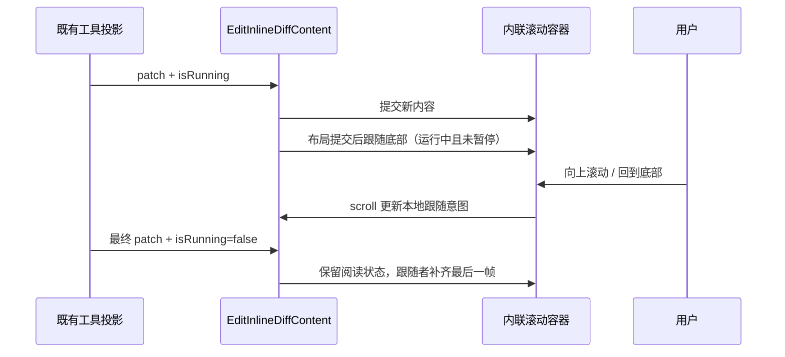

# 文件写入预览跟随输出

## 产品规则

聊天工具块展开后的文件 diff 预览，在 Write / Edit / apply_patch 等文件变更工具运行时默认显示最新输出，并在内容增长时保持底部可见。单文件与多文件子块使用相同规则，沿用现有高度、主题、代码设置和轻量高亮。

- 运行中首次展开时定位到当前内容底部；短内容自然从头显示。
- 用户向上滚动离开底部（容差 8px）后暂停自动跟随，后续输出继续更新，但不抢回阅读位置。滚动回到底部后恢复跟随。鼠标、键盘与触摸最终都由同一容器 scroll 事件处理。
- 运行结束的同一更新可以补齐最后一段并跟随一次；之后停止自动滚动。暂停状态下结束也不改变阅读位置。
- 首次打开已完成或失败的历史工具记录从头显示，不主动滚动到底部。
- 收起后内容按现有 ToolLayout 生命周期卸载；重新挂载时按当前运行状态初始化。每个文件的阅读状态相互独立。
- 仅调整内联预览的纵向位置，不操作外层会话、完整文件预览或横向滚动位置。
- 保留现有长 diff 的有界首尾预览，末尾输出保持可见；本次不改变截断策略。

## 状态所有者与接口

`EditInlineDiffContent` 是内联预览跟随状态和 DOM 滚动位置的唯一所有者。新增可选 `isRunning` 展示属性（默认 false），由 `EditToolCallBlock` / `EditFileSummaryBlock` 透传现有工具运行状态。状态仅在组件实例内保存，不写入 Zustand、持久化或服务端。

Desktop `desktop-continuous` 和手机 `web-remote-replayable` 沿用既有传输、去重、顺序和投影；该功能只读取已接受的 patch 与运行状态，不增加队列、计时器、协议字段或恢复写入。异步语法高亮与尺寸变化只在运行且跟随时校正当前容器位置，卸载后释放观察器。

## 验收场景

| 场景                                        | 预期                                               |
| ------------------------------------------- | -------------------------------------------------- |
| 运行中展开已有长文件，再追加多段内容        | 首次定位底部，每次新输出后末尾可见                 |
| 短文件逐渐超过预览高度，含同一行增长与换行  | 无溢出时从头显示，溢出后自动跟随                   |
| 上滚后继续输出，再回到底部                  | 上滚暂停且保留位置；回底恢复，后续输出跟随         |
| 跟随 / 暂停状态分别接收最后一段并完成或失败 | 跟随者看到最后一段，暂停者不跳动；终态后可自由浏览 |
| 已完成历史记录首次展开                      | 初始位置在顶部                                     |
| 多文件独立展开与更新                        | 各自跟随/暂停，无相互干扰                          |
| 异步高亮、字号/换行设置或容器宽度变化       | 跟随时保持末尾，暂停时不强制回底                   |
| 超过 800 行、收起后重新展开                 | 仍可见最新末尾；重新挂载遵循运行/历史规则          |
| 390px / 1200px，Zai Light / Dark，中英文    | 同样交互，无页面横向溢出，横向阅读位置不被重置     |

验证使用真实 Chromium 的工具卡片展开、流式更新、滚动与完成场景。浏览器 fixture 的 Write 通过已有 V4 row adapter 驱动，多文件使用现有 legacy changes 展示契约；它验证渲染交互，不代替真实 Agent/Host 传输 E2E。

## 验证记录（2026-10-31）

- Node 24.14.0 / pnpm 10.33.2。
- 3.17.1 已退役 App 单测；本次合入以保留的真实浏览器用例验证，不沿用旧基线单测结果。
- 浏览器入口：`node --test packages/ui/test/browser/manual-review/pending/streaming-file-preview.test.mjs`；可用 `CHROME_EXECUTABLE_PATH` 指定浏览器。当前使用 Chromium 内核的 Edge，4 组全部通过，覆盖 390px / 1200px × 深浅主题，中英文，真实 wheel、键盘滚动与运行中收起后重新展开。
- 仓库级类型、Lint 和架构验证随 3.17.1 Personal 发布集成统一执行并记录。
