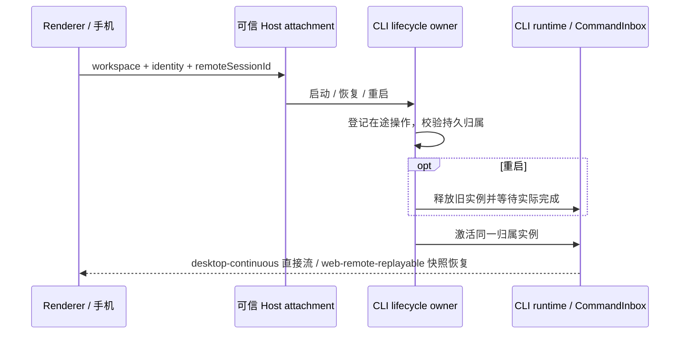

# 官方 3.17.2 合入与 Personal 发布

## 基线与范围

- 从 `v3.17.1-personal.7`（`f20201126a3ad603a772d1b87778719f7d53292e`）创建 `release/3.17.2-personal.1`。
- 合入官方 `v3.17.2`（`a9fe401eede6e6e5e01be9048679c206fe6f02d9`），保留双亲合并历史；相比官方 3.17.1 共 203 个文件变化。
- 官方发布页的安装包 Build source 为 `e6b675b40abb79e1d38d98d4e8750d0859cfedd9`；本次以公开标签源码为准，不把公开同步提交当成官方安装包构建提交。
- 保留现有 Personal 身份、数据根、GitHub 更新通道、Codex 订阅、子代理选模、执行折叠与耗时、直接继续、浮层稳定性、流式文件预览和独立侧栏窗口。
- 当前本地 `main` 含额外个人提交且与远端分叉，本次不改写它，也不恢复已经删除的 `personal` 分支。

## 上游变更与合并规则

| 范围          | 采用的上游行为                                                                    | Personal 交叉点                                                               |
| ------------- | --------------------------------------------------------------------------------- | ----------------------------------------------------------------------------- |
| 会话生命周期  | 启动前校验可信 workspace；等待真实资源关闭；旧 WSL 记录只读解释后由原激活流程修复 | 子会话沿持久父链解析目录 owner；保留子目录范围、显式 identity 和循环/删除防护 |
| MCP / 插件    | 草稿使用实际预热 session；首发保留附件和插件上下文；补齐权限、鉴权与错误诊断      | 使用同一 Host / CLI 与 Personal 数据根，不建立第二个运行时                    |
| 子代理 / 工具 | Explore 委托权限、插件权限只能收紧、上下文提醒；命令 shell 交给正常工具链         | 保留每次调用的模型选择与历史恢复                                              |
| 浏览器 / 预览 | 本地 HTML 受控协议、文件管理器定位、预览卡片修复                                  | 原生独立窗口保持稳定 portal / guest；跨 realm Error 识别仍生效                |
| 打包          | 同步上游锁文件及平台依赖裁剪实现                                                  | 沿用五平台、13 安装包及 manifest/checksum 合同                                |

会话事实与 CommandInbox 仍由 CLI/runtime 唯一持有；Host 负责 attachment 路由和组织态；
Renderer 仅保留草稿、展示投影与侧栏布局。生命周期先校验归属再释放；草稿插件使用现有
预热 session，首次发送提升同一个 session。独立窗口只改变展示位置。

HTML 导航的新增 IPC 通过依赖注入复用既有 `resolveSidePaneViewOwner`，以原 BrowserWindow
主 frame 和 guest 的逻辑 owner 匹配，保留 partition、导航代际与文件授权边界。
冷恢复夹具的旧 cwd 注入只作用于子代理子目录场景，其他 auxiliary 类型继续验证原范围约束。
插件故障注入与内联配置夹具使用现有 `resolveE2EStorageRoot`，确保 Personal 验收实际操作
隔离 `.zcode-personal` 中的 managed 副本；本地 HTML 验收明确进入项目草稿，通过跨平台按钮
展开侧栏。插件回放沿用 DOM 标题栏按钮交互，返回工作区后等待真实草稿输入恢复，再检查内容。
HTML 手工评审复用 Electron 录屏工具保存证据；本机无 Xvfb 时，被遮挡窗口的动画可能停在
`opacity=0`，持续采帧使真实渲染继续，不向产品注入等待或修改动画状态。



## 验收与发布

1. 冲突前核对两侧 spec、已有 E2E 与 CLI 回归，按语义组合；不整文件选 ours/theirs 覆盖交叉改动。
2. 根及 CLI 类型检查、Lint，架构检查与 pre-push；发布工具、平台裁剪和许可证基础检查。
3. 受影响 CLI 测试覆盖权限、命令、生命周期、冷恢复与 Personal 子目录继承；同时保留 continuous / replayable 场景。
4. 真实浏览器验证 Personal 浮层/折叠等交叉行为；Electron 回放直接继续、插件草稿和本地 HTML 等受影响场景。仅报告实际运行结果，远端真机与账号场景单列限制。
5. 更新根 package 与 npm lock 的版本，重新生成第三方输入清单；保留上游已登记的材料缺口。
6. 用户已授权发布：五个原生目标及安装包启动检查全部通过后，核对草稿源码提交、15 项资产名称/大小/服务器 SHA-256，公开 `v3.17.2-personal.1` 并设为 Latest。已公开版本不覆盖。

```text
Personal.7 + 官方 v3.17.2 → 合并与验证 → release 分支
  → 五平台构建 / 启动 → 草稿 / manifest / SHA256SUMS 核验 → 公开 Latest
```

## 本地验收记录（2026-11-05）

- 根工作区、CLI（34 个任务）与 Electron E2E 类型检查通过；根 Lint 84 个警告、0 错误，CLI Lint 72 个警告、0 错误。
- 架构检查以 `v3.17.1-personal.7` 为显式比较基线，0 违规；冻结依赖安装、许可证基础检查通过。
- CLI 26 个文件共 1,188 个不同测试通过：adapters 50、bootstrap 580、core 357、contracts 7、CLI node:test 194。冷恢复夹具修正后重新执行其 138 项，未将重复运行重复计数。
- 发布工具 Node 测试 10 项、Linux 包目标与平台裁剪工程测试 8 项通过。
- 真实 Chromium 的浮层稳定性、执行历史、预览卡片和流式文件预览共 44 项通过。
- Electron 直接继续两项通过，运行 `desktop-e2e-20261105092316610-p81588-41b22be541613fee`。
- Electron 插件市场完整生命周期通过，运行 `desktop-e2e-20261105093717957-p90308-9bdc0534d30f7ea7`；同批早期 HTML 初始化失败由后续独立运行覆盖，不能将整批写成通过。
- Electron HTML 完整场景通过，运行 `desktop-e2e-20261105094759550-p98803-8d20d7f1599445fd`：相对 CSS/JS/ESM/图片/JSON、同一 guest 移出/收回、陌生窗口导航拒绝、隐藏文件/符号链接/目录越界/伪造 token、iframe 隔离、刷新/后退及异步导航竞态。
- 本机无 Xvfb，使用现有隔离 HOME、Personal 数据根、HTTP 回放和 Electron 录屏；未调用真实付费模型。实体手机远控、真实账号和跨版本覆盖安装未验证。
