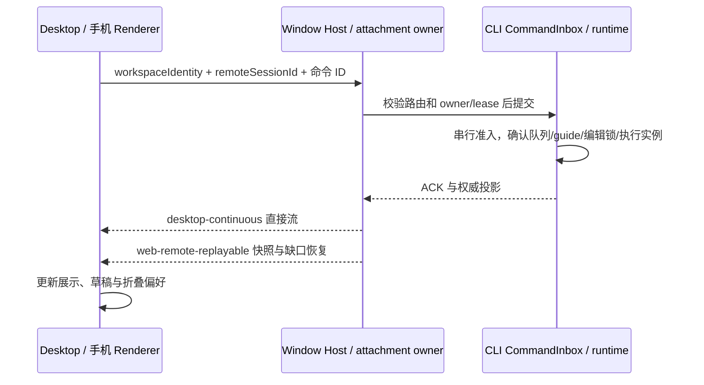

# 官方 3.18.0 与 Personal 集成

## 基线与用户决定

- 官方源码基线：`b95ebaffeab641907b38652f45c1502bd762972d`（3.18.0）。
- Personal 基线：`ec0c8159cb8a07144c1349b7631b92783e5061ae`，包含已发布的 `v3.17.2-personal.5` 和未发布的 AskUserQuestion 历史答案修复。
- 集成分支：`codex/integrate-3.18.0-personal`；保留双亲合并历史，不改写现有发布分支。
- 用户决定：官方与 Personal 功能相同时采用官方实现；保留官方尚未提供的 Personal 能力。此次只集成和验证，不发布安装包或创建发布标签。
- 集成版本为 `3.18.0-personal.1`，验证完成前不视为可发布版本。

## 合并规则与交叉点

| 能力 | 最终行为与唯一所有者 | 验收 |
| --- | --- | --- |
| 设置搜索 | 采用官方搜索索引、导航与高亮；删除 Personal 重复搜索状态和入口。Personal 独有设置接入官方索引 | 官方搜索浏览器/E2E 场景；Personal 选项可定位 |
| 会话、Worktree、扩展、注释、语音及消息编辑 | 采用官方 3.18.0 契约；Host 管理资源与组织态，CLI 持有会话事实和命令准入 | 类型、CLI 受影响测试、桌面回放/浏览器验收 |
| 执行活动折叠与耗时 | 保留 Personal 分组折叠、后台唤醒折叠、可选运行展开与阶段变化收起；接入官方时间线投影，不复制执行状态 | execution-history 与 overlay-stability 浏览器场景 |
| 引导消息撤回与快捷键 | 保留尚未消费 guide 的撤回，CLI 在同一串行准入边界确认；成功后 UI 恢复草稿，过期或已消费不撤回 | steering CLI 回归、引导撤回场景、官方编辑队列锁兼容 |
| 继续执行 | 保留无预设用户消息的继续路径；复用官方 runtime 控制与拒绝条件 | 直接继续回放与 CLI 控制测试 |
| Codex 订阅 | 保留账号、额度、模型同步与 SSE/无 MIME 响应适配；凭据存储复用官方新 cipher，不维护第二份凭据事实 | adapters 单测、服务/设置浏览器回归；真实账号不作为离线通过结论 |
| 子代理按次选模 | 保留 Personal 显式 model/reasoning 覆盖；与官方新停止、恢复和停滞提醒组合，实际执行模型由 runtime 确认 | 子代理工具/runner 测试与模型列表测试 |
| 独立侧栏窗口 | 保留同一内容实例、portal 与逻辑 owner；官方 Browser 设计、文件操作仍经原窗口权限边界 | 侧栏/浏览器回放、类型与平台工程检查 |
| Android 与手机远控 | 保留 Personal APK、设备偏好、平板布局；官方登录、Web 兼容与恢复语义优先 | Android 工程检查、设备偏好与平板浏览器验收 |
| Personal 身份与发布通道 | 保留独立数据目录、协议/应用身份、GitHub 更新、Linux 与 Windows CUA 构建；新 keyring 与 runtime-host 纳入现有打包闭包 | Personal 隔离/发布工程测试与构建检查 |
| AskUserQuestion 历史答案 | 保留未发布修复；官方该 helper 相对 3.17.2 未变化 | answer-display 浏览器回归 |

## 状态与同步边界

`workspaceIdentity?.trim() || workspacePath` 继续用于身份隔离；文件与 Git 操作用真实路径。
Renderer 不持有第二份 accepted queue。独立窗口不创建新的 Host 或会话。官方新增的编辑锁、执行代次与迟到事件保护不能被 Personal 撤回、折叠或恢复逻辑绕过。

## 集成与验证顺序

1. 在修改实现前核对上述现有规格、case catalog 和 coverage matrix；保留已有 case ID。E2E 目录按官方领域重排，修正 Personal 用例位置、导入与 fixture 元信息，不凭 Git 的目录猜测归类。
2. 按冲突语义合并，采用官方设置搜索并删除退役入口和引用；保持未发布修复的回归场景。
3. 安装锁定依赖；运行根 `pnpm typecheck`、`pnpm lint`、CLI 相关类型与测试、E2E 类型、架构检查。
4. 运行 Personal 交叉点浏览器回归、必要桌面离线回放和工程门禁；不将上游历史验证记录当成本次运行结果。
5. 记录每项真实验证结果、现有失败及环境限制。未验证真实账号、跨机远端、原生 Windows/macOS 或发布安装包时明确说明。

## 本次验证记录

待集成后填写。开始前 Personal 基线架构检查通过，0 违规；工作区干净。
