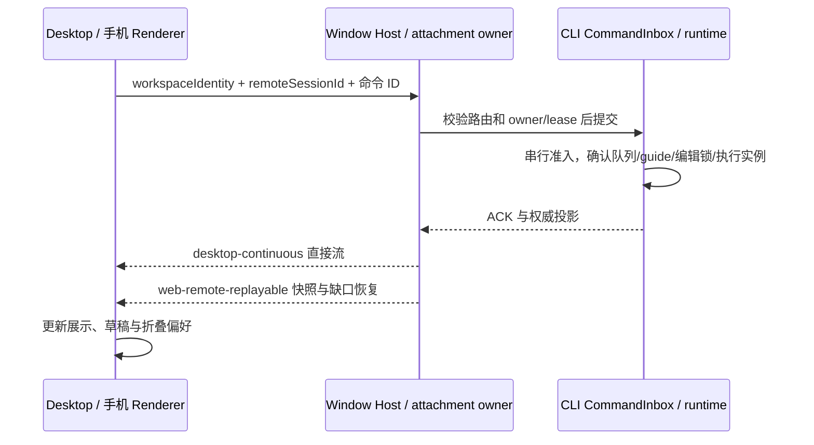

# 官方 3.18.0 与 Personal 集成

## 基线与用户决定

- 官方源码基线：`b95ebaffeab641907b38652f45c1502bd762972d`（3.18.0）。
- Personal 基线：`ec0c8159cb8a07144c1349b7631b92783e5061ae`，包含已发布的 `v3.17.2-personal.5` 和未发布的 AskUserQuestion 历史答案修复。
- 集成分支：`codex/integrate-3.18.0-personal`；保留双亲合并历史，不改写现有发布分支。
- 用户决定：官方与 Personal 功能相同时采用官方实现；保留官方尚未提供的 Personal 能力。此次只集成和验证，不发布安装包或创建发布标签。
- 集成版本为 `3.18.0-personal.1`，验证完成前不视为可发布版本。

## 合并规则与交叉点

| 能力                                       | 最终行为与唯一所有者                                                                                                                                                                               | 验收                                                                                     |
| ------------------------------------------ | -------------------------------------------------------------------------------------------------------------------------------------------------------------------------------------------------- | ---------------------------------------------------------------------------------------- |
| 设置搜索                                   | 采用官方搜索索引、导航与高亮；删除 Personal 重复搜索状态和入口。Personal 独有设置接入官方索引                                                                                                      | 官方搜索浏览器/E2E 场景；Personal 选项可定位                                             |
| 会话、Worktree、扩展、注释、语音及消息编辑 | 采用官方 3.18.0 契约；Host 管理资源与组织态，CLI 持有会话事实和命令准入                                                                                                                            | 类型、CLI 受影响测试、桌面回放/浏览器验收                                                |
| 执行活动折叠与耗时                         | 折叠、分组统计与后台过程展示采用官方 ConsecutiveSummaryGroup，移除 Personal 重复分组组件与旧 Explore/Terminal/Changes 开关；独有的可选运行阶段展开接入官方结构闭合判据，手动选择优先，耗时修复保留 | 官方 tool-summary-groups 补充自动展开/工具间隙/结构闭合/手动优先，overlay-stability 回归 |
| 引导消息撤回与快捷键                       | 快捷键与单条投递采用官方规则（queue 模式组合键立即发送）；保留尚未消费 guide 的撤回，CLI 在同一串行准入边界确认；成功后 UI 恢复草稿，过期或已消费不撤回                                            | steering CLI 回归、引导撤回场景、官方编辑队列锁兼容                                      |
| 继续执行                                   | 保留无预设用户消息的继续路径；复用官方 runtime 控制与拒绝条件                                                                                                                                      | 直接继续回放与 CLI 控制测试                                                              |
| Codex 订阅                                 | 保留账号、额度、模型同步与 SSE/无 MIME 响应适配；凭据存储复用官方新 cipher，不维护第二份凭据事实                                                                                                   | adapters 单测、服务/设置浏览器回归；真实账号不作为离线通过结论                           |
| 子代理按次选模                             | 保留 Personal 显式 model/reasoning 覆盖；与官方新停止、恢复和停滞提醒组合，实际执行模型由 runtime 确认                                                                                             | 子代理工具/runner 测试与模型列表测试                                                     |
| 独立侧栏窗口                               | 保留同一内容实例、portal 与逻辑 owner；官方 Browser 设计、文件操作仍经原窗口权限边界                                                                                                               | 侧栏/浏览器回放、类型与平台工程检查                                                      |
| Android 与手机远控                         | 保留 Personal APK、设备偏好、平板布局；官方登录、Web 兼容与恢复语义优先                                                                                                                            | Android 工程检查、设备偏好与平板浏览器验收                                               |
| Personal 身份与发布通道                    | 保留独立数据目录、协议/应用身份、GitHub 更新、Linux 与 Windows CUA 构建；新 keyring 与 runtime-host 纳入现有打包闭包                                                                               | Personal 隔离/发布工程测试与构建检查                                                     |
| AskUserQuestion 历史答案                   | 保留未发布修复；官方该 helper 相对 3.17.2 未变化                                                                                                                                                   | answer-display 浏览器回归                                                                |

## 状态与同步边界

`workspaceIdentity?.trim() || workspacePath` 继续用于身份隔离；文件与 Git 操作用真实路径。
Renderer 不持有第二份 accepted queue。独立窗口不创建新的 Host 或会话。官方新增的编辑锁、执行代次与迟到事件保护不能被 Personal 撤回、折叠或恢复逻辑绕过。

## 集成与验证顺序

1. 在修改实现前核对上述现有规格、case catalog 和 coverage matrix；保留已有 case ID。E2E 目录按官方领域重排，修正 Personal 用例位置、导入与 fixture 元信息，不凭 Git 的目录猜测归类。
2. 按冲突语义合并，采用官方设置搜索并删除退役入口和引用；保持未发布修复的回归场景。
3. 安装锁定依赖；运行根 `pnpm typecheck`、`pnpm lint`、CLI 相关类型与测试、E2E 类型、架构检查。
4. 运行 Personal 交叉点浏览器回归、必要桌面离线回放和工程门禁；不将上游历史验证记录当成本次运行结果。
5. 记录每项真实验证结果、现有失败及环境限制。未验证真实账号、跨机远端、原生 Windows/macOS 或发布安装包时明确说明。

## 架构接入边界

官方新增的 `resourceManagerStorage.ts` 与 `provider-data-schema.ts` 已由上游快照准入，但 Personal 现有的资料目录隔离和 Codex access schema 会改变其 blob。沿用仓库针对已准入存量文件的窄路径例外，仅豁免这两个文件的 unmanaged-new-file；存储 owner、Provider 配置 owner、依赖与层检查不变，不扩大到整个 desktop/provider 模块。

## 本次验证记录

2026-11-12，Linux 本机，Node 24.14.0 / pnpm 10.33.2。开始前 Personal 工作区干净，基线架构检查 0 违规。根 workspace 的 `pnpm install --frozen-lockfile` 成功；以根锁文件安装 CLI，不使用其已过时的嵌套锁文件。

| 检查                                | 本次结果                                                                                         |
| ----------------------------------- | ------------------------------------------------------------------------------------------------ |
| 根 `pnpm typecheck`                 | 通过，包含 Desktop main/host/renderer、Web、E2E 与 CUA 类型                                      |
| CLI `typecheck`                     | 34 个任务通过；命令 PATH 使用根 workspace 的工具                                                 |
| 根 `pnpm lint`                      | 0 错误、545 警告；未将警告标成全部既有问题                                                       |
| CLI lint                            | 0 错误、86 警告，另有 4 条原样上游大文件诊断                                                     |
| 架构                                | changed 检查 0 违规，架构工程测试 61/61                                                          |
| CLI 核心                            | 10 个测试文件，331 通过、1 跳过；包含 Agent 按次模型、ListModels、官方编辑锁与 guide reservation |
| CLI bootstrap                       | 5 个测试文件，184/184；包含继续控制、准入、冷恢复及 Worktree cwd                                 |
| CLI adapters                        | 3 个测试文件，127/127；包含 Codex SSE 与配置适配                                                 |
| 官方连续摘要浏览器                  | 38/38，包含 Personal 可选自动展开的交叉场景                                                      |
| 历史/耗时/自动展开浏览器            | 38/38，主轮/后台轮/timeline、桌面/手机、深浅主题                                                 |
| 未发布 AskUserQuestion 历史答案     | 8/8；实现文件与 `ec0c8159` 一致                                                                  |
| 时间线浮层稳定性                    | 8/8                                                                                              |
| Codex 设置与官方搜索接入            | 11/11 + 1/1                                                                                      |
| 流式文件预览                        | 4/4                                                                                              |
| Android 设备偏好 / 平板布局         | 4 个语言主题组合通过 / 36 项布局观察通过                                                         |
| 待引导撤回 Linux Electron           | 1/1，草稿冲突、ACK 恢复、请求不抢占、不将撤回内容送入模型及 Escape 停止                          |
| 继续执行 Linux Electron             | 2/2，同 session 连续继续、不伪造用户消息、保留队列、防双击及新任务导航                           |
| 子代理独立侧栏窗口 Linux Electron   | 1/1，真实子代理、原 session/标签身份、移出后新输出、收回后内容及唯一子代理请求                   |
| Personal 发布/隔离/Android 工程回归 | 10/10                                                                                            |
| Windows CUA 协议工程回归            | 8/8（本机 Node 验证，不代表真实 Windows 控制）                                                   |
| 数据库 schema / 第三方声明工程测试  | 8/8 / 7/7；声明与 inventory 已重新生成                                                           |

桌面回放使用本次构建的 Electron 44.7.0 / Chromium 152 产物和 CLI，后续测试仅复用相同源码的构建。关键产物：

- guide：`packages/desktop/.e2e-artifacts/desktop-e2e-20261112044607711-p3447278-833128d3b6cc6350/summary.json`
- continue：`packages/desktop/.e2e-artifacts/desktop-e2e-20261112044751564-p3448556-672cd0f00d65747c/summary.json`
- side-pane：`packages/desktop/.e2e-artifacts/desktop-e2e-20261112045848685-p3453478-1f7c66c01d3e19f6/summary.json`
- 浏览器截图：`packages/desktop/.e2e-artifacts/execution-history/`、`.tmp/android-tablet-layout/browser/`；已核对自动展开、平板文件树与独立子代理窗口的代表截图。
- 汇总日志：`.tmp/upstream-3.18.0-personal-verification/`。最终提交门禁使用 `ZCODE_PRE_PUSH_BASE=origin/release/3.17.2-personal.5 pnpm verify:pre-push`，输出保存在其中的 `pre-push.log`。

工程测试选择器将此次跨版本合并选为全部 169 个规格，按仓库现有规则跳过全套工程测试并返回成功；这不表示 169 个规格通过。上表中的定向工程测试是另外实际执行的结果。

最初失败的旧测试假设已按官方规则调整：至少两条摘要成组、失败工具和中断思考参与连续摘要、运行态循环动效不作为布局动画等待。旧 mock 补入官方 `pendingInputEditLocks`，继续控制测试改在实际模型注册表准入点触发竞态。浏览器 fixture 使用独立 Vite cache；构建期间热重载干扰的平板失败已在稳定环境下完整复测通过。

guide 回放仅需一个模型；前置流程改为通过正式 Provider 配置仓库显式声明已有回放模型的 MCS 能力，再冷启动确认配置生效。新增第二个模型的离线 metadata 前置曾失败，没有据此修改官方模型设置实现，也不把该流程计作通过。

独立窗口回放复用默认权限（夹具只运行返回文本的 Agent）；针对 Electron 152 可见性误判，用实际 DOM 命中点加真实指针事件操作控件，未修改产品样式或绕过产品 handler。收回会同步销毁辅助窗口，测试在 pointerUp 后不再向已关闭窗口发送 releaseActions。

本次不声称完成真实 Codex 账号、手机摄像头/公共 OAuth、跨机器远控、Windows/macOS 原生窗口和更新安装、浏览器 guest 独立窗口、签名/公证或安装包发布验证。GW04 的跨端及 A → B → A 迟到 ACK 保护沿用官方代次并经代码检查，未补充端到端竞态覆盖。
