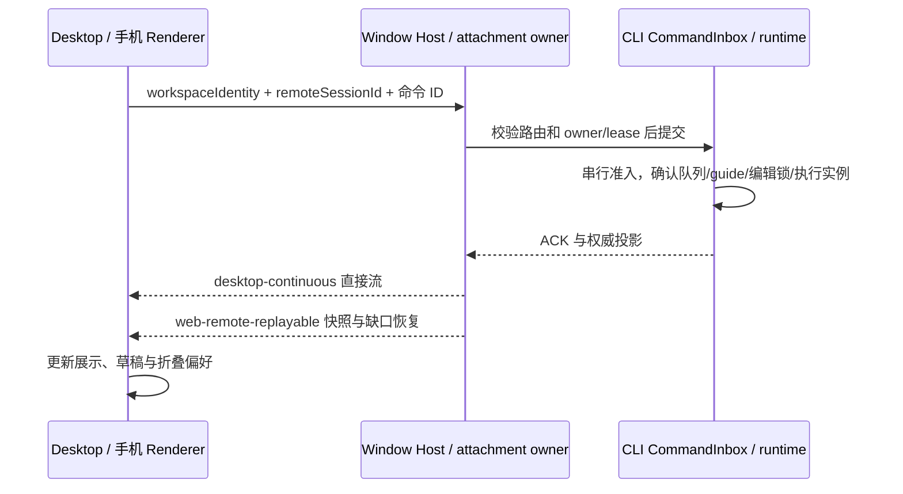

# 官方 3.18.1 与 Personal 集成

## 基线与用户决定

- 官方源码基线：`c5904686ea8341826b3affe5d993d06a134fa779`（3.18.1，Source-Commit `8c930ce5`）。
- Personal 基线：`254bc1561adfe857f30044eff376d64b67aa4148`（已发布的 `v3.18.0-personal.2`）。
- 集成分支：`release/3.18.1-personal.1`，从 `v3.18.0-personal.2` 创建；保留双亲合并历史，不改写现有发布分支。
- 用户决定（2026-11-13）：官方与 Personal 针对同一功能或修复存在不同实现时一律以官方为准；保留官方尚未提供的 Personal 能力。完成后推送发布分支（触发五平台构建与草稿资产上传，不自动公开）。
- 集成版本为 `3.18.1-personal.1`，验证完成前不视为可发布版本。

## 合并规则与交叉点

| 能力 | 最终行为与唯一所有者 | 验收 |
| --- | --- | --- |
| Windows 安装/更新链路 | 采用官方进程收口 helper（完整映像路径句柄核验、同句柄终止/等待、复查残留）与「尽力备份」语义（备份失败不再中止安装、弃用半份备份、仅完整备份才恢复、提示按有无备份区分）；保留 Personal 打包身份、更新通道与发布闭包 | installer 工程测试、NSIS smoke/patch 测试、`windowsInstallerCompile` |
| 麦克风权限 | 采用官方权限引导浮层与 macOS 重授权流程（`microphone-access` main 模块、`useMicrophonePermissionGuide`、`zcode:reset-microphone-access`、restart-required 判定）；Personal 无同名实现，语音输入失败处理随之更新 | 官方 voice-input 浏览器/工程验收 |
| 内存诊断 | 采纳官方 `memory-diagnostics` 模块、shared 契约与反馈归档收集；纳入 Personal 发布闭包与数据目录隔离路径 | adapters 单测、工程测试、日志归档收集 |
| ZAI OAuth | 采用官方国内渠道修复（ZAI_CN 回调携带 provider、polling 完成后唤醒只补归因、旧回调不写入新会话） | oauth 服务/登录回归 |
| reasoning 与队列摘要 | 流式自动折叠与队列摘要流式渲染采用官方实现；保留 Personal 耗时修复与本轮性能摘要（不同能力，合并后共存，官方结构判据不被绕过） | 官方 queued-summary-streaming、tool-summary-groups、turn-performance 回归 |
| 对话列最小宽度 | 采用官方实现（web-remote shell `0px`、桌面 `360px`），替换 Personal 平板 `35%` 规则；同一布局修复以官方为准 | 桌面/手机布局浏览器验收 |
| macOS 字体平滑、交互来源徽标、browser design mode、设置搜索索引 | 采用官方实现；Personal 独有设置继续注册进官方索引 | 官方 pending 人工评审用例沿用、设置搜索回归 |
| AskUserQuestion 历史答案 | 保留未发布修复；官方该 helper 本轮未变化 | answer-display 浏览器回归 |
| 文档交叉点 | `conversation-session-case-catalog` 与 `conversation-session-e2e-coverage-matrix` 的 Personal（PERF、集成复验）与官方（XSG03）新增小节并存，互不覆盖 | 目检 |

Personal 独有能力继续保留：Codex 订阅与 SSE 适配、子代理按次选模、独立侧栏窗口、待引导撤回、继续执行、Android 平板布局与手机远控、Personal 身份与发布通道、本轮性能摘要。

## 状态与同步边界

`workspaceIdentity?.trim() || workspacePath` 继续用于身份隔离；文件与 Git 操作用真实路径。
Renderer 不持有第二份 accepted queue。独立窗口不创建新的 Host 或会话。官方 3.18.1 的
OAuth flow generation 防护、安装器进程收口语义不能被 Personal 发布或恢复逻辑绕过。

## 集成与验证顺序

1. 在修改实现前核对既有规格、case catalog 与 coverage matrix；保留已有 case ID，新增官方小节并存。
2. 按「同一功能/修复以官方为准」合并；保留 Personal 独有能力与未发布修复；版本定为 `3.18.1-personal.1`。
3. 同步根 `package-lock.json` 两处版本，运行 `node scripts/licenses.mjs notices` 重新生成输入哈希并 `check`。
4. 安装锁定依赖；运行根 `pnpm typecheck`、`pnpm lint`、架构检查与 CLI/工程定向回归。
5. 记录每项真实验证结果、现有失败及环境限制。未验证真实账号、跨机远端、原生 Windows/macOS 或发布安装包时明确说明。

## 架构接入边界

官方新增 `memory-diagnostics`、`microphone-access` 与 `installer-process-helper` 模块由上游快照准入；
Personal 对既有 `exportLogs.ts`、`WorkspaceShellLayout.tsx` 等文件的修改沿用窄路径例外。
存储 owner、Provider 配置 owner、依赖与层检查不变，不扩大豁免范围。

## 本次验证记录

2026-11-13，Windows 11 本机（win32 10.0.26300 x64），Node 24.18.0（mise.toml 钉 24.14.0，
本机未安装 mise，版本漂移如实记录）/ pnpm 10.33.2（钉版安装）。合并前工作区干净，
冲突 6 个文件：package.json/package-lock.json（版本取 `3.18.1-personal.1`）、
WorkspaceShellLayout.tsx（取官方最小宽度规则）、两份文档交叉点（双保留）、
third-party/inventory.json（重新生成）。

| 检查 | 本次结果 |
| --- | --- |
| `pnpm install --frozen-lockfile --child-concurrency=1` | 成功（2m09s，node-pty 用 win32 预编译） |
| 根 `pnpm typecheck` | 通过（合并后、文案改动后各一次） |
| 根 `pnpm lint` | 0 错误、544 条存量警告；改动文件专项 lint 0/0，无 hooks 诊断 |
| `pnpm architecture:check` | violations 0 |
| `licenses.mjs notices` + `check` | 通过（基础检查）；19 项材料缺口按发布合同披露 |
| CLI adapters 全量 | 2813 项：2682 过 / 61 败 / 70 跳过；新入 memory-diagnostics 10/10 过 |
| CLI bootstrap 全量 | 3755 项：3406 过 / 337 败 / 12 跳过 |
| 合并触碰测试隔离复跑 | v4-gateway + session-event-store-retention + product-projection 共 369/369 通过 |
| turn-performance 浏览器验收 | 4 轮复跑均在到达断言的组全部通过（desktop/dark 2/4、mobile 4/4，含 zh/en 新文案断言）；desktop/light 4 轮均因首轮 Vite 冷启动 30s 导航超时未达断言 |

全量套件的失败均为本机环境性问题，与合并改动无关：209 项 `Test timed out in 5000ms`
（真实子进程/多进程/git 用例在本机超时）、symlink 创建 EPERM（无开发者模式）、
Windows ESM 盘符路径、文件占用 EBUSY；失败模块未被合并改动（合并在 adapters 仅新增
memory-diagnostics）。合并触碰文件的相关测试隔离运行全绿；未将全量环境失败标为通过。

本机无 cmake/VS 2022 工具链，`pnpm bootstrap` 的 windows-runtime-host 原生 helper
构建步骤失败（spawn cmake ENOENT），CLI 各包 dist 在该步骤前已构建完成；原生构建由
发布 CI 的 Windows runner 执行。未验证真实 Codex 账号、跨机远控、原生 macOS/Windows
安装器交互、发布安装包与签名公证。

## 本次同版本行为调整：运行态摘要带已完成请求数

用户 2026-11-13 决定将运行态摘要由「本轮已完成请求」改为「本轮（已完成 N 请求）」
（英文 `This turn (N completed)`），消除“缺数字标题”式误读。规格、i18n（zh/en）、
TurnPerformanceSummary 与浏览器断言同步更新，完成态样式与详情浮层不变。
浏览器断言在 desktop/dark 与 mobile 组验证通过（见上表）。
