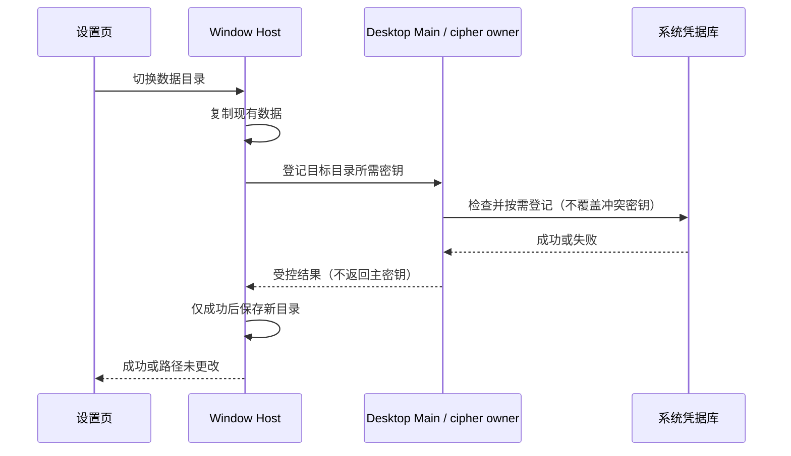

# 官方 3.18.2 与 Personal 集成

## 基线与发布授权

- Personal 基线：已发布 `v3.18.1-personal.1`，提交 `9980c1510357f36d9d9cd46f0bbd124ed7929594`。
- 官方目标：`fec975905a2abd4c07e35c40d51fa097a2258ec9`（3.18.2）；仅合入 3.18.1 之后的增量。
- 分支 `release/3.18.2-personal.1`，保留双亲 merge 历史，不改写已发布版本。
- 用户于 2026-11-14 授权合并、提交、推送并正式发布。正式拼写沿用 `personal`。
- 根版本 `3.18.2-personal.1`；Android versionCode 从 5 递增为 6。

## 产品规则与边界

采用上游既有规格和回归用例，不新增另一套凭据或账号状态。Personal 身份、更新通道、
Codex 订阅/SSE、子代理选模、引导撤回和思考阶段引导、继续执行、独立窗口、Android
布局与设备偏好、问答历史答案和本轮性能摘要均保留。

| 增量 | 所有者及接口 | 验收 |
| --- | --- | --- |
| Linux 无 Secret Service 时首次凭据存储 | Main 开启共享 cipher 的文件密钥回退；仅尚未绑定来源且无 v2 密文时允许；独立 CLI/Server 不主动开启 | CLI credential-security 与 linux-fallback 回归 |
| 切换数据目录 | Host 复制后经私有通道请求 Main 登记目标路径系统密钥；成功后才保存新目录 | CLI 凭据迁移回归、system-credential-data-root E2E |
| 国内 Start 权益 | 共享 provider-family 映射与服务层账号解析为唯一事实，设置页复用；不改付费套餐归属 | start-plan-cn-unlinked-login E2E、类型及 Hooks 扫描 |
| Windows 签名检查 | 官方 PowerShell helper 负责路径转义、受限语言兼容与临时结果清理；保留 Personal 更新完整性校验 | powershell-command 工程回归、更新 source security smoke |

规格沿用 `docs/plans/2026-10-29-system-credential-storage.md`、`docs/zcode-login-rework.md`、
`docs/zai-start-plan-provider.md` 和 `docs/desktop/auto-update-service-manifest.md` 的上游更新。
不修改 session/queue、owner/lease、workspaceIdentity 或桌面 continuous / 手机 replayable 语义。

## 验证与发布

运行根 typecheck、lint、架构及推送门禁，检查受影响 UI 的 Hooks 诊断；执行凭据与
PowerShell 定向回归和可用的桌面 E2E。记录环境失败和未覆盖范围，不以 CI 启动冒充
真实账号、跨机远控或各系统安装器交互验证。

五平台桌面与签名 Android 构建沿用 `personal-release.yml`。五平台启动、Android 签名、
聚合门及远端资产名称/大小/SHA-256/源码提交核验成功后公开 Release 并设为 Latest。
macOS ad-hoc、Windows 无 Authenticode 及第三方材料缺口继续如实披露。

## 本次验证记录

2026-11-14 Fedora Linux，Node 24.14.0 / pnpm 10.33.2（与 mise 一致）。

| 检查 | 实际结果 |
| --- | --- |
| 根 `pnpm typecheck`、CLI adapters typecheck | 通过 |
| 根 `pnpm lint` | 0 错误、545 条告警 |
| 改动 UI 专项 Hooks 扫描 | 7 条告警，与 v3.18.1-personal.1 相同；无新增缺失依赖或 Hook 调用位置诊断 |
| 架构检查 | 0 违规 |
| CLI 凭据及 Linux 回退回归 | 42/42 通过 |
| PowerShell 与 E2E 环境工程回归 | 25 通过、5 个 Windows 平台项在 Linux 跳过 |
| Personal/Android 发布及身份隔离回归 | 10/10 通过 |
| 更新来源安全 smoke | 默认、AppImage、NSIS 三模式，共 24 个 PASS |
| Linux Electron E2E | Start 无关联账号、系统凭据跨目录迁移两项均通过 |
| 第三方声明生成与基础检查 | 通过，保留 19 项材料缺口；不声称严格审计通过 |

E2E 证据：`packages/desktop/.e2e-artifacts/desktop-e2e-20261114070819094-p1721960-3f25df4465518cd6/`。
Start 设置页截图已目检。使用合成账号控制面，未执行真实 Start 模型推理或真实账号登录。
凭据迁移使用本机系统库，验证复制、目标密钥登记、冷重启解密及新凭据写入。

初轮环境失败如实保留：manual-review 默认 capture 缺模型地址，改为文档指定 common replay；
ChromeDriver 回退下载路径未被自定义启动器识别，显式指定同主版本下载路径；根 tsc 与 E2E
打包并行写入 out/host，导致运行产物被未打包输出覆盖、Host 退出。根检查完成后单独重新
构建解决，未修改产品代码或测试断言。失败轮不计作通过。

Hooks 复核：新增 startPlanFamilyDomain 是当前设置/OAuth 渠道派生值，并已加入对应 memo
依赖；七条原有诊断为连接选择空对象导致的三处不稳定引用，以及四条多余依赖诊断，未在
本次改动中引入，也未禁用规则或机械扩大依赖。它们仍作为已有性能清理项保留。

四处合并冲突：根版本与锁文件统一为 Personal 版本；清单重新生成；安全 smoke 保留
Personal 的 shared/env 子入口映射，但遵循上游移除根 alias，使隔离源插件仍能生效。
声明清单的字节哈希变化包含上一版 Windows 与本次 Linux 的换行差异；Apache 许可正文
归并为同一 LF 内容，未移除许可义务。

发布门禁由推送时的 verify:pre-push 执行；五平台、Android 和聚合结果以本次 Actions 为准。
未验证实体手机远控、真实模型账号、各系统原生安装器交互或签名公证。
