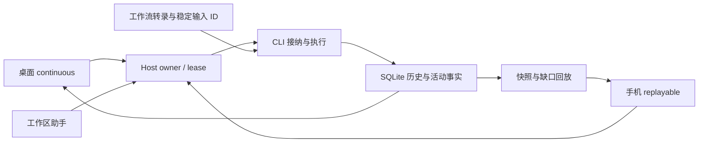

# 官方 4.0.0 与 Personal 合入规格

以正式版 `v3.18.2-personal.5` 为基线，合入官方 `a4b44451`。保留两条提交历史。
同一功能采用官方实现。能组合的独有行为继续支持。确实无法兼容时采用官方行为，并记录具体差异。
本次交付合入分支，版本使用 `4.0.0-personal.1` 作为集成候选。

| 边界 | 产品规则与验收 |
| --- | --- |
| Agent 工具 | CLI 以官方后台开关与生命周期为准，继续支持单次调用的模型选择及绑定模型限制。校验开关两态、模型合法性及 SendMessage 继承。 |
| 会话和索引 | CLI 是正文与活动的唯一所有者。保留官方索引裁剪、完整历史与个人版的辅助对话分支隔离和有界读取。工作区助手由 Local Host 持有事务，继续使用现有只读协议及稳定输入 ID。覆盖 SSC、WA 与冷恢复。 |
| 工作流 | CLI 先按官方等待 actor runtime 与会话挂载，再按已持久化的交付事实发送或无输入续跑。覆盖 DWU-01 的重复停止和同文新指令。 |
| 会话界面 | 使用官方状态栏和交互边界。保留个人版撤回引导、无输入继续、每轮性能摘要、独立窗口及队列删除等独有交互。 |
| 模型和凭据 | 官方维护 Responses 投影、凭据绑定及迁移。Codex 订阅身份、请求头、SSE 归一化及配置独立保留。 |
| 应用和工具 | 保留 Personal ID、数据目录、下载源和完整性校验、Windows 开源 CUA、Linux/Android 分发。官方交互、预装工具、崩溃恢复和 Linux 授权使用各自现有入口。 |

沿用已有用例和身份边界，不改业务状态归属。运行根 typecheck、lint、架构及定向 CLI、工程、桌面回归。
构建和执行结果单独记录。
