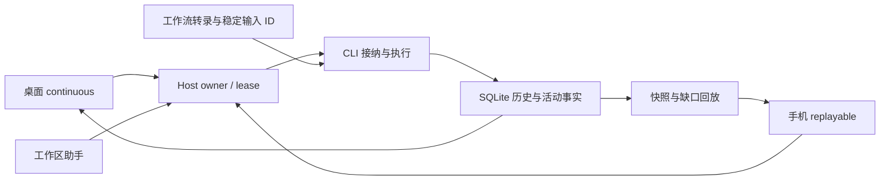

# 官方 4.0.0 与 Personal 合入规格

以正式版 `v3.18.2-personal.5` 为基线，合入官方 `a4b44451`。保留两条提交历史。
同一功能采用官方实现。能组合的独有行为继续支持。确实无法兼容时采用官方行为，并记录具体差异。
本次交付合入分支，版本使用 `4.0.0-personal.1` 作为集成候选。

| 边界       | 产品规则与验收                                                                                                                                                                                                       |
| ---------- | -------------------------------------------------------------------------------------------------------------------------------------------------------------------------------------------------------------------- |
| Agent 工具 | CLI 以官方后台开关与生命周期为准，继续支持单次调用的模型选择及绑定模型限制。校验开关两态、模型合法性及 SendMessage 继承。                                                                                            |
| 会话和索引 | CLI 是正文与活动的唯一所有者。保留官方索引裁剪、完整历史与个人版的辅助对话分支隔离和有界读取。工作区助手由 Local Host 持有事务，继续使用现有只读协议及稳定输入 ID。覆盖 SSC、WA 与冷恢复。                           |
| 工作流     | CLI 先按官方等待 actor runtime 与会话挂载，再按已持久化的交付事实发送或无输入续跑。覆盖 DWU-01 的重复停止和同文新指令。                                                                                              |
| 会话界面   | 使用官方状态栏和交互边界。保留个人版撤回引导、无输入继续、每轮性能摘要、独立窗口及队列删除等独有交互。                                                                                                               |
| 模型和凭据 | 官方维护 Responses 投影、凭据绑定及迁移。Codex 订阅身份、请求头、SSE 归一化及配置独立保留。                                                                                                                          |
| 应用和工具 | 保留 Personal ID、数据目录、下载源和完整性校验、Windows 开源 CUA、Linux/Android 分发。官方交互、预装工具、崩溃恢复和 Linux 授权使用各自现有入口。Personal 使用官方稳定版预装资源，安装目录仍按 Personal 数据根隔离。 |

沿用已有用例和身份边界，不改业务状态归属。运行根 typecheck、lint、架构及定向 CLI、工程、桌面回归。
构建和执行结果单独记录。

## 合入验证

2026-11-23，Fedora、Node 24.14.0、pnpm 10.33.2。

- 根 typecheck、CLI 工作区构建、Lint、架构和两库 schema 检查通过。Lint 为 0 错误、546 条告警，对 267 个变更的前端源文件单独进行 Hooks 扫描，与两个基线比较没有新增诊断。
- 定向 CLI 共 790 项通过，包括模型选择与后台行为、思考引导与性能统计、SQLite 转录、工作流运行服务及 Codex Responses。工程 Vitest 25 项通过，Windows GNU tar 一项在 Linux 跳过。个人版发布和数据隔离 9 项、Windows CUA 的模拟边界 8 项、更新源 smoke 24 项通过。
- Electron 的助手分派和冷恢复通过，产物为 `desktop-e2e-20261123-140455-731`。辅助对话两项、工作流 DWU-01～04 通过，产物为 `desktop-e2e-20261123-140820-718`。性能摘要在桌面、手机尺寸及浅深主题四组浏览器用例中通过。
- 本机 Host 的手机 Web 回放两项通过，覆盖宽窄屏查看、离开和断线后读取未读、前后台切换及首发晋升，产物为 `desktop-e2e-20261123-141251-210`。
- SSH 队列用例缺少 `ZCODE_E2E_SSH_HOST`，在用例设置阶段结束。真实订阅账号、各系统原生安装及 Windows 原生 CUA 未运行。
- 无 `origin/staging` 的个人 fork 使用 `ZCODE_PRE_PUSH_BASE=origin/main` 运行预推送门禁。受影响工程测试选中全套 182 个规格，按现有规则跳过；上述定向工程测试实际执行。
- 基础第三方授权检查通过，保留清单的 19 项待补材料。本次使用 Android versionCode 11 作为后续构建候选。
