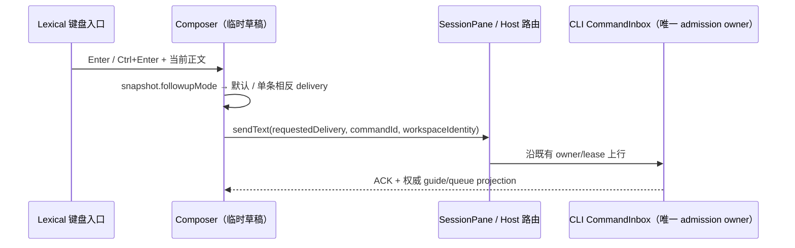

# Chat Message Queue（当前事实）

聊天队列的唯一事实源是每个 workspace CLI 的 runtime command queue，并通过 `ConversationSnapshot.queue` 投影给所有客户端。renderer 不维护 accepted queue，也不存在桌面 renderer queue 与手机 host queue 两套产品顺序。

## 状态链路

```text
desktop / mobile input
  -> V4 command admission
  -> inputRouting: startNow | enqueue | guide | choice
  -> CLI runtime queue
  -> ProductProjection.queue
  -> snapshot/delta
  -> queue UI
```

running 时，普通 `sendText` 与 `sendGoalCommand` 都由 CLI admission 决定是否入队。held queue 下的新输入必须带用户对现有队列的处置选择，不能由 UI 猜测清空或保留。

## 操作

| 用户动作 | V4 command         | 权威结果                                      |
| -------- | ------------------ | --------------------------------------------- |
| 删除     | `deleteQueueItem`  | projection 移除 queue item                    |
| 撤回编辑 | `deleteQueueItem`  | projection 移除后，仅发起端恢复 composer 草稿 |
| 立即发送 | `sendQueuedNow`    | CLI 按 stop barrier/优先规则消费              |
| 排序     | `reorderQueueItem` | projection 返回新顺序                         |
| 自动续跑 | `setAutoDrain`     | snapshot 更新 auto-drain 状态                 |

UI 可对点击做短暂 pending/disabled 反馈，但不能只改本地数组。刷新、切 pane、桌面与手机同时在线时，均以 snapshot/delta 为准。

第一方桌面、Web 与手机 UI 的“编辑”不是 queue 内原地改写，而是把完整输入意图撤回到发起操作的 composer：

```text
点击编辑(queueItem, baseRevision, sessionId, workspaceKey)
  -> composer 是否已有 text / attachment / web context / selection ref / uploading state
       ├─ 是: 不发 command，queue 与现有草稿均不变，提示先处理当前草稿
       └─ 否: 锁定目标 queue row 与 composer
              -> deleteQueueItem(baseRevision)
                   ├─ stale / noop / rejected / failed
                   │    -> 不恢复草稿，解锁并提示重试
                   └─ accepted / duplicate
                        -> 所有端接收权威 queue removal projection
                        -> 仅发起端、且仍是原 session + workspaceKey 时
                           恢复 kind + text + AttachmentRef[]
                        -> 用户修改后重发，产生新的 commandId / queueItemId
```

`workspaceKey = workspaceIdentity?.trim() || workspacePath`。撤回请求绑定点击时的 session 与
workspaceKey；ACK 返回前切换 task/workspace 不得把旧 payload 写进新 composer。重复 ACK 或重复
restore request 必须幂等。目标已被消费或被另一端删除时，`deleteQueueItem` 返回可判别 `noop`，不得把
旧 projection 重复恢复成本地草稿。

普通文本和 goal 可以撤回；goal 恢复为 `/goal ...`。`compact` 继续没有编辑入口。附件按 queue 中的
原顺序、完整 `AttachmentRef` 恢复为 ready chip，标记为 session-owned reference；删除、追加和直接
重发都不重复 upload/adopt，runtime restart 与清理逻辑也不得把它误判为尚未接管的 staged ref。
图片没有本地 object URL 时显示文件名和类型图标，不新增缩略图下载协议。

发起端恢复的草稿保持 renderer-local，不写入 conversation snapshot、relay 或 main process；其他桌面
或手机端只消费权威 queue removal。底层 `editQueueItem` 继续作为 V4 兼容能力保留，但第一方 UI 不再调用。

`compact` 队列项只显示 `/compact` 命令文本，不在文本前增加维护命令图标。它继续通过“立即执行”按钮和不可编辑行为与普通消息区分。

`guide` 是对 active turn 的引导语义，不作为普通 queue item 提供编辑、删除或立即发送。Stop 只停止当前执行；queue 是否 held/续跑由 CLI projection 明确表达。Goal 暂停、恢复和 queue drain 也由 CLI reducer/handler 统一裁决。

## 当前入口

- Schema：`packages/shared/src/zcode-protocol-v4/command.ts`、`snapshot.ts`
- CLI handlers：`apps/zcode-cli/packages/bootstrap/src/zcode-protocol-v4/commands/handlers/queue.ts`
- UI：`packages/ui/src/v4/SessionPane.tsx`

## Enter 与修饰键的单条投递（2026-10-30）

普通 Enter/点击沿用当前 `followupMode`；Ctrl+Enter（macOS 兼容 Cmd+Enter）以及按住平台主修饰键点击，对本条消息交换 `guide` / `queue`：

| 默认模式 | Enter | Ctrl/Cmd+Enter |
| -------- | ----- | -------------- |
| 引导     | guide | queue          |
| 队列     | queue | guide          |

组合键不修改设置或 session 的默认模式；按钮提示随单条投递显示“引导当前任务”或“加入队列”。
本规则替代旧的 queue → startNow 抢占映射。“立即发送”仍由队列的显式操作提供。
空闲/新草稿仍按 CLI admission 正常开始；Shift+Enter、IME、空输入、禁用和自定义换行键保持现有门禁。
手机 Web 远控移动输入视口继续保留 Enter 换行；桌面窄窗口不改变键盘语义。



影响范围：Lexical → ConversationComposer → followupModeSettings（must-inspect）；按钮提示、App 偏好同步、快捷键改绑与手机门禁（should-inspect）。
输入正文仍由 Composer 持有，默认模式由 App 设置同步到 CLI；不新建 accepted queue 或写入路径。
本地/远程 workspace 保持 identity 路由；desktop-continuous 与 web-remote-replayable 继续使用同一 admission 的不同交付链路。
codegraph 不可用，以这些源码种子追踪两层调用。用户已明确双向互换，未定义项无；剪枝网络故障和后台任务排列，不修改 runtime 状态机。

验收：M06k（queue + running + Ctrl/Cmd+Enter → guide，不抢占，已有普通 queue 保留），M06n（guide → future queue），M06o/p（idle、桌面窄窗口与手机边界）复用原案例 ID。
增加双向默认键/组合键、Shift+Enter、IME、空输入、禁用与 tooltip 的组件/单测覆盖；桌面 ME 规格与 fixture 同步更新，历史“抢占”回放证据不代表新语义已验证。

### 本次验证

- 24 项相关单测通过，包括真实 Lexical Enter/Ctrl/Meta 事件、两种默认模式、Shift/IME 门禁、提示和设置同步。
- `pnpm typecheck`、`pnpm --filter @zcode/desktop typecheck:e2e`、`pnpm architecture:check --changed` 通过；`pnpm lint` 为 0 错误、96 条既有警告。
- ME 的 case-local fixture 检查通过，包含“待引导”和已有 future queue 均不得提前发起请求的 `maxMatches=0` 断言。
- 最终 Personal 源码的 Electron case-local 与默认回放均 2/2 通过，覆盖 M06k/M06n；使用现有 `ZCODE_E2E_CONTAINER=1` 的 X11/软件渲染参数，未执行 Docker 准入。
- 证据：`packages/desktop/.e2e-artifacts/desktop-e2e-20261030-014436-891/summary.md`、`desktop-e2e-20261030-014549-251/summary.md`。此前启动/侧栏 pending 动画和草稿归属问题的调查见 `docs/desktop/startup-critical-path.md`。
