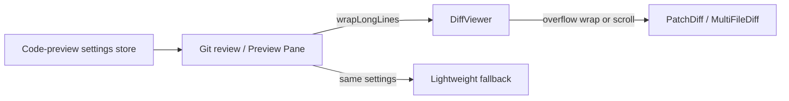

# Diff Viewer

`packages/ui/src/components/ui/diff-viewer.tsx` is the focused renderer for code-viewer and review diff previews.

It wraps `@pierre/diffs/react` diff components directly:

- renders one unified patch string with `PatchDiff`
- renders a before/after file pair with `MultiFileDiff`
- uses its own Pierre-style defaults instead of `createPatchDiffOptions`
- keeps the diff worker pool enabled by default
- applies ZCode background and font-size CSS variables
- contains no parser recovery or plain-text fallback itself; patch callers must route unsafe inputs before mounting it

The default options intentionally follow the official docs more closely while fitting the side pane: `diffIndicators: "bars"`, `lineDiffType: "word-alt"`, hidden file headers, and built-in hunk separators. `DiffViewer` does not inject Shadow DOM CSS or carry a plain-text fallback path, so any patch that reaches the component still leaves parsing and rendering to `@pierre/diffs`.

`PatchDiff` inputs use `simple` hunk separators because patch-only previews do not contain full hidden context and cannot expand unmodified lines. `MultiFileDiff` inputs keep `line-info` separators so expandable unmodified lines remain available.

Current `DiffViewer` integrations are the `PreviewPane` and Git pane. Change-summary `Review` actions open a `PreviewPane` diff source rather than mounting `DiffViewer` directly. Expanded edit tool inline previews use `HighlightedLightweightDiffPreview`, not `DiffViewer`.

## Long-line wrapping

The global code-preview setting `codePreviewSettings.wrapLongLines` also applies to right-side
code changes: Git review cards and Preview Pane diffs, for both patch-only and before/after inputs.
The UI settings store owns this preference; callers pass it to `DiffViewer.wrapLongLines`, which
derives Pierre's `overflow: "wrap" | "scroll"` option. The renderer does not keep a second preference
or read the store itself. Its default remains `false` for callers without a preference.

Changing the setting updates already-open diffs. When enabled, long lines, including uninterrupted
tokens, wrap inside the available pane width and preserve line numbers, additions/deletions and
syntax highlighting. When disabled, the same content is available through horizontal scrolling.
Narrow panes and mobile Web use the same rule. Existing large/unsafe-patch fallback selection stays
unchanged and the lightweight renderer follows the same preference.

Browser acceptance case `DV-WRAP-01` is accepted for the actual Git card and Preview Pane content
components: full-file, patch-only and lightweight-fallback paths; toggle off → on → off; light/dark
themes and 390/1200px viewports; persistence after reload and no page-level horizontal overflow.
The reproducible case is `packages/ui/test/browser/manual-review/pending/diff-wrap.test.mjs`.
This component-browser case does not claim real SSH/mobile-relay transport coverage.

2026-11-16 acceptance: four viewport/theme combinations passed, each exercising all six renderer
paths, live toggles, long unbroken tokens and persistence after reload. Geometry assertions and
screenshots are in `packages/desktop/.e2e-artifacts/diff-wrap-browser/`. Before the fix, the rich
renderers stayed on one visual line with horizontal scrolling after enabling wrapping; the
lightweight fallback still overflowed on unbroken tokens because its flex child could not shrink.
The fix passes the preference to both rich renderers and permits the lightweight code cell to shrink.

Replay from the repository root with
`node --test packages/ui/test/browser/manual-review/pending/diff-wrap.test.mjs`;
set `CHROME_EXECUTABLE_PATH` when Chrome is not installed in its default location. This is browser
acceptance against the actual UI components, not an App business unit test or a promoted desktop gate.

## Patch Input Safety Boundary

`DiffViewer` is intentionally a rendering primitive. Patch safety belongs to the callers that decide whether mounting `PatchDiff` is valid:

- `PreviewPane` patch sources go through `PatchFallbackContent`, which calls `getPlainTextPatchFallbackLines` before rendering `DiffViewer`.
- Git pane patch responses go through `getGitPaneDiffPreviewPlan`, which selects a rich `MultiFileDiff`, a validated patch-only `PatchDiff`, or the lightweight fallback.
- `getPlainTextPatchFallbackLines` classifies missing or multiple file diffs, parser rejection or file-boundary mis-splitting, metadata-only patches, oversized or deep hunks, create/delete inputs, and explicitly unstable file types as lightweight-fallback candidates.

Git pane treats `beforeContent` and `afterContent` as one atomic full-content pair. It mounts
`MultiFileDiff` only when both sides were read successfully for the requested Git comparison. If
either side is unavailable, the original Git patch remains the source of truth and goes through the
same validated `PatchDiff` or lightweight-fallback decision instead of guessing that the unreadable
side is an empty file.

Only a bounded patch that the preflight accepts as one renderable file reaches `PatchDiff` through these integrations. Fallback candidates render through `HighlightedLightweightDiffPreview` unless an entry point has complete files and deliberately selects `MultiFileDiff`. `MultiFileDiff` does not use the patch-parser fallback because it receives explicit `beforeContent` and `afterContent` files. Git pane normally prefers that full-content path; its patch-only path is reserved for inputs that pass the same preflight boundary.

## Change Summary Row Actions

Each expanded change-summary file row exposes two separate preview actions:

- `Review` opens the row's diff review source, preserving the previous change-summary `Open` behavior.
- `Open` opens the changed file as a normal `file` preview source in the side pane.

The split keeps review and source-reading flows distinct without changing the inline row expansion behavior. Desktop keeps the existing `Open` split-button menu for opening the file in an installed editor. Mobile remote control still hides that external-editor menu and keeps both in-app actions available.

## Diff Header Source Entry

Diff preview tabs expose a header action for opening the changed file as a normal preview tab. The action creates a separate `file` code-viewer source instead of switching the current diff tab mode, so users can keep the diff and the current file preview side by side in the side pane tab bar.

The header action is rendered as an icon plus text button, not icon-only. The text label makes the source-opening path visible in dense diff tabs where the icon alone is ambiguous. Its corner radius matches the adjacent header icon buttons so the action cluster keeps a consistent shape.

The action is available only when the diff source can be resolved to a usable file path:

- `multi-file-diff` uses its `path`
- `patch` uses `path` first, then falls back to the first usable `+++`, `diff --git`, or `---` header path
- `/dev/null` is ignored because it represents create/delete diff metadata, not a workspace file

The generated file preview preserves `workspacePath`, `workspaceIdentity`, and `workspaceRemoteSessionId` from the diff source. This keeps local, remote, and mobile remote-control preview reads inside the same workspace identity boundary as the diff tab.
