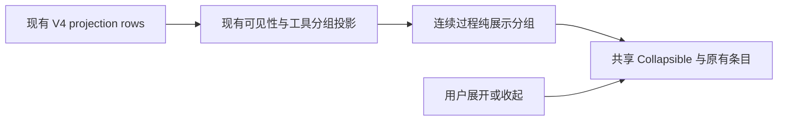

# 执行中的连续过程折叠

## 行为

运行中的工作段，将连续可见的思考、普通工具调用、文件读取/修改和终端操作显示为一个默认收起的“执行过程”分组。摘要显示思考与工具数量以及运行状态；单个过程项也从收起状态开始，后续流式追加到同一组，不重置用户已选择的展开状态。

点击分组或使用键盘展开后，使用现有的 reasoning、ToolCallBlock、Explore/Execute/Changes 子分组和文件 Diff 展示；内部原有按钮和操作保持不变。已有的思考显示开关与工具分组设置继续决定展开后的内容。

普通助手正文、用户输入、错误/取消、待授权工具、交互问答、插件 UI、Agent 子任务入口、产物和特殊时间线卡片是分组边界，保留在过程分组外。不同连续片段独立展开，原始顺序不变。过程项转为错误或等待授权时立即在外层展示，不能藏在已收起的组内。

仅增加运行中展示的折叠层。完成、停止后的整轮“已工作/已停止”历史结构继续沿用现有行为，展开仍是原有明细。后台任务持续运行不重新打开已经结束的主轮。

## 所有者与边界

CLI/Host 仍持有执行事实，Desktop continuous 与手机 Web replayable 使用同一个 UI 分组逻辑，不修改协议、队列、快照和历史持久化。分组身份锚定第一个原始行；组件只保存展开状态。新模块 `execution-activity` 负责通用连续分组与折叠外壳，V4 renderer 负责将现有条目描述成过程项及边界。

## 验收

- 思考、Read/Write/Edit、Bash 与普通 MCP 工具连续出现时聚合，跨正文和交互边界不合并。
- 流式追加、单项升级为 Explore/Execute 子分组和状态更新保持分组身份与手动展开状态。
- 错误、待授权、插件 UI 和子任务入口保持可见；隐藏的 reasoning 不计数，也不改变已有可见性设置。
- 收起后可用键盘展开；展开时能使用原有工具详情与文件 Diff。最终正文与结束后的历史展示正常。
- 桌面和手机宽度、深浅主题及中英文均可用；定向单测、真实桌面流式 E2E、根类型/Lint/架构检查通过。

## 验证入口

- 定向单测：`packages/ui/src/execution-activity/contract.test.ts`、`v4AssistantWorkRenderItems.test.ts`、`v4ConversationTurnGroup.test.ts`、`v4ConversationTurnRenderUnits.test.ts`。
- 桌面 E2E：`conversation-session-execution-activity-collapse.test.ts`，用受控 provider 流分阶段释放，Read/Write/Bash 在隔离工作区真实执行。覆盖键盘展开、单项升级为 Explore 后保持展开、文件 Diff、正文边界及完成后的历史。
- 手机布局：共享组件在独立浏览器 390 × 844 触摸视口验证中英文和 Zai 深浅主题、无溢出、触摸展开/收起及追加后保留展开。该检查验证展示层，不代表测试了远控配对或重连链路。
