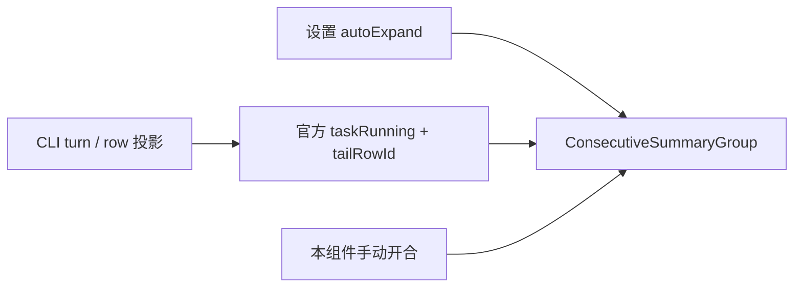

# 执行过程分组与可选自动展开

3.18.0 Personal 采用官方 [工具摘要分组](tool-display-rendering.md) 的连续分组、统计与断组规则。旧 Personal ExecutionActivityGroup、分类计数及 Explore/Terminal/Changes 开关退役；普通轮、后台轮、子代理与历史统一使用官方渲染。

## EA-AUTO-01

设置位于 Agent 行为，默认关闭。开启后，只有官方 SummaryGroupBoundaryContext 判定的运行中尾组自动展开；工具暂时完成不代表结构闭合，后续文本或新组改变 tailRowId、或整轮终止时自动收起。

UI 只拥有用户展开偏好，CLI 仍拥有执行状态。手动开合优先于自动值，流式更新不重置；组件卸载后按当前设置和结构状态重新初始化。分享只读页不读取个人自动展开偏好。耗时仍以 CLI 投影为准，不因卸载重算。

浏览器验收沿用 tool-summary-groups.test.mjs：默认收起、开启运行态展开、工具间隙保持、结构闭合收起、手动收起保持、手动展开在终态保留、重挂载重新派生。覆盖桌面与手机宽度；官方分组生命周期、统计与滚动案例继续回归。
