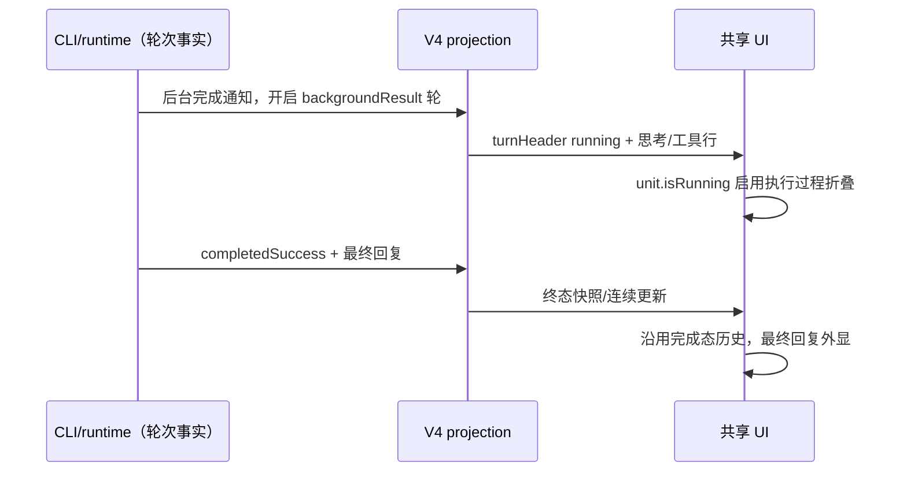
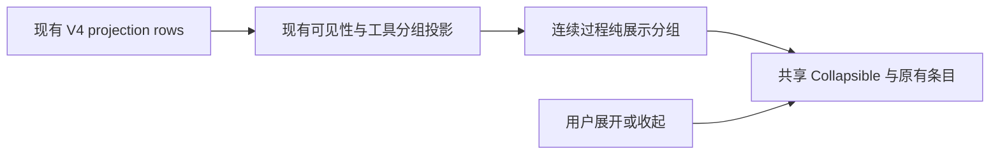

# 执行中的连续过程折叠

## 行为

运行中的工作段，将连续可见的思考、普通工具调用、文件读取/修改和终端操作显示为一个默认收起的“执行过程”分组。摘要按类别显示思考、读取、编辑、终端、浏览器等操作次数以及运行状态；单个过程项也从收起状态开始，后续流式追加到同一组，不重置用户已选择的展开状态。

点击分组或使用键盘展开后，使用现有的 reasoning、ToolCallBlock、Explore/Execute/Changes 子分组和文件 Diff 展示；内部原有按钮和操作保持不变。已有的思考显示开关与工具分组设置继续决定展开后的内容。

普通助手正文、用户输入、错误/取消、待授权工具、交互问答、插件 UI、Agent 子任务入口、产物和特殊时间线卡片是分组边界，保留在过程分组外。不同连续片段独立展开，原始顺序不变。过程项转为错误或等待授权时立即在外层展示，不能藏在已收起的组内。

### 普通终端结果与内层异常边界（2026-10-31）

实际会话记录确认：成功的 Bash 返回 `bash_output` 后被展示类型白名单排除；
连续 WebFetch 中的网络失败又使整个 Explore 组外显，连带暴露正常调用。
`bash_output`（包括截断输出及完整输出文件入口）属于普通过程，结果到达前后保持折叠。
错误、取消、待授权等边界按原始工具行判定，在运行中先隔离边界，再构建 Explore/Execute/Changes
内层组；仅边界行外显，前后正常工具仍分别折叠，顺序和计数不变。已结束历史沿用原有分组。
状态事实仍归 CLI，UI 仅纯投影；不改变协议或 Desktop continuous / Web replayable 的传输。

```text
CLI 工具状态/结果 → V4 row → 运行中隔离边界行 → 内层工具分组 → 执行过程折叠
                              └→ 错误/待授权等原行外显
```

验收：成功 Bash 的纯文本变为结构化/截断结果后不拆组，展开可读日志及文件入口；
WebFetch/终端/文件编辑组内的异常不带出相邻成功调用；授权解除后恢复聚合；
桌面与远控紧凑渲染结果一致。定向测试覆盖两种 display 通道、内层分组开关和结束态历史。
桌面已有执行过程场景补充真实长终端输出，验证收起、展开与重新收起。

验证记录：4 个定向测试文件共 194 项通过；桌面该场景 default replay 通过
（`desktop-e2e-20261031-133255-866`）。长输出断言读取真实 `bash-result-output`，
收起后等待 Radix 动画结束并卸载子项。根 typecheck、E2E typecheck、架构检查通过；
Lint 为 0 error / 96 条现有 warning。当前检出为 3.16.2-personal.5；生产代码及
E2E 修改可应用到 origin/release/3.17.1-personal.1，三个被该分支移除的旧 UI 单测文件
须按目标分支测试布局迁移，不恢复旧测试目录。

### 浏览器过程截图（2026-10-30）

用户确认：操作过程中的截图与执行日志一起折叠，轮尾最终截图继续独立展示。
普通 Node REPL 调用的 `node_repl_images` 是该工具的结果展示，包括浏览器截图、多个图片及
仅携带 app 身份的无图结果；它本身不是独立产物边界。结果到达前后的整条调用留在同一组，
工具数量仍计一次，保持首行 key 和用户选择的展开状态，不拆分或复制图片/日志。
仅 `source=browser_turn_end` 的最终截图保留外显；错误、取消、待授权及插件交互规则优先。
同时兼容 `output.display` 与旧 `row.display`，前者继续具有优先权。

```text
CLI 工具结果 → 原有 V4 ToolCallRow → UI display 分类 → 同一执行过程组
                                    ├→ 普通过程图 + 日志：原 ToolCallBlock
                                    └→ browser_turn_end：外层最终截图
```

已复现根因：原分类只允许 `file_diff` / `mcp_tool` display，图片结果会把整条 Node REPL
调用当作边界，使前后连续过程被拆开。没有修改传输、持久化、折叠状态所有者或图片渲染器。

验收：普通日志变为含图结果后不漏出、不拆组；展开后日志、缩略图和图片预览可用；再次收起
全部隐藏；原地更新保留手动展开；最终截图、错误及待授权继续外显。真实桌面回放在原执行
过程场景增加一次 Browser/Node REPL 截图，UI 单测覆盖两种 display 通道与远控紧凑投影。
截图布局准备以窗口宽度、实际主题 class 和目标元素布局为就绪条件；不等待后台窗口可能
不再提交的 `requestAnimationFrame`，也不通过截图推进时钟后再判断功能是否可操作。

仅增加运行中展示的折叠层。完成、停止后的整轮“已工作/已停止”历史结构继续沿用现有行为，展开仍是原有明细。后台任务持续运行不重新打开已经结束的主轮。

## 所有者与边界

### 后台结果自动唤醒（2026-10-31）

后台 Agent/Bash 完成通知在主会话空闲时会启动 `backgroundResult` 轮，不要求用户发送 guide 或停止后继续。
已从问题会话核对：截图中的助手消息属于 `source=background_task` 输入启动的轮；CLI 将其投影为
`backgroundResult`。独立后台渲染分支遗漏 `collapseActivities`，默认 false，导致该轮所有思考和普通工具
绕过过程折叠；此前 `bash_output` 分类修复不能覆盖这一调用入口遗漏。

后台唤醒轮在 `unit.isRunning` 时必须启用与普通轮相同的连续过程分组，包含 history 和 following 两条入口；
当前工作段尾部的内层工具组接收同一个运行状态。后台身份标题、workflow 通知卡、正文、交互及异常边界保持外显。
完成后仍使用原有“已工作”整轮历史，最终正文独立可见；不改变 CLI 生命周期或重开已结束主轮。



Desktop continuous 与 Web/mobile replayable 共用上述渲染，不改变协议和状态所有者。
验收 `EA-BG-01`：真实后台 Agent 在主轮结束后完成，自动唤醒轮产生思考及多次 Bash；初始默认收起，
展开后日志可读，追加不重置展开，重新收起不漏出；后台标题/正文边界外显，完成后保留最终回复及可展开历史。
不把子会话面板的普通 agent 轮、guide 多段和完整远控重连组合重复纳入此入口修复。

2026-11-01 验证核对：未修改生产代码时，真实桌面回放已执行后台通知和 Bash，DOM 无过程分组，
在目标断言失败（`desktop-e2e-20261031152029173-p122191-e235ad7d4ba9949a`）。补齐两个调用入口后，
同一用例 1/1 通过（`desktop-e2e-20261031152348444-p124800-cc905a26f20e7d45`）；展开/收起截图、
追加后的分组身份及手动状态、最终回复和完成态历史均已核对。根类型、E2E 类型与架构检查通过；
Lint 为 0 errors / 83 条既有 warnings。夹具校验通过，三个 warning 分别是通用标题匹配器无专属标记、
日志与正文输出标记不参与后续请求匹配。候选保持 pending，不恢复已退役 App 单测。

### 分类摘要（2026-10-30）

用户确认保留一个执行过程折叠组；摘要按操作类别显示次数，例如“读取 2 · 编辑 1 · 终端 1 · 浏览器 3”。
只显示非零类别，固定顺序为思考、读取、编辑、终端、浏览器、搜索、网页、脚本、应用、其他。
读取对应文件读取，编辑对应写入/编辑/补丁，终端对应 shell 调用，搜索对应查找/检索，网页对应 WebFetch。
未归入上述类别的技能、上下文及普通 MCP 工具显示“其他”；原有 CUA、子代理与插件交互边界不变。

浏览器通过本仓库 Browser Runtime 的 Node REPL 初始化代码识别：同时导入 `browser-client.mjs`
并调用 `setupBrowserRuntime(...)`。普通 Node REPL 代码属于脚本；仅有图片不能据此判为浏览器。
带宿主 app 身份的非浏览器 Node REPL 结果显示为应用操作。输入尚未完整时可先显示脚本，
随同一行的输入/结果更新重新分类，但不增加次数或改变分组 key、展开状态。
分类只用于 UI 摘要，不作为工具权限、协议或执行路由的依据。

每个原始工具调用只计一次，不按文件去重，不按截图数或脚本内部动作数增加计数。
已有 Explore/Execute/Changes 内层分组仍按每条原始调用分类，开关这些分组不会改变摘要。
分类计数取代单一 `toolCount`，由 V4 行纯投影生成；折叠组件只格式化分类文案，
不另外维护计数状态。流式追加、重放及类别变化都继续使用首行身份。

验收：混合操作只保留一个外层折叠组；中英文摘要分别显示类别且无零计数；窄屏在类别之间换行，类别名和次数不拆开、无横向溢出；
分类更新保持手动展开；截图和日志仍一起折叠，最终截图及需处理的异常仍外显。



CLI/Host 仍持有执行事实，Desktop continuous 与手机 Web replayable 使用同一个 UI 分组逻辑，不修改协议、队列、快照和历史持久化。分组身份锚定第一个原始行；组件只保存展开状态。新模块 `execution-activity` 负责通用连续分组与折叠外壳，V4 renderer 负责将现有条目描述成过程项及边界。

## 验收

- 思考、Read/Write/Edit、Bash 与普通 MCP 工具连续出现时聚合，跨正文和交互边界不合并。
- 流式追加、单项升级为 Explore/Execute 子分组和状态更新保持分组身份与手动展开状态。
- 错误、待授权、插件 UI 和子任务入口保持可见；隐藏的 reasoning 不计数，也不改变已有可见性设置。
- 收起后可用键盘展开；展开时能使用原有工具详情与文件 Diff。最终正文与结束后的历史展示正常。
- 桌面和手机宽度、深浅主题及中英文均可用；定向单测、真实桌面流式 E2E、根类型/Lint/架构检查通过。

## 验证入口

- 定向单测：`packages/ui/src/execution-activity/contract.test.ts`、`v4AssistantWorkRenderItems.test.ts`、`v4ConversationTurnGroup.test.ts`、`v4ConversationTurnRenderUnits.test.ts`。
- 桌面 E2E：`conversation-session-execution-activity-collapse.test.ts`，用受控 provider 流分阶段释放，Read/Write/Bash 在隔离工作区真实执行。覆盖键盘展开、单项升级为 Explore 后保持展开、文件 Diff、正文边界及完成后的历史。
- 手机布局：共享组件在独立浏览器 390 × 844 触摸视口验证中英文和 Zai 深浅主题、无溢出、触摸展开/收起及追加后保留展开。该检查验证展示层，不代表测试了远控配对或重连链路。

### 2026-10-30 截图折叠与分类摘要回归结果

- 定向 UI 单测 6 个文件、239 项通过，包含分类计数、输入补全后的重新分类、内层分组开关与重复文件调用计数，以及过程图/最终图、两种 display 通道、远控紧凑投影和图片预览原有行为。
- 真实浏览器检查 8 组（390/1200 宽度 × 中英文 × Zai 深浅主题）通过，验证触摸/键盘展开收起、流式追加保留展开和内容、类别短语不拆行且无溢出。产物：`packages/desktop/.e2e-artifacts/activity-categories-browser/`。这是共享组件展示层验证，不代表手机远控链路 E2E。
- 桌面 E2E 独立 fixture 回放及默认回放均通过。真实 Read/Write/Bash 和 Browser/Node REPL 调用验证中英文分类摘要与同组身份，浏览器访问本地测试页面并生成截图，断言日志与图片归属同一组、预览打开/关闭、再次收起与完成后的历史。
- 独立回放产物：`packages/desktop/.e2e-artifacts/desktop-e2e-20261030-062140-315/`；默认回放产物：`packages/desktop/.e2e-artifacts/desktop-e2e-20261030-062326-327/`。
- 本地 Fedora Wayland 环境曾出现窗口被判为隐藏、截图准备超时或采集未返回；上述通过记录使用隔离 Xvfb/X11、软件渲染，并非 Docker 准入或后台截图行为验证。
- 根 `pnpm typecheck`、桌面 `typecheck:e2e`、架构检查与 fixture 检查通过；`pnpm lint` 为 0 错误、96 条既有警告。
