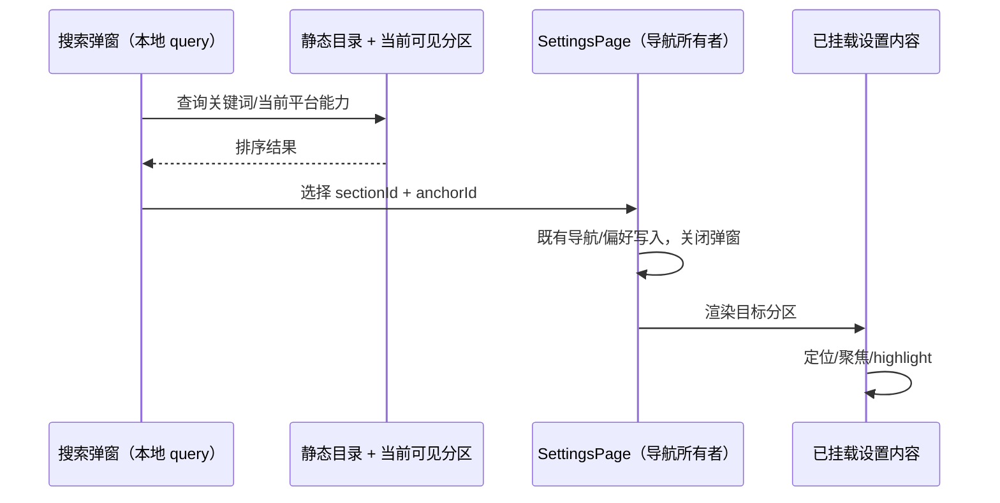

# 设置全局搜索（2026-10-30）

## 产品规则

设置侧栏顶部提供搜索入口（窄屏为图标），打开有无障碍标题的搜索弹窗，自动聚焦输入框。
宽屏弹窗最大 36rem，窄屏保留两侧间距，结果区域限制高度并可滚动。
空查询显示当前可用分区；非空查询匹配分区和配置项标题、说明与关键词，中英文均可搜索，
忽略大小写和首尾空格，多词全部匹配。标题优先于说明，排序稳定；无结果显示明确空态。
方向键选择、Enter 跳转、Escape 关闭；清空不导航。再次打开清空上次查询。

搜索目录覆盖全部已注册且当前平台可见的分区，以及常规、外观、自动归档的具体配置项。
模型/API key、插件、MCP、技能、命令、子代理、快捷键等复杂列表以分区入口和领域关键词
检索；不加载或索引用户 API key、路径、插件内容或任务数据，不替代分区内部列表搜索。
未注册的 migration 和 Web 不可用的远程设备、电脑控制等入口不得出现在结果里；
Windows shell、桌面更新/保持唤醒、Windows/Linux 托盘等项目复用实际显示条件。

选择结果复用 SettingsPage 的导航状态和偏好写入，清理旧插件/远程详情导航意图，递增原有
导航版本。具体项用稳定 message ID 作为 DOM anchor，在内容挂载后滚动、聚焦其行并高亮；
分区结果定位标题。未知或当前未渲染的 anchor 回到分区标题，不用超时猜测挂载。
搜索、关闭、定位均不改变设置值，不主动访问网络或持久化查询；离开分区清除定位。

## 所有者与时序

SettingsPage 仍是唯一分区/导航偏好所有者；新 settings-search UI 模块拥有纯索引和临时
弹窗状态。不新增 Zustand、服务、RPC、Host 状态或广播。主机连接、owner/lease、会话和
Desktop continuous/mobile replayable 链路不受影响。移动端继承现有设置页面布局，弹窗不横向溢出。

## Impact Brief

- Capability：settings navigation；change layers：presentation / option-source / validation。
- UI surface：桌面宽侧栏与窄屏图标进入同一个搜索弹窗，结果复用现有 SettingsPage 分区。
- must-inspect：settingsPageConfig 平台可见性 → 搜索目录；SettingsPage 导航 → 行 anchor。
- should-inspect：SettingsRow、常规/外观/自动归档字段、中英文翻译。
- invariant-only：各分区服务保存路径、原列表搜索、工作区隔离。
- 共享：既有 Dialog/Command、Button、国际化与设计 token；差异：全局查找配置，局部查找资源。
- codegraph 不可用；通过 settingsPageConfig、SettingsPage、SettingsRow 等源码种子核对两层调用。
- graph delta：登记 settings-global-search capability 与入口/规格，不把搜索当成配置状态 owner。
- 无阻塞未定义项；范围排除用户数据全文检索、远端动态目录索引与命令中心全局快捷键。

## 测试场景与覆盖矩阵

| ID    | 前置 / 动作                                   | 断言                                              | 验证层                    |
| ----- | --------------------------------------------- | ------------------------------------------------- | ------------------------- |
| SGS01 | 当前设置页面搜索“字体”或 font                 | 中文/英文标题/说明匹配，具体项优先，结果带分区    | unit + browser            |
| SGS02 | 搜索界面字体，选中结果                        | appearance 导航；定位行聚焦高亮，不改设置值       | unit + browser            |
| SGS03 | 输入无匹配词、清空、Escape、再次打开          | 空态；清空不导航；键盘焦点返回入口；新 query 为空 | unit + browser            |
| SGS04 | 键盘方向/Enter 选择结果；关闭后重复选择同一项 | 导航正确，同一项可重复定位                        | browser                   |
| SGS05 | Web/macOS/Windows/Linux 和 hostPlatform 不同  | 当前不可用分区/设置项不出现在候选                 | unit                      |
| SGS06 | 390/1280px，中英文，Zai 明暗主题              | 搜索输入、结果与关闭可操作，无横向溢出            | browser screenshots       |
| SGS07 | 分区导航/外部跳转；列表原有搜索               | 搜索定位不阻止导航；旧搜索保持独立                | integration/source + unit |

浏览器场景登记在 ui/test/browser/manual-review/pending；使用真实搜索、导航配置和目标内容组件，
不调用生产服务保存设置。此为 UI fixture 浏览器证据，不冒充完整 Electron/手机远控 E2E，
未人工 review 前不转正到 CI。纯本地导航剪枝网络/后台任务排列，不跑全量 UT。

## 验证记录

- 相关 Vitest：6 个文件、55 项通过，包含搜索目录/焦点、SettingsPage 导航接线及原有列表搜索回归。
- Chromium 浏览器：4 组通过（390/1280px、中英文、明暗主题）；截图人工检查，宽屏弹窗尺寸有断言。
- `pnpm typecheck`、`pnpm architecture:check --changed` 通过；`pnpm lint` 为 0 错误、96 条已有警告。
- 变更源码、测试与文档格式通过；`architecture-policy.yaml` 的既有格式问题在 HEAD 副本复现，本次保留原文，只追加模块声明。
- Feature graph 新文档与符号种子有效，4 条既有悬空关系未增加。
- 浏览器复现：`node --test packages/ui/test/browser/manual-review/pending/settings-search/search.test.mjs`，需要已安装 Playwright Chromium；截图位于系统临时目录的 `zcode-settings-search-browser`。
- 完整 Electron/手机远控端到端未执行；重复同项定位与离开时清除高亮另有组件单测覆盖。
