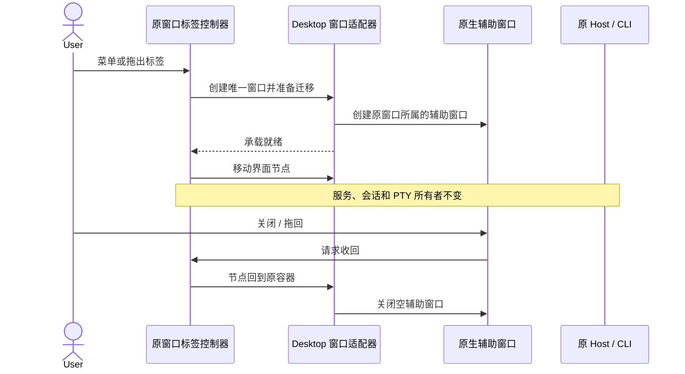
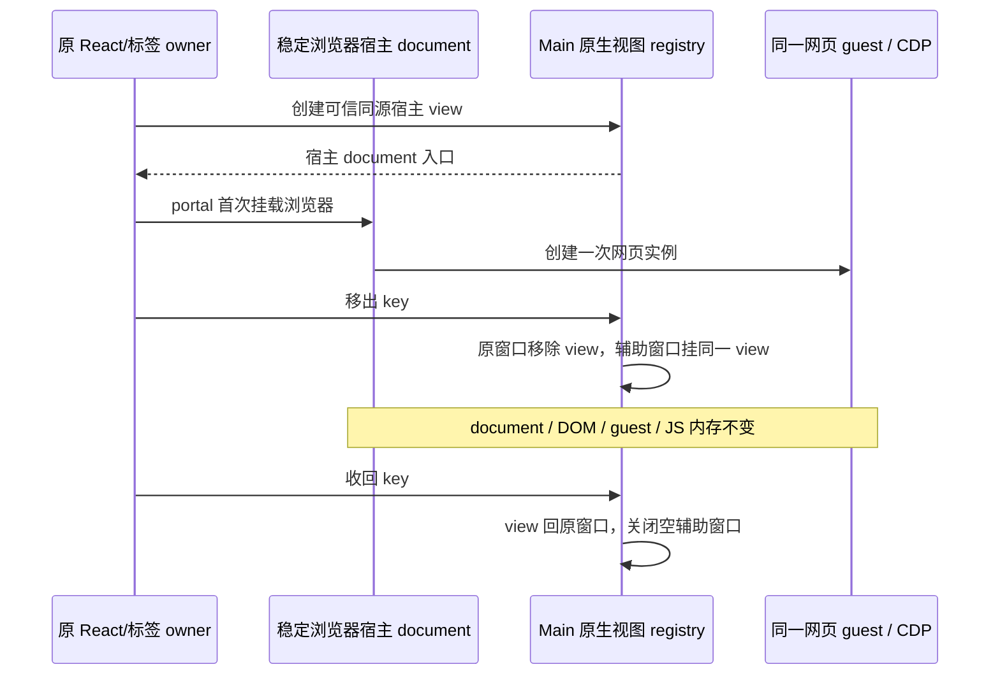

# 侧边标签独立窗口

## 产品边界

2026-10-30 用户确认：一个标签对应一个窗口；同时提供拖出主窗口、拖回侧栏和菜单入口；关闭主窗口时一起关闭辅助窗口并把标签收回。关闭辅助窗口等价于收回，不关闭标签或终止其任务。原有标签关闭操作仍执行真正的资源关闭。

独立窗口是原桌面窗口的显示宿主，不是新工作区或新会话。Web 和手机不显示桌面窗口操作。标签的 `id`、工作区 identity、会话归属、remoteSessionId 与原有服务连接保持不变。打开失败保留原标签；重复打开只聚焦已有窗口。

2026-10-30 用户进一步确认：浏览器必须保留页面现场。移出、收回和关闭辅助窗口均不得重新导航、重建 guest 或恢复 URL 来模拟原页面。未提交表单、DOM/JavaScript 内存、Canvas、滚动位置、导航历史、登录会话和在途浏览器操作继续属于同一个页面实例。

## 状态所有者与接口

- `useAppPanels`：唯一标签注册表和原始顺序、归属；独立显示不删除、重建或复制标签。
- 侧边窗口 UI 控制器：仅持有显示位置及移动中的事务，不保存业务会话事实。
- Desktop 平台适配器：创建辅助原生窗口、承载同一界面节点、同步主题/语言/标题、转发关闭请求。
- Main：窗口父子关系、关闭和安全策略；不另起 Host、不接管任务或终端状态。
- 原 Host / CLI：继续拥有 PTY、会话流、CommandInbox 与 owner/lease。辅助窗口不申请新的会话 attachment，不改变 desktop-continuous 或手机 web-remote-replayable 的语义。

同一标签只允许一条移动事务；关闭与重复操作加入当前事务。异步准备完成后重新检查标签与原工作区是否仍存在，过期结果关闭空窗口且不得复活已关闭的标签。原窗口销毁时终止辅助窗口；显示位置不落盘，冷启动沿用现有标签恢复规则。

卸载期间已发送的原生收回请求仍须处理完成或失败，不能留下未处理的 Promise rejection。承载 document 意外销毁时注销其映射并关闭空辅助窗口；销毁处理使用创建时保存的 WebContents 引用，不再读取已失效的 WebContentsView getter。

## 交互

- 标签右键菜单提供“移至独立窗口”，已移出的标签提供“聚焦独立窗口”和“收回侧栏”。保留原位置作为可发现的入口。
- 同窗口拖动继续排序；拖动终点在主窗口客户区之外才移出。取消拖动不改变位置。
- 独立窗口顶部的标签可拖回原窗口侧栏；只接受属于该原窗口的标签标识。提供“收回侧栏”按钮作为键盘等价操作。
- 侧栏在 dragenter / dragover 阶段识别标签专用 MIME 并声明 move 投放；松开后仍由原窗口注册表校验 key，未知来源不改变标签。
- 独立窗口使用原生标题栏，提供系统最小化、最大化和关闭；内容使用现有设计 token、主题、语言和字号。
- 终端保留 PTY、xterm 实例、scrollback；移动后通知 xterm 重新绑定 owner window 并测量尺寸。
- 子代理继续显示同一 childSessionId 和 rootSessionId，流式输出不创建第二个消费者或 Agent。

## 验收

| ID      | 场景                                   | 断言                                                                                |
| ------- | -------------------------------------- | ----------------------------------------------------------------------------------- |
| SPW-001 | 终端菜单移出、收回、重复移出           | 同一个终端 ID/进程与输出；每标签最多一个窗口                                        |
| SPW-002 | 拖出主窗口、拖回侧栏、同窗排序、Escape | 真实原生窗口数量与标签顺序正确；取消不移动                                          |
| SPW-003 | 关闭辅助窗口、关闭主窗口               | 标签收回；不把关闭显示窗口当成关闭终端/会话                                         |
| SPW-004 | 子代理运行时移出/收回                  | 原 child/root/scope 不变；输出持续更新                                              |
| SPW-005 | 浏览器 human / agent 移出/收回         | 同一 guest / JS token / 表单 / Canvas / 历史，导航计数不增加；在途 CDP 不因移动中断 |
| SPW-006 | 窗口创建失败、移动中关闭、重复点击     | 事务幂等、无空窗口、无复活标签                                                      |
| SPW-007 | 中英、亮暗、窄窗口、Web/手机           | 弹层在所属窗口、布局无横向溢出；非桌面不出现窗口入口                                |

## 当前实现与验证（2026-10-30）

已接入 `terminal`、`subagent-session`、`bash-output`、human browser 和 Agent browser。浏览器使用稳定原生承载保留同一页面实例。文件、预览、插件等其他标签尚未接入，不在本轮验证范围内。工作区显示宿主卸载时收回并关闭其辅助窗口；显示位置不跨应用重启恢复。

- Linux X11 隔离桌面真实 Electron：5 项 UI 场景通过，含真实鼠标拖出/拖回、PTY PID/环境变量/历史保留、原生关闭、按钮收回、重复移出不新建、两个标签对应两个窗口、主窗口隐藏后全部收回、360px 窄窗口的中英/亮暗组合及弹层归属。
- human browser E2E：1 项通过。真实鼠标拖出/拖回、菜单/按钮/原生关闭反复移动、同一 guest/host/JS token/表单/Canvas/滚动/历史、唯一导航、在途 CDP 命令、权限提示、主窗口菜单遮挡及关闭标签资源释放均有断言。
- Agent browser E2E：1 项通过。真实工具在移出后继续填写/点击原页，过程图与轮尾图均成功解码，最终图在完成历史外；guest、host、内存不变且页面仅加载一次。
- 子代理 E2E：1 项通过。真实 Agent 和 controlled child stream 在移出前后分别产生新文本；收回后 childSessionId/tabId 不变，唯一 child provider 请求及结果回到原父会话均已断言。
- 定向单测 12 文件 / 258 项通过，含创建失败、晚到结果、StrictMode 重连、非法跨窗 key、原生 close/ACK、主窗口销毁、异常宿主释放、异步卸载失败、跨 realm Error、浏览器安全安装与截图 owner 隔离。
- 必跑 `pnpm typecheck`、`pnpm lint`（0 error / 96 项既有 warning）、`pnpm architecture:check --changed`（0 violation）通过。
- 额外尝试的独立 preload/renderer TypeScript 项目仍有既有配置失败：shared 缺少 DesktopZoomState/WindowControlsOverlayMetrics 入口、renderer rootDir 漏收 shared 文件与 Window.zcode 声明等；该命令不在根 typecheck 的项目列表中，不记为通过。
- 新场景保持 manual-review/pending，没有自动转正或 Docker 准入。Windows、macOS、Wayland 原生拖放、真实手机/远程连接、主窗口最小化后的辅助显示未执行；同窗排序与 Escape 取消尚未追加本功能的 E2E 断言。

证据目录均位于 `packages/desktop/.e2e-artifacts/`：`desktop-e2e-20261030-101009-426`（终端/UI 5/5，四张中英亮暗窄窗口截图）、`desktop-e2e-20261030-100739-825`（human browser 1/1，含原生拖放）、`desktop-e2e-20261030-101134-178`（Agent browser 1/1）、`desktop-e2e-20261030-100857-859`（子代理 1/1）。

修复定位：跨窗口的 webview 异常属于不同 realm，`instanceof Error` 会漏认尚未 ready 的预期错误；按结构保留和识别 message，真实挂载回归通过。native view 销毁后其 webContents getter 已失效，清理改为创建时保存的引用。浏览器拖回窄标签条时，只在 dragover 接纳会收到 move 但没有 drop；同一专用 MIME 在 dragenter 和 dragover 均接纳后，真实原生拖放通过。

测试定位：缩小主窗口会触发现有的 300ms resize idle 自动收栏，测试需等待收栏动画结束后经原入口展开；原生 HTML 拖放需保留到达目标后的 hover 阶段，允许 Chromium 产生 dragover 后再松开，不能用单 document 合成事件代替跨窗口拖放。

## 浏览器原生承载设计（保留页面现场）

现有 Electron webview 直接跨 document 移动会重建 guest，不能用于此需求。浏览器从首次挂载起使用可移动的原生宿主视图，其 HTML document、webview 节点和 guest 在标签整个生命周期保持不变。移出只把该原生视图重新挂到辅助窗口；收回把同一视图放回原窗口。普通终端/子代理继续使用已有 DOM portal。

- 原 renderer 仍是唯一 React/服务及逻辑标签 owner；同源宿主 document 只承载原 React portal，不启动 App、Host 或会话。
- Main 的 native-view registry 记录可信 opener、显示窗口与 native view。消息必须由原 opener 发起且匹配其 key；不以 renderer 提供的任意窗口 ID 建立授权。
- `BrowserGuestManager` 的逻辑 window/workspace/session/generation 继续冻结在原 owner。显示窗口变化不是 guest replacement，不触发 CDP detach/rebind、tab claim、history restore 或 generation 递增。
- 嵌入网页的安全偏好、固定 preload、导航/popup/蓝牙守卫复用当前安装路径；权限提示路由回逻辑 owner。原生呈现位置和逻辑业务归属分别解析。
- 跨窗口异常保留原始 message/stack；局部错误边界不能因不同 document 的 Error 构造器不同而只显示 Unknown error。
- 主窗口 DOM 覆盖层与原生视图必须有明确的遮挡协调：标签内容内部浮层在宿主 document 内；原窗口菜单/对话框覆盖页面时，保留当前显示快照并暂时隐藏原生视图，覆盖结束再恢复同一实例。页面不会因遮挡重新加载。
- 尺寸、缩放、选中/隐藏和截图准备仍来自现有 UI 状态；原生位置以所属窗口客户区坐标同步，不把 child window 当作新的 workspace。
- 关闭辅助窗口只收回，真正关闭标签仍先遵守现有 CDP detach ACK 再销毁 guest。打开失败保留原位置，不偷偷降级为重载。

新增 SPW-005a（human）与 SPW-005b（agent）验收：真实页面写入未提交表单、内存 token、Canvas 和滚动状态，在请求仍进行时移出/收回，断言 guest ID 与导航计数保持不变；Agent 在移出后仍可读取和操作原页。另覆盖主窗口菜单遮挡、浏览器内权限提示、页面历史、截图准备、重复移动和关闭标签的释放顺序。测试保持 pending，不自动转正。
