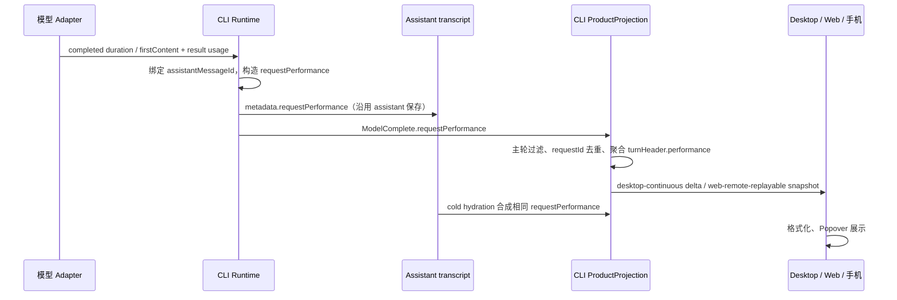

# 本轮性能摘要

## 产品规则

在对话每轮底部显示弱化的可点击摘要：`本轮 · 52 tok/s · 首响应 0.8s`。
运行中显示 `本轮（已完成 N 请求）`（英文 `This turn (N completed)`；N 为本轮已完成
请求数，第一笔请求完成前不显示入口），让用户一眼确认统计范围与样本量；此前运行态
标签「本轮已完成请求」不带数量，易被误读为缺数字的标题，故按用户 2026-11-13 决定
改为带计数样式。仅在请求完成后更新准确统计，不以字符数假装 Token；
第一笔请求尚未完成时不显示空指标。完成、中断和失败的轮保留已完成请求统计。
窄屏摘要隐藏首响应文字，点击同一入口可读取全部数据。摘要始终可见，不依赖 hover。
不新增全局开关，不挤占模型/思考深度/发送工具栏。点击、键盘 Enter/Space 打开 Popover，
Escape、外部点击关闭；使用现有主题、字体和国际化。

详情包含已完成请求数、平均首响应、平均输出速度、模型请求耗时、生成耗时、输入、
输出、推理、缓存读取和写入 Token；未知显示 `—`，不以零填补。首响应是请求开始到
首个有效内容（可能是思考或工具调用），不是正文首字，也不是点击发送到屏幕绘制的时间。
平均首响按有记录的请求算术平均；速度是具有完整耗时及输出 Token 的请求之
`Σ outputTokens / Σ(durationMs - timeToFirstContentMs)`，排除首响应等待和工具耗时。
详情明确采样请求数，避免部分模型未提供 usage 时误称全轮完整数据。
模型请求耗时包含首响应等待；不同请求求和，不将 Highspeed 的耗时字段改作普通统计。
Token 遵循现有 ModelUsage：inputTokens 已含缓存读/写，不重复相加。

## 所有者、接口与恢复

统计的单一所有者为 CLI ProductProjection；UI 只读 turnHeader.performance，无计时器、
额外查询、事件旁路订阅或持久缓存。Runtime 只捕获当前模型 step 的完成事实并随原有
assistant 保存；发布统计前仅补 metadata，不提前设置 assistant.completed/finish，最终保存保留同一指标。未完成、失败重试、compact/title/sampling/subagent 不混入主轮统计。
`requestId` 使用 assistantMessageId；去重状态随候选 projection clone/commit，重复投递
不累计，旧 turn 的迟到事件不得污染新 turn。guide 继续属于原 product turn。
已有 Host owner/lease、workspaceIdentity 与 remoteSessionId 路由原样复用；Main/relay
不存储统计。新字段 optional，旧 CLI、旧历史或无 timing 仍可阅读；无数据不显示入口。
metadata 随 transcript 保存与分支选择，冷恢复只读取活动历史，不恢复已回滚的请求。

## 验收与范围

| ID     | 设置、动作                                      | 断言                                                       | 证据计划                         |
| ------ | ----------------------------------------------- | ---------------------------------------------------------- | -------------------------------- |
| PERF01 | 同轮两次模型请求，间隔工具执行                  | 速度按生成时长加权；首响应平均；输入缓存不双计             | CLI 投影回归                     |
| PERF02 | 重复请求、旧 turn 迟到、compact/subagent        | 不重复、不串轮、不计旁路请求                               | CLI 投影回归                     |
| PERF03 | 保存 assistant metadata 后冷恢复；两种 delivery | live/cold 数值一致；snapshot/delta 保留字段                | CLI hydration 与协议回归         |
| PERF04 | 桌面/390px 手机、浅/深色、中/英文               | 摘要可见；点击/键盘、Escape；浮层不出屏                    | 浏览器真实 ConversationTurnGroup |
| PERF05 | running → completed；未知值、旧历史、中断       | 展示范围正确、运行摘要带已完成请求数、未知不伪造 0、旧历史无入口、停止保留已完成值 | 浏览器 + CLI                     |

不新增 App 业务单测。浏览器 fixture 验证真实组件和 projection 输入，不替代实际远端
设备或真实供应商速度测量；正式跨设备链路沿用现有协议，本次须报告未实测部分。

## 本次验证

2026-11-12：CLI 540 项回归和浏览器 4 组布局/交互验收通过；根类型检查、
桌面 E2E 类型检查、CLI 逐包类型检查、架构和改动代码格式检查通过。
根 Lint 为 0 错误 / 545 存量告警，CLI Lint 为 0 错误 / 86 存量告警。
CLI 标准类型检查入口因缺少 turbo 无法执行，使用 pnpm 递归逐包入口完成等价检查。
完整日志、桌面/手机深浅色截图见 `packages/desktop/.e2e-artifacts/turn-performance`。
真实供应商与手机远控连接未实测；浏览器 fixture 不等同于正式 Electron E2E 转正。
