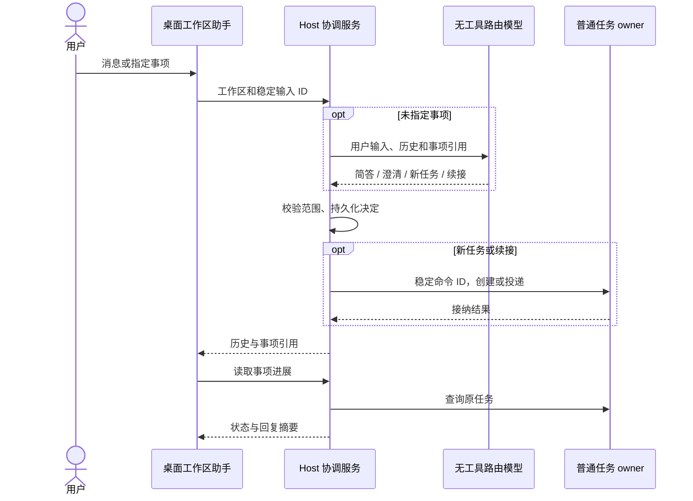

# 桌面工作区助手

## 设计依据

DeepSeek Harness 团队的[设计文章](https://mp.weixin.qq.com/s/zoS7GlReWPhfCjENGxXCdg)把跨事项的连续交互交给 Router，把耗时执行和详细上下文交给隔离的 Worker。原文讨论了按引用召回旧上下文、已订阅事件直达执行者、后台完成后再通知前台，以及人的注意力成本。第 7 节消融实验用合成消息流和模拟耗时工作比较调度方案，不能据此推断本产品真实编码速度。公开[研究原型](https://github.com/deepseek-ai/dsh-superagent-prototype/tree/8c32a9dc5d72c033816c6a8110b37f40cf94fba4)的 Engine 持有事项和分派，Executor 持有会话，通过结构化报告和待办提示请求人介入。原型与团队内部系统及文章设想有差别。

ZCode 在一个本地桌面工作区提供固定入口。前台用当前配置的模型回答一般问题、区分独立事项、识别后续输入，存在歧义时列出候选。耗时调查与执行委托给普通 ZCode 根任务，用户可打开原任务审批、接手和查看完整记录。明确选择的事项直接送达。退出后停止工作，重新打开可查看历史。第一版聚焦 App 内的用户输入和所托事项的进展；外部事件采集、推测性执行、云端运行及独立 Watchdog 属于文章中其他应用方向。

### 从研究原型到桌面产品

| 原型中的机制                                          | ZCode 的选择与依据                                                                                                                     |
| ----------------------------------------------------- | -------------------------------------------------------------------------------------------------------------------------------------- |
| Router 承担不同事项间的决策，Worker 内部自行拆解工作  | 使用无执行工具的短模型请求作前台分派。个人开发者仍能打开每个普通根任务，使用原有工具、权限和手动接管流程。                             |
| Intake 对输入去重，Engine 记录决定，Executor 异步工作 | 在 Host 把输入、一次分派决定、目标和创建时的模型选择先落盘。随后向现有 CLI 提交稳定命令 ID，等待接纳回执即可继续交互，重试复用原决定。 |
| 订阅已归属的消息流，省去重复的模型判别                | 桌面用户选中具体事项就已给出归属。确认澄清时将原话直达目标。普通聊天中的自然语言追问保留语义判断。                                     |
| 通过报告向人暴露值得关注的结果                        | 卡片投影普通任务的状态、待处理交互和回复。执行细节留在可打开的原会话。退出桌面后的托管、外部事件和推测性执行不属于该工作流。           |

参考[原型领域模型](https://github.com/deepseek-ai/dsh-superagent-prototype/blob/8c32a9dc5d72c033816c6a8110b37f40cf94fba4/docs/001-domain.md)和[原型实现说明](https://github.com/deepseek-ai/dsh-superagent-prototype/blob/8c32a9dc5d72c033816c6a8110b37f40cf94fba4/docs/007-architecture.md)。

## 所有权与交互

本地 Host 按 workspaceIdentity.trim() 或 workspacePath 隔离对话和事项引用。项目 ID 只用于正确创建普通任务。路由模型读取有界的对话、事项 ID、标题和实际结果摘要。修改文件与执行命令由普通任务负责。路由器沿用 CLI 辅助请求的最低公开推理档，并把输出预算限制在模型声明的上限内。普通会话、队列、审批和最终回复仍由现有 CLI/runtime 和 owner/lease 链路负责。每个事项有独立的会话上下文，普通任务沿用当前工作区文件。两个事项修改同一文件时，改动对双方可见。工作项卡片保留分派时的事项名称，原会话标题仍按普通任务规则生成和修改。Renderer 负责输入、候选选择和展示，工作项卡片从原任务读取进展和回复。首次进入读取空历史即可。双窗口对同一提交 ID 必须使用同一决定、任务和命令 ID。失败不自动重新执行有副作用的工作，允许显式重试同一提交。未确认执行结果不可显示为成功。

### 上下文、恢复和实验边界

路由请求取最近 20 条对话，从本工作区选出至多 80 项候选，并读取前 6 项的状态与回复预览。输入明确写出的事项标题或 ID 优先，其次是近期对话已经引用的事项，最后按创建顺序从新到旧补足。较早事项仍可从分页列表直接选中。新建或续接时可以附上此前已商定的背景，执行端同时保留本次原话。指定目标绕过模型。冷读取仅使用工作区只读协议客户端批量查询有效分支回复；浏览卡片不会执行任务输入。权限问题回原会话由人处理。简答、归属失败和无效模型输出均不会触发执行。

文章第 7 节每种方案重复五次，以约 300 条消息（约 20 项工作）驱动模拟任务。去掉订阅直通后 Router 决策约增加三成，完成速度接近。这里采用显式目标直通，测试验证实际省去一次路由请求；个人桌面输入没有团队事件洪峰，首版不引入批处理等待。原文将跨月记忆、跨边界协作和中途接管列作开放问题。本实现保留普通会话的原生接管入口；可见的有限摘要属于近期召回，不能当作已实现通用链式检索。[作者文章全文转载](https://telegra.ph/Super-agent-%E8%AE%BE%E8%AE%A1%E6%8E%A2%E7%B4%A2%E8%BF%88%E5%90%91%E6%9B%B4%E8%87%AA%E4%B8%BB%E7%9A%84-Agent-%E7%B3%BB%E7%BB%9F-10-31-2)

## 验收

- WA01 同一工作区创建 A、B；A 工作期间可分派 B。B 先完成时可打开 B 的原会话。定向补充只交给 A。完成次序不改变事项与结果的绑定。
- WA02 简单问题直接回答；多个合理目标时澄清，在确认之前不开工。候选来自当前工作区且实际存在。模型输出无效或不可用时显示可恢复错误。同一澄清的首次选择决定派工目标；双窗口选择同一候选幂等，竞争选择不同候选给后到者冲突提示。
- WA03 切换工作区、离开再进入或重启后，事项和对话归属稳定。重复提交同一请求不重复派工。
- WA04 手动接手、审批、删除、运行失败从原任务读事实；不可达时显示无法获取状态。已知删除的任务保留已有消息和标题，消息跳转、澄清候选及已指定该任务的输入均显示删除状态并禁用相应操作。手机远控和远程项目继续沿用既有普通任务入口。

## 验证记录（2026-11-18）

Fedora 上两条真实 Electron 用例使用可控模型响应，分别验证多事项交错与等待人回答。主用例还在隔离环境模拟 CLI 已接纳、Host 未记录回执便退出的窗口，重启重试后首次执行请求仍只有一次。记录、截图和未验收组合见[桌面覆盖矩阵](testing/conversation-session-e2e-coverage-matrix.md#桌面工作区助手wa)。

另用本机已配置的官方 DeepSeek 模型与合成输入验证语义判断。四个中文试例分别得到预期的简答、新建、续接与澄清。隔离的 Host 协调服务经打包 CLI 的 workspace/generateText 实际调用 deepseek-flash，返回简单问题的答案，工作项数量保持为零。四个试例只用于烟测，尚无大样本语义路由准确率评估。
