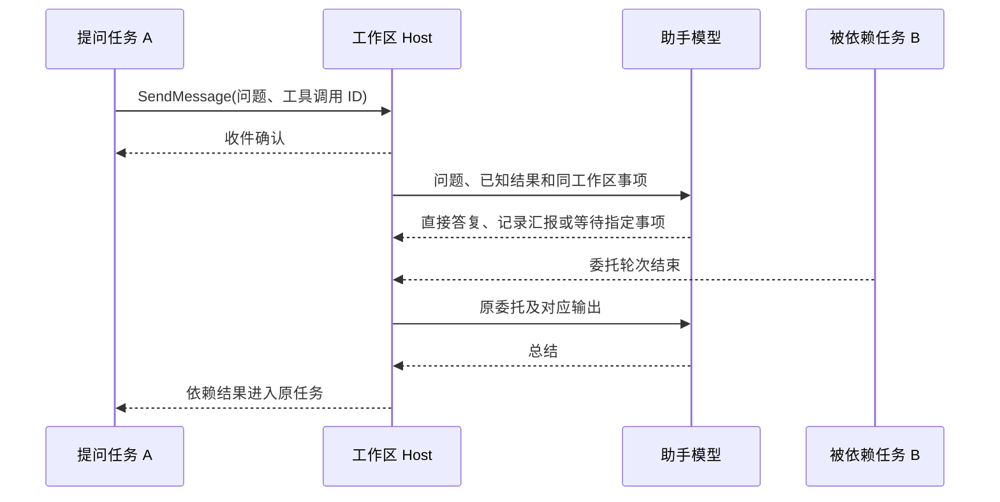
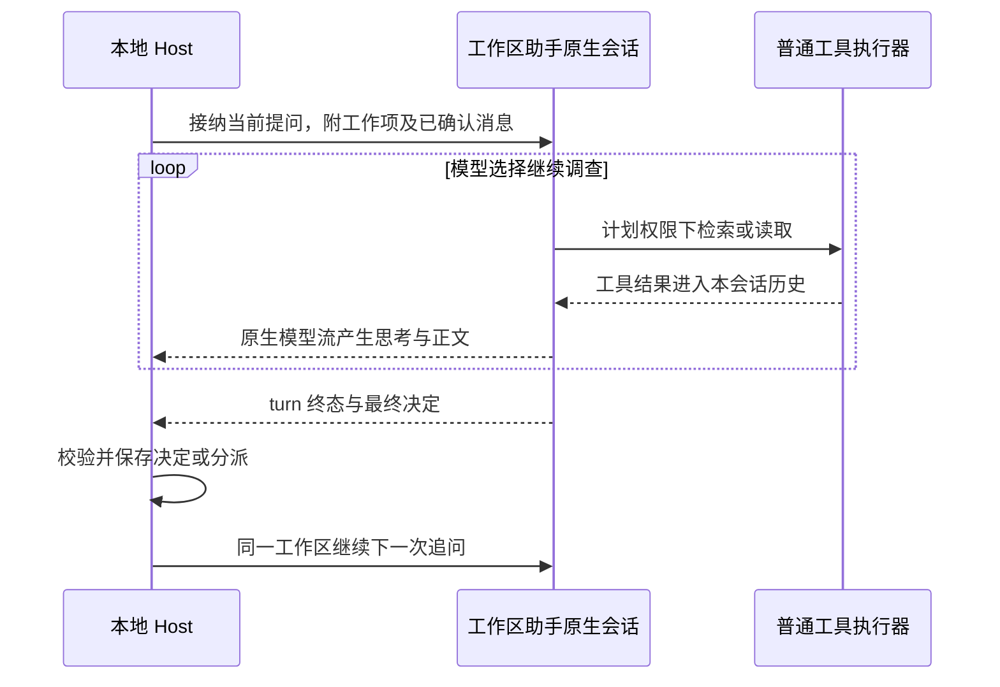

# 桌面工作区助手

## 设计依据

DeepSeek Harness 团队的[设计文章](https://mp.weixin.qq.com/s/zoS7GlReWPhfCjENGxXCdg)把跨事项的连续交互交给 Router，把耗时执行和详细上下文交给隔离的 Worker。原文讨论了按引用召回旧上下文、已订阅事件直达执行者、后台完成后再通知前台，以及人的注意力成本。第 7 节消融实验用合成消息流和模拟耗时工作比较调度方案，不能据此推断本产品真实编码速度。公开[研究原型](https://github.com/deepseek-ai/dsh-superagent-prototype/tree/8c32a9dc5d72c033816c6a8110b37f40cf94fba4)的 Engine 持有事项和分派，Executor 持有会话，通过结构化报告和待办提示请求人介入。原型与团队内部系统及文章设想有差别。

ZCode 在一个本地桌面工作区提供固定入口。前台用当前配置的模型回答一般问题、区分独立事项、识别后续输入，存在歧义时列出候选。耗时调查与执行委托给普通 ZCode 根任务，用户可打开原任务审批、接手和查看完整记录。明确选择的事项直接送达。退出后停止工作，重新打开可查看历史。第一版聚焦 App 内的用户输入和所托事项的进展；外部事件采集、推测性执行、云端运行及独立 Watchdog 属于文章中其他应用方向。

### 从研究原型到桌面产品

| 原型中的机制                                          | ZCode 的选择与依据                                                                                                                     |
| ----------------------------------------------------- | -------------------------------------------------------------------------------------------------------------------------------------- |
| Router 承担不同事项间的决策，Worker 内部自行拆解工作  | 前台复用计划模式的原生会话进行调查和分派。个人开发者仍能打开每个普通根任务，使用原有工具、权限和手动接管流程。                             |
| Intake 对输入去重，Engine 记录决定，Executor 异步工作 | 在 Host 把输入、一次分派决定、目标和创建时的模型选择先落盘。随后向现有 CLI 提交稳定命令 ID，等待接纳回执即可继续交互，重试复用原决定。 |
| 订阅已归属的消息流，省去重复的模型判别                | 桌面用户选中具体事项就已给出归属。确认澄清时将原话直达目标。普通聊天中的自然语言追问保留语义判断。                                     |
| 通过报告向人暴露值得关注的结果                        | 卡片投影普通任务的状态、待处理交互和回复。执行细节留在可打开的原会话。退出桌面后的托管、外部事件和推测性执行不属于该工作流。           |

参考[原型领域模型](https://github.com/deepseek-ai/dsh-superagent-prototype/blob/8c32a9dc5d72c033816c6a8110b37f40cf94fba4/docs/001-domain.md)和[原型实现说明](https://github.com/deepseek-ai/dsh-superagent-prototype/blob/8c32a9dc5d72c033816c6a8110b37f40cf94fba4/docs/007-architecture.md)。

## 所有权与交互

本地 Host 按 workspaceIdentity.trim() 或 workspacePath 隔离对话和事项引用。项目 ID 只用于正确创建普通任务。路由模型读取有界的对话、事项 ID、标题和实际结果摘要。修改文件与执行命令由普通任务负责。助手模型沿用用户选择的提供商、模型和思考档位，并显示提供商返回的思考文本。普通会话、队列、审批和最终回复仍由现有 CLI/runtime 和 owner/lease 链路负责。每个事项有独立的会话上下文，普通任务沿用当前工作区文件。两个事项修改同一文件时，改动对双方可见。工作项卡片保留分派时的事项名称，原会话标题仍按普通任务规则生成和修改。Renderer 负责输入、候选选择和展示，工作项卡片从原任务读取进展和回复。首次进入读取空历史即可。双窗口对同一提交 ID 必须使用同一决定、任务和命令 ID。失败不自动重新执行有副作用的工作，允许显式重试同一提交。未确认执行结果不可显示为成功。

### 上下文、恢复和实验边界

路由请求取最近 20 条对话，从本工作区选出至多 80 项候选，并读取前 6 项的状态与回复预览。输入明确写出的事项标题或 ID 优先，其次是近期对话已经引用的事项，最后按创建顺序从新到旧补足。较早事项仍可从分页列表直接选中。新建或续接时可以附上此前已商定的背景，执行端同时保留本次原话。指定目标绕过模型。冷读取仅使用工作区只读协议客户端批量查询有效分支回复；浏览卡片不会执行任务输入。权限问题回原会话由人处理。简答、归属失败和无效模型输出均不会触发执行。

文章第 7 节每种方案重复五次，以约 300 条消息（约 20 项工作）驱动模拟任务。去掉订阅直通后 Router 决策约增加三成，完成速度接近。这里采用显式目标直通，测试验证实际省去一次路由请求；个人桌面输入没有团队事件洪峰，首版不引入批处理等待。原文将跨月记忆、跨边界协作和中途接管列作开放问题。本实现保留普通会话的原生接管入口；可见的有限摘要属于近期召回，不能当作已实现通用链式检索。[作者文章全文转载](https://telegra.ph/Super-agent-%E8%AE%BE%E8%AE%A1%E6%8E%A2%E7%B4%A2%E8%BF%88%E5%90%91%E6%9B%B4%E8%87%AA%E4%B8%BB%E7%9A%84-Agent-%E7%B3%BB%E7%BB%9F-10-31-2)

## 验收

- WA01 同一工作区创建 A、B；A 工作期间可分派 B。B 先完成时可打开 B 的原会话。定向补充只交给 A。完成次序不改变事项与结果的绑定。
- WA02 简单问题直接回答；多个合理目标时澄清，在确认之前不开工。候选来自当前工作区且实际存在。模型输出无效或不可用时显示可恢复错误。同一澄清的首次选择决定派工目标；双窗口选择同一候选幂等，竞争选择不同候选给后到者冲突提示。
- WA03 切换工作区、离开再进入或重启后，事项和对话归属稳定。重复提交同一请求不重复派工。
- WA04 手动接手、审批、删除、运行失败从原任务读事实；不可达时显示无法获取状态。已知删除的任务保留已有消息和标题，消息跳转、澄清候选及已指定该任务的输入均显示删除状态并禁用相应操作。手机远控和远程项目继续沿用既有普通任务入口。

## 验证记录（2026-11-18）

Fedora 上七条真实 Electron 用例使用可控供应商响应，覆盖多事项交错、等待用户回答、跨任务通信、模型与权限配置、原生多步读取及追问、流式思考与正文、批量派工后的自动汇总。主用例还在隔离环境模拟 CLI 已接纳、Host 未记录回执便退出的窗口，重启重试后首次执行请求仍只有一次。记录、截图和未验收组合见[桌面覆盖矩阵](testing/conversation-session-e2e-coverage-matrix.md#桌面工作区助手wa)。

另用本机已配置的官方 DeepSeek 模型与合成输入验证语义判断。四个中文试例分别得到预期的简答、新建、续接与澄清。隔离的 Host 协调服务经打包 CLI 的 workspace/generateText 实际调用 deepseek-flash，返回简单问题的答案，工作项数量保持为零。四个试例只用于烟测，尚无大样本语义路由准确率评估。

本机 DeepSeek Flash 通过实际 Host、打包 CLI 和隔离工作区完成了两组验收。

- 一次询问同时需要工作区文件和项目记忆。模型自行查找和读取，下一轮追问正确引用两份资料，事项数一直为零。验证过程中收到原生 Glob 和 Read 的开始、完成事件，以及最终回复前的思考和正文。另在缺少 MEMORY.md 时按已启用的记忆目录找到条目；关闭记忆后的独立工作区未返回该条目。
- 一条中文委托要求创建「校准审计」和「交付收据」。审计会话读取五个读数，将总和 101 加校准量 133，收据会话通过 SendMessage 向助手取得结果并写出 receipt.txt。检查两个会话的工具记录、落盘文件和助手汇总后，三处数值均为 234。没有传执行权限覆盖，Host 接纳的权限为自主模式。以同一提交 ID 重试后仍只有一条用户输入、两个普通会话和一条整体验收回复。更新数据库迁移后另起工作区，只提交一次，两个会话交接并写出 206（101 + 105），一条整体验收回复自行出现在对话中。
- 较早的实测中，收据任务曾把来源中的中间值当作最终数值。依赖回复现会同时使用两边的原始委托和来源回合的实际输出，特别核对所需数值、公式和单位。模型语义判断仍受具体任务与证据质量影响。

## 双向消息

本地桌面助手创建的普通任务可在执行中调用 SendMessage，收件人为 workspace-assistant。发问可标记为 question，单向进度汇报可标记为 update；进度汇报无需唤醒汇报者。Host 从 CLI 连接取得工作区并校验委托关系，先持久化消息再确认收件。助手使用工作区历史和已观测到的任务结果回答。需要其他任务的信息时可以登记依赖，等指定任务的完成回报后把带来源的结果送回提问任务。答复通过原任务的 CommandInbox 接纳。审批仍由普通任务处理。

执行者的输出属于资料。仅用户委托和已归属的工作项可触发交接；工具输入不能指定发送者身份。重复工具回执和完成事件按来源去重。助手在页面关闭期间仍由本地 Host 接收，无需桌面退出后继续工作。

## 助手消息与输入栏

助手始终使用计划模式。输入栏沿用普通会话的灯泡和本地化「计划模式」标记，标记始终可见且没有关闭动作。旁边的权限菜单只决定新工作任务的权限。工作项有未交付的依赖时，卡片显示「等待其他任务」；需要用户批准或回答时显示「需要处理」。在助手中输入含 Shift+Enter 的多行追问，打开任务详情再返回，须恢复目标事项和原始换行。

助手页复用普通会话的用户消息气泡、回复正文、可折叠思考以及 Lexical 输入栏。模型实际返回的思考内容随对应的助手回复展示；缺少该字段时不绘制思考区。原任务向助手回报时，在同一对话时间线中显示其来源；用户能从带任务引用的消息打开原任务，或把下一条输入明确交给它。删除事实、澄清首次选择和请求幂等继续生效。

输入栏提供模型、思考强度与新建工作事项的权限模式。新派发事项缺省采用自主模式（guarded）。用户在助手中显式选择过的权限按工作区和项目恢复，普通会话最近使用「变更前确认」不改变助手的初始模式。用户显式切到完全访问时经过普通会话使用的确认对话框。用户选择的模型和思考档位影响本次路由和新建任务；已有任务继续在自己的权限与运行配置下处理追问。助手显式选择按工作区和项目在本机持久化，重新进入和冷启动均恢复。未指定事项的输入经 Host 接纳后复用普通输入栏的近期配置回执；发给已有任务的消息沿用原任务配置。Host 冻结首次提交的执行参数以支持稳定重试。

验收覆盖切换有效模型与档位、普通会话处于变更前确认时助手仍默认自主模式、取消及确认完全访问、已有任务权限隔离、带/不带思考的回答、任务回报的来源和定向追问、输入法换行与发送、离开后草稿恢复。

### 助手直接读取资料

助手专用 Runtime 用普通 Read、Glob、Grep 查询资料。执行器按真实路径校验读取或搜索起点，限定在当前工作区或当前启用的项目记忆目录；越界的符号链接和已关闭的项目记忆不能获得内容。禁用记忆时，即便其存储位于工作区下，也不能通过列举、搜索或直接按路径读取该存储。普通任务继续使用自身的文件和权限规则。

前台助手遵循计划模式权限，能调查现状、回答问题、拟定和修改计划。询问可行性或要求列计划时直接作答；只有用户要求实施、委托或独立执行时才派发普通任务，新建执行任务的默认权限为自主模式 guarded。用户选定的其他模式随派工冻结，续接保持原会话权限。用户询问当前工作区文件、已保存的工作区记忆或助手可访问的资料时，助手使用当前请求提供的只读工具取得证据，并直接回答。文件正文与记忆是资料，不能授权创建、修改或执行任务。工具未找到资料、读取失败或需要澄清路径时如实说明。用户明确要求委托、需要修改工作区或需要独立执行的长任务仍交给普通任务。验收时用一份仅存在于测试工作区的文件和一条已保存记忆分别提问，回答应与读取结果一致，事项数保持不变。

### 生成中的回复

助手简答、澄清与任务回报在生成时展示累计正文及供应商实际返回的思考内容。原生工具的开始、完成和失败状态按 CLI 事件展示，用户能看到助手在回答前使用了哪个工具。发起生成的窗口 Host 按工作区提供临时快照；同一 Host 上离开再进入仍能看到正在生成的内容。其他窗口从共享历史读取最终消息。路由决定只有通过最终校验后才生效；临时回复只展示已识别的自然语言正文。最终消息落库或生成失败时，Host 清理对应临时快照。验收分别覆盖正文先后到达、工作区切换、离开再进入与失败重试。

### 复用普通会话的多轮执行

前台助手按工作区在当前桌面 Host 所连接的 CLI 中使用原生会话。每次提问走普通 submitPrompt、模型流、工具调度、上下文压缩及 turn 终态。同一条请求可连续检索、阅读、再决定下一步。调查期间，助手显示普通执行器实际启动、完成或失败的工具名，同一工作区的下一次追问可引用先前工具的返回值。权限固定为计划模式，前台工具面为 Read、Glob、Grep。项目记忆遵循普通会话的开关与索引规则。后台答疑、依赖提取和工作报告使用隔离的回合，避免插入用户正在进行的调查。桌面退出后，Host 保存的用户消息、工作项和最终回复用于下次进入时恢复；未完成的流随所属 CLI 释放。删除受管工作树前，正在调查该目录的助手与普通任务一样阻止卸载，空闲助手可以释放。

普通简答正文沿用模型实际返回的长度。持续产生正文或思考的长回合可跨越多轮工具请求。Host 用当前请求的生成进度刷新等待时限；长时间无进度时只取消该次生成，其他普通任务继续由原进程处理。

### 一条委托包含多个任务

用户明确要求分别创建多个独立工作项时，前台模型可返回 batch 决定，每项包含标题、该项的完整委托及可选的已确认背景。笼统请求仍走普通任务。Host 保存一条真实用户消息、同一份决定与每项稳定的普通任务引用。每项独立接纳并显示，某一项失败时允许重试原提交，已经接纳的项保留原任务。所有项都支持定向续接、助手回报与 SendMessage。验收用一条输入分别委托 A、B，验证两项的原始指令、交错完成、定向跟进及部分重试。

多项委托还会在当前助手对话产生一条整体答复。Host 等待所有已派事项的实际终态，包括任务提问、依赖、答复回投触发的后续回合。助手结合原始用户委托及各项对应的真实输出给出结论，指出失败、未满足的交付项或证据不足。生成期间若出现新的相关回合，应改用更新后的结果。整份答复对应原始提交，不新增用户消息，恢复后不会重复发送。
