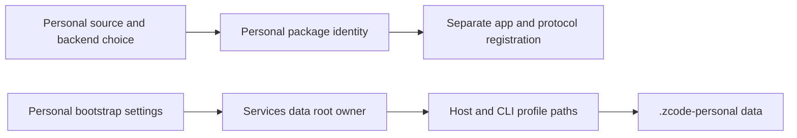

# Personal distribution isolation

This branch is an unofficial personal adaptation of zai-org/ZCode under the original Apache-2.0 license. LICENSE, NOTICE.md and THIRD-PARTY-NOTICES.md remain intact; ZCode and Z.ai names identify upstream, not endorsement. No official account, quota, authorization or safety boundary changes.

## Rules and owners

- `desktop-product-identity.mjs` owns package identity. Both existing backend/flavor choices use personal application IDs, names and executables; selecting production must never recreate official identity.
- Services paths own the local profile root: `<dataBaseDir>/.zcode-personal`. Bootstrap settings and CLI defaults use the same namespace. Project `.zcode` configuration stays project scoped. No automatic migration/copy from official data.
- OS integration uses `zcode-personal` and independent desktop entry, Finder service and helper identities. Official `zcode` registration is never replaced.
- Automatic updates are unconditionally disabled in the personal source. Backend selection, authentication, minimum-version security gate and permission checks remain unchanged. A backend-required version upgrade may therefore block an older personal build; follow upstream instead of bypassing it.
- Official OAuth redirect registration may not support the personal scheme. Do not claim OAuth login works until exercised against an approved callback; do not steal official registration or invent credentials to make it work.
- Existing explicit test/data directory overrides remain supported; they must be isolated directories. No installer is run as part of implementation.

## Validation

Assert production and preview identities differ from upstream; bootstrap, provider and session defaults never resolve to the official profile; update enable flags cannot enable automatic updates. Exercise actual Windows packaging separately from Linux unit/type checks. OAuth, packaged helper entitlement, Windows install/uninstall and coexistence need native acceptance before release.

## Upstream maintenance

Keep `main` at upstream baseline. Rebase/merge upstream into this feature branch only after reviewing identity, path, update and protocol changes. Keep memory and compact UI commits independent. Open only a draft PR in the personal fork. Do not release or merge a distribution branch before native acceptance.
