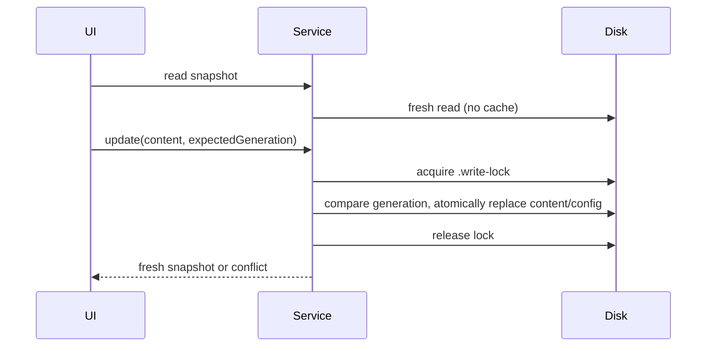

# Personal profile memory settings

The Memory service owns local profile memory management. The CLI adapter and service share
`cli/memories/global/{config.json,memory/MEMORY.md,.write-lock}`. No cloud sync or vector store.
Config defaults: enabled and extractionEnabled true, generation 0, disabledSessionIds [].
Reads return fresh disk state. Every mutation takes an exclusive mkdir lock; lock contention
is surfaced, never stolen. Changes use same-directory temporary files and rename; generation
increments for content, clear and preferences. An expected generation prevents stale editors
from restoring deleted data. Delete empties MEMORY.md and increments generation; extraction
must compare its captured generation before writing. All reads and writes reject symlink
ancestors/files and use fixed filenames, so Windows aliases and path traversal are unavailable.

Settings show global scope, source/time metadata in Markdown, edit/save/delete, enable and
pause recording independently of project memory. Session disable targets an actual session ID.
Errors and stale saves are visible and refreshable. Content is background data, never a higher
priority instruction; secrets and imported tool/page instructions must not be persisted.

Acceptance: defaults, pause, enable, clear, stale editor, lock contention, symlink rejection,
round-trip Unicode Markdown, session disable list, visible save failure and narrow layout.
